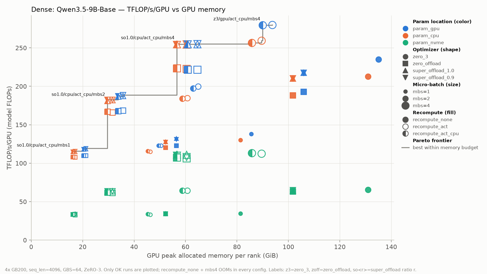
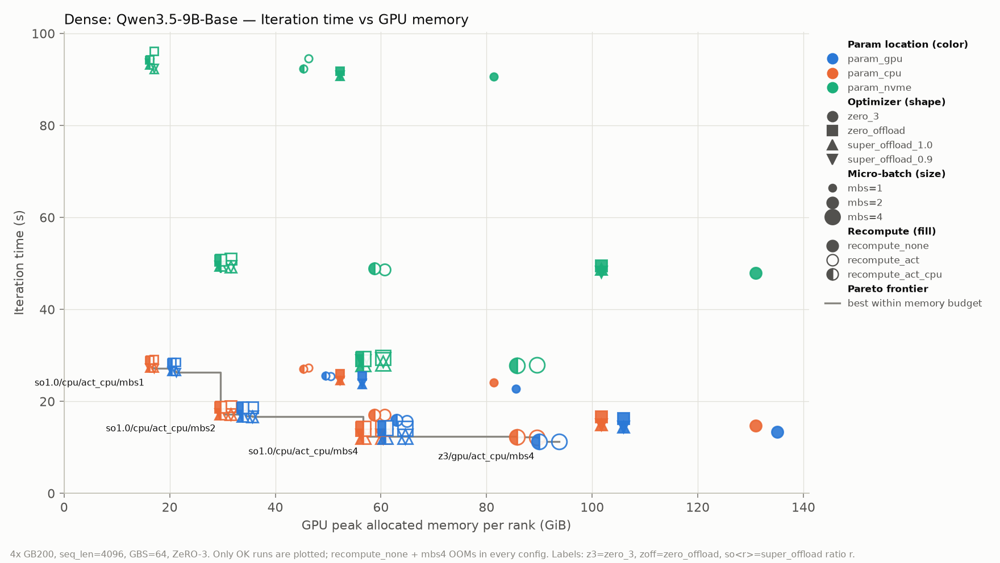
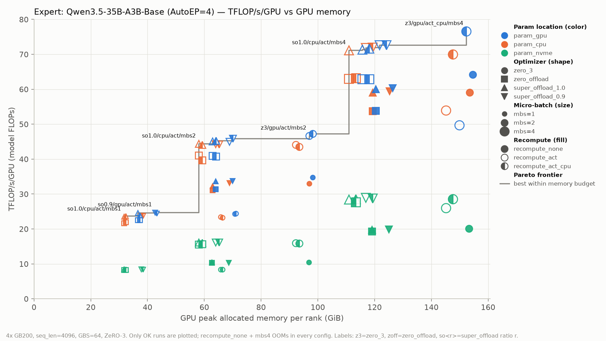
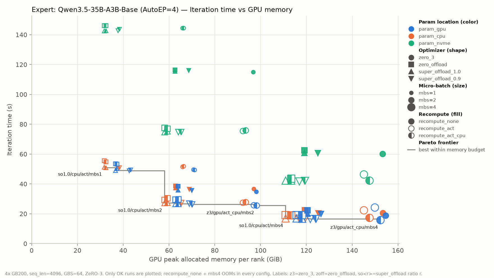

# DeepSpeed Offload × Recompute 矩阵性能报告

本文整理 [02-deepspeed-offload](../../../examples/scale-down/01-analyse/02-deepspeed-offload/README.md) 在 4×GB200 上跑完的组合矩阵，给出 dense 与 expert（MoE）模型的显存–性能曲线，以及各显存预算下的推荐配置。

- 原始数据：`results/01-analyse/02-deepspeed/`（432 个 run 目录 + 两个 `experiment_summary_*.txt`）
- 汇总表：`results/01-analyse/02-deepspeed/summary.csv`（每个组合一行）
- 汇总 / 绘图脚本：[summarize_offload_matrix.py](../../../examples/scale-down/01-analyse/02-deepspeed-offload/summarize_offload_matrix.py)、[plot_offload_matrix.py](../../../examples/scale-down/01-analyse/02-deepspeed-offload/plot_offload_matrix.py)

## 结论速览

| 问题 | 结论 |
| --- | --- |
| 影响吞吐最大的轴是什么 | **micro-batch size**。ZeRO-3 每个 micro-step 都有固定开销（dense 约 1.2 s，MoE 约 2.8 s），全局 batch 固定时 mbs 越大，micro-step 越少。“recompute + mbs4” 全面优于 “不 recompute + mbs2”。 |
| 显存最充裕时的最快配置 | dense：`zero_3 / param_gpu / act(_cpu) / mbs4`，280 TFLOP/s/GPU、11.2 s/iter、90–94 GiB。MoE：`zero_3 / param_gpu / act_cpu / mbs4`，76.6 TFLOP/s/GPU、15.8 s/iter、152 GiB。 |
| SuperOffload 相比 ZeRO-Offload | 显存相同，iteration 时间平均 **−9.4%（dense）/ −8.7%（MoE）**，收益全部来自 optimizer step（dense 约 2.9 s → 1.0 s）。只要卸载 optimizer，就应该用 SuperOffload。 |
| SuperOffload `ratio=0.9` vs `1.0` | dense 完全等价（subgroup 实际全部落在 CPU）；MoE 显存 +6 GiB，时间只快 0.7%。**用 `ratio=1.0`。** |
| optimizer 卸载的代价 | 相比 `zero_3`，GPU 峰值显存省 29 GiB（dense）/ 34 GiB（MoE），dense 慢约 4%（mbs4 时约 10%）。 |
| param 放 CPU | 只省约 4 GiB 显存，时间增加约 3%。性价比低，只在差这 4 GiB 时使用。 |
| param 放 NVMe | GPU 显存与 param_cpu **完全相同**，时间却增加 **1.7–3.0 倍**。它的唯一作用是节省 host 内存。 |
| `act` vs `act_cpu` | dense：`act_cpu` 省 1–4 GiB，速度相同。MoE：allocated 反而 +1.4 GiB，但 **reserved 少 30–45 GiB**，同时消除了 zero_3 mbs4 的抖动（49.7 → 76.6 TFLOP/s/GPU）。**MoE 推荐 `act_cpu`。** |
| 重计算的代价 | 同 mbs 下 dense +13%、MoE +37% 时间，换来 35–70 GiB 显存。 |
| 失败 | `recompute_none + mbs4` 在两个模型的所有组合下都 OOM（24 个）。MoE 另有 2 个 FAILED：重计算时专家路由与前向不一致（§5）。 |

## 1. 实验设置

| 项目 | Dense | Expert |
| --- | --- | --- |
| 模型 | Qwen3.5-9B-Base（32 层，每 4 层 1 层 full attention，其余为 GDN） | Qwen3.5-35B-A3B-Base（40 层，64 专家、top-8 + 1 shared expert） |
| 并行 | ZeRO-3 DP=4 | ZeRO-3 + AutoEP=4 |
| 公共 | 4×GB200，seq_len 4096，GBS 64（每 GPU 16 条，`grad_accum = 16 / mbs`），bf16，10 step（前 2 步 lr=0 不计入），`expandable_segments:True` | 同左 |

遍历的四个轴（单模型 4×3×3×3 = 108 个组合）：

| 轴 | 取值 | 图中编码 |
| --- | --- | --- |
| param 位置 | `gpu` / `cpu` / `nvme` | 颜色 |
| optimizer 策略 | `zero_3` / `zero_offload` / `super_offload_1.0` / `super_offload_0.9` | 形状 |
| micro-batch | 1 / 2 / 4 | 大小 |
| recompute | `none` / `act` / `act_cpu` | 填充（实心 / 空心 / 半实心） |

运行状态：

| 模型 | OK | OOM | FAILED |
| --- | --- | --- | --- |
| Dense | 96 | 12（全部为 `none + mbs4`） | 0 |
| Expert | 94 | 12（全部为 `none + mbs4`） | 2（§5） |

### 1.1 指标口径

- **GPU 显存（横轴）**：rank 0 的 `torch.cuda.max_memory_allocated`（GiB），即 `metrics.csv` 的 `gpu_peak_gigabytes`。allocator 的 reserved 峰值记在汇总表的 `gpu_reserved_gib` 列，§3.4 会用到它。
- **Iteration 时间**：一个 optimizer step（16 个样本 × 4 GPU，262144 token）的平均时间，取 8 个稳态 step 的均值。各组合的标准差大多不超过 0.8 s，例外见 §3.4。
- **TFLOP/s/GPU**：model FLOPs，不计重计算，口径与 Megatron 一致。按 `megatron.bridge.training.utils.flop_utils.hybrid_flops` 的分层公式计算：SwiGLU MLP / routed + shared expert、GDN 层、full attention 层（core attention 按 `s²` 计，不做 causal 折半）、logits，再 ×3 计入 fwd + bwd。不计 MTP，因为 HF 模型会忽略 `mtp.*` 权重，不执行这一层。结果为 dense 47.9 GFLOP/token（折合 6N，N≈8.0B）、MoE 18.4 GFLOP/token（N≈3.1B，与 A3B 一致）。因为每个 iteration 的 token 数固定，TFLOP/s 与 1/iteration 时间严格成正比，两张图展示的是同一信息的两种读法。
- **fwd / bwd / step**：DeepSpeed `wall_clock_breakdown` 在 rank 0 上每个 iteration 的累计值，见汇总表的 `fwd_s` / `bwd_s` / `step_s` 列。

## 2. 结果图

图中灰色阶梯线是 **Pareto 前沿**：在不超过某个显存预算的前提下能达到的最好值。文字标注只标在前沿每一级台阶上显存最小的那个配置。

### 2.1 Dense（Qwen3.5-9B-Base）





### 2.2 Expert（Qwen3.5-35B-A3B-Base）





两组图的共同形态：

1. **点按 mbs 分成三列**，每列内部再按 optimizer / param 位置上下分层。决定横向位置（显存）的主要是 mbs × recompute，决定纵向位置（性能）的主要是 mbs 和 param 是否在 NVMe。
2. **绿色（NVMe）整体压在底部**，与同一横坐标上的橙色（param_cpu）点一一对应，说明它不省 GPU 显存，只是更慢。
3. **`super_offload_1.0`（▲）与 `super_offload_0.9`（▼）在 dense 图上完全重合**，叠成六角星；在 MoE 图上，▼ 比 ▲ 右移约 6 GiB。

## 3. 分轴分析

下表的每一行只改变一个轴，其余三个轴一一配对后取平均（括号内为最小 / 最大值）。时间为相对变化，显存为 GPU allocated 峰值的绝对变化。

| 变化 | Dense 时间 | Dense 显存 | Expert 时间 | Expert 显存 |
| --- | --- | --- | --- | --- |
| `zero_offload` → `super_offload_1.0`（非 NVMe） | −9.4%（−12.9 ~ −6.0） | 0 | −8.7%（−12.3 ~ −3.5） | 0 |
| `zero_offload` → `super_offload_1.0`（NVMe） | −2.6% | 0 | −2.5% | 0 |
| `super_offload_1.0` → `0.9` | +0.1% | 0 | −0.7% | +6.0 GiB |
| `zero_3` → `super_offload_1.0`（非 NVMe） | +3.8%（+0.1 ~ +9.9） | −29.2 GiB | −2.0%（−30.3 ~ +7.0）¹ | −34.1 GiB |
| param `gpu` → `cpu` | +3.4% | −4.2 GiB | +2.6% | −3.9 GiB |
| param `cpu` → `nvme` | **+197%**（+108 ~ +275） | 0 | **+174%**（+107 ~ +219） | 0 |
| recompute `none` → `act` | +13.4% | −35 ~ −70 GiB | +36.5% | −27 ~ −61 GiB |
| recompute `act` → `act_cpu` | +0.2% | −2.2 GiB | −2.3%（−35.1 ~ +3.5）¹ | +1.4 GiB |
| mbs 1 → 2 | −37.3% | +13 ~ +50 GiB | −45.5% | +26 ~ +57 GiB |
| mbs 2 → 4（有 recompute） | −27.1% | +28 GiB | −33.7% | +53 GiB |

¹ 极值来自 MoE `zero_3 / act / mbs4` 的显存压力抖动，见 §3.4。

### 3.1 micro-batch：最大的杠杆

全局 batch 固定为每 GPU 16 条，mbs 从 1 升到 4，micro-step 数从 16 降到 4。用 `t(mbs1) − t(mbs4)` 除以少掉的 12 个 micro-step，可以估算出每个 micro-step 的固定开销：**dense 1.22 s（1.17–1.26），MoE 2.76 s（2.10–3.04）**。在 dense `zero_3 / param_gpu / act` 下，mbs1 每个 iteration 25.5 s，其中约 19.5 s 是这部分固定开销。

这部分开销的构成没有单独 profile。从机制上推断，主要是 ZeRO-3 每个 micro-step 都要做的参数 all-gather（fwd、recompute、bwd 各一次）和梯度 reduce-scatter，再加上小 batch 下 GEMM 效率偏低。MoE 每层多了 AutoEP 的 dispatch / combine，所以这部分开销是 dense 的 2 倍多。

直接后果：

- dense 不开 recompute 的最好结果是 `zero_3 / gpu / none / mbs2`：235 TFLOP/s、135 GiB。开 recompute 用 mbs4，反而达到 280 TFLOP/s、94 GiB，**更快且省 41 GiB**。
- MoE 同理：`zero_3 / gpu / none / mbs2` 为 64.2 TFLOP/s、155 GiB，而 `zero_3 / gpu / act_cpu / mbs4` 为 76.6 TFLOP/s、152 GiB。
- 结论：**先用 recompute 把 mbs 推到最大，再考虑其他手段。**

### 3.2 optimizer：SuperOffload 稳定优于 ZeRO-Offload

两者的 GPU 显存完全相同（optimizer state 都在 CPU），差别只在 optimizer step 的执行方式：

| 配置（mbs4 + recompute，非 NVMe） | Dense step 耗时 | MoE step 耗时 |
| --- | --- | --- |
| `zero_3`（param_gpu，GPU torch AdamW） | 0.09 s | 0.15 s |
| `zero_3`（param_cpu） | 0.97 s | 1.17 s |
| `super_offload_1.0` | 0.92–1.00 s | 1.03–1.22 s |
| `zero_offload` | 2.75–2.94 s | 3.27–3.49 s |

各配置的 fwd / bwd 时间基本相同（差异 ≤0.3 s），所以 SuperOffload 的约 1.9 s（dense）/ 2.3 s（MoE）收益全部来自 optimizer step。这与 SuperOffload 的设计一致：CPU 更新后把 optimizer state 直接经 NVLink-C2C 搬回 GPU 再做精度转换，并与 backward 重叠。NVMe 场景下，fwd / bwd 被参数换入拖长到 ~10–60 s，这 1.9 s 的收益就被摊薄到 2.5%。

**`ratio=0.9` 不值得开**：

- dense：每个 rank 只有 6–7 个 subgroup，按 `i >= int((1 − ratio) · n)` 划分，结果全部落在 CPU，与 `1.0` 完全等价（README §6.2）。数据上时间差 +0.1%，显存差 0。
- MoE：确实有 subgroup 留在 GPU，显存因此 +6.0 GiB，时间只快 0.7%，远小于同样 6 GiB 换成更大 mbs 的收益。

**optimizer 卸载 vs 不卸载**：`zero_3 → super_offload_1.0` 省下的 29 GiB（dense）/ 34 GiB（MoE）是固定值，相当于每个 rank 上 FP32 master + Adam m/v 的分片。代价是 dense mbs4 下多约 1 s（11.2 → 12.3 s，−9% TFLOP/s）。

### 3.3 param 位置：CPU 收益小，NVMe 代价大

- **CPU**：只省约 4 GiB，即每个 rank 上 bf16 参数分片的大小（9B × 2 B / 4 ≈ 4.5 GB）。代价是时间 +3%，`zero_3` 的 step 也从 0.1 s 增加到约 1 s（更新后的参数要写回 CPU）。
- **NVMe**：GPU 显存与 param_cpu 相同。与 param_cpu 相比，每个 micro-step 多出 **4.1 s（dense）/ 5.7 s（MoE）**，且这一开销基本不随 mbs 变化。从分解看，fwd 从 2.5 s 增加到 11.7 s（dense mbs4），NVMe 参数换入落在 fwd / bwd 的关键路径上。所以 NVMe 在 mbs4 时最“便宜”（dense 113 TFLOP/s，为 param_cpu 的 44%），在 mbs1 时最差（34 TFLOP/s）。
- NVMe 换来的是 **host 内存**：dense `super_offload` 下 `cpu_peak` 从 33 GB 降到 20 GB；`zero_3` 下从 13 GB 降到约 0。只有 CPU 内存成为瓶颈时（例如单机跑更大的模型）才值得使用。

> `cpu_peak_gb` 取自 `metrics.csv` 的 `cpu_peak_gigabytes`。`run.log` 中同一个值被打印为 `cpu.peak=… MiB`，这是标签错误，数值与 CSV 一致，单位为 GB。

### 3.4 `act` vs `act_cpu`：MoE 上的关键是 reserved 而不是 allocated

dense 上 `act_cpu` 的表现符合预期：checkpoint 层的输入异步卸载到 CPU，allocated 少 1–4 GiB，时间不变。

MoE 上 allocated 反而多 1.4 GiB（卸载缓冲区），但 **reserved 峰值大幅下降**。以 mbs4 为例：

| 配置（MoE，mbs4） | allocated | reserved | reserved − allocated | iter 时间 ± std |
| --- | --- | --- | --- | --- |
| `zero_3 / gpu / act` | 149.9 GiB | 179.6 GiB | 29.8 GiB | 24.29 ± 6.72 s |
| `zero_3 / gpu / act_cpu` | 152.3 GiB | 154.7 GiB | 2.4 GiB | 15.76 ± 0.60 s |
| `zero_3 / cpu / act` | 145.1 GiB | 178.7 GiB | 33.6 GiB | 22.40 ± 4.31 s |
| `zero_3 / cpu / act_cpu` | 147.5 GiB | 150.8 GiB | 3.3 GiB | 17.25 ± 0.79 s |
| `super_offload_1.0 / gpu / act` | 115.7 GiB | 153.4 GiB | 37.7 GiB | 16.93 ± 0.51 s |
| `super_offload_1.0 / gpu / act_cpu` | 118.1 GiB | 121.2 GiB | 3.1 GiB | 16.85 ± 0.40 s |

MoE 在 `act` + mbs4 下 reserved 比 allocated 多 30–45 GiB，`none` 时只有 6–11 GiB。推测原因是专家路由使每层的 token 数随 batch 变化，激活张量大小不固定，allocator 难以复用已有的块。`act_cpu` 把这些激活移出 GPU，差值降到 2–5 GiB。`zero_3` 的 reserved 已接近单卡显存上限（约 179 GiB），allocator 在这里反复回收和整理碎片，导致明显抖动（std 4–7 s）；换成 `act_cpu` 后，TFLOP/s 从 49.7 回升到 76.6。

因此，**MoE 应以 reserved 判断余量，并优先使用 `act_cpu`**。按 allocated 看，`act` 似乎更省显存，但它实际占用的显存更多、也更不稳定。

### 3.5 recompute 的代价

同 mbs 下从 `none` 切到 `act`：dense 时间 +13%，MoE +37%。理论上，一次额外 forward 约占 fwd + bwd 的 1/3（+33%）：

- dense 低于理论值，因为 iteration 时间中有相当一部分是 §3.1 的固定开销，重计算不会放大它。
- MoE 高于理论值，因为重计算还要重做 AutoEP 的 dispatch / combine，以及 ZeRO-3 的参数 gather。

前文已说明，重计算换来的显存应该用来增大 mbs，而不是停在同一个 mbs 上。

## 4. 推荐配置（按每卡显存预算）

取自 Pareto 前沿。显存为 allocated 峰值，MoE 同时给出 reserved。

### 4.1 Dense（Qwen3.5-9B-Base）

| 显存预算 | 推荐配置 | 显存 | TFLOP/s/GPU | s/iter |
| --- | --- | --- | --- | --- |
| ≥ 94 GiB | `zero_3 / param_gpu / act / mbs4` | 93.7 GiB | 279.8 | 11.22 |
| ≥ 90 GiB | `zero_3 / param_gpu / act_cpu / mbs4` | 90.0 GiB | 279.4 | 11.24 |
| ≥ 57 GiB | `super_offload_1.0 / param_cpu / act_cpu / mbs4` | 56.6 GiB | 254.9 | 12.32 |
| ≥ 34 GiB | `super_offload_1.0 / param_gpu / act_cpu / mbs2` | 33.8 GiB | 187.0 | 16.79 |
| ≥ 30 GiB | `super_offload_1.0 / param_cpu / act_cpu / mbs2` | 29.6 GiB | 181.2 | 17.33 |
| ≥ 16 GiB | `super_offload_1.0 / param_cpu / act_cpu / mbs1` | 16.1 GiB | 115.2 | 27.26 |

注意 57–90 GiB 这一段：`zero_3 / param_cpu / act(_cpu) / mbs4` 占 86–90 GiB，只比 SuperOffload 快 1–2%，因此这一段统一选 SuperOffload。

### 4.2 Expert（Qwen3.5-35B-A3B-Base）

| 显存预算 | 推荐配置 | allocated / reserved | TFLOP/s/GPU | s/iter |
| --- | --- | --- | --- | --- |
| ≥ 155 GiB | `zero_3 / param_gpu / act_cpu / mbs4` | 152.3 / 154.7 GiB | 76.6 | 15.76 |
| ≥ 122 GiB | `super_offload_1.0 / param_gpu / act_cpu / mbs4` | 118.1 / 121.2 GiB | 71.7 | 16.85 |
| ≥ 63 GiB | `super_offload_1.0 / param_cpu / act_cpu / mbs2` | 59.2 / 62.5 GiB | 44.1 | 27.38 |
| ≥ 36 GiB | `super_offload_1.0 / param_cpu / act_cpu / mbs1` | 32.3 / 35.4 GiB | 23.7 | 50.90 |

按 allocated 计，前沿上还有 `super_offload_1.0 / param_cpu / act / mbs4`（110.9 GiB、71.2 TFLOP/s），但它的 reserved 达到 154.9 GiB；同配置的 `act_cpu` 版本是本矩阵中失败的 run 之一（§5）。因此推荐表按 reserved 选，并统一用 `act_cpu`。

## 5. 失败记录

| Run | 现象 | 判断 |
| --- | --- | --- |
| 24 个 `*__recompute_none__mbs4` | OOM | 不开 recompute 时，mbs4 的激活超出单卡显存，与 optimizer / param 位置无关 |
| MoE `super_offload_1.0 / param_cpu / act_cpu / mbs4` | 在第 3 个 warmup 之后的首个计入 step 的 backward 中 `CheckpointError: Recomputed values … have different metadata`，专家输入的 token 数从 132192 变成 132184 | 重计算时 router 的 top-k 选择与前向不一致（bf16 下 logits 有微小差异时，并列的候选可能翻转），被路由到该 rank 的 token 数随之改变。这是 MoE 与非确定性重计算的组合问题，与 offload 本身无关 |
| MoE `zero_offload / param_nvme / act / mbs4` | 正常跑完 4 个稳态 step 后，`vectorized_gather_kernel index out of bounds` 断言触发 abort（rc=250） | 同样发生在重计算路径上，推测是同一根因：重计算的路由结果与前向不一致，导致 gather 下标越界。日志不足以完全确认 |

后两个失败说明：**MoE + recompute 的结果依赖 router 的确定性**，即使这次跑通，其它组合也可能偶发同样的错误。下一步可以考虑两种做法：

- 在 checkpoint 前保存路由结果并在重计算时复用；
- 把 router 排除在重计算之外，类似 Megatron 只重算 `moe_act` 而不重算 router 的做法。

## 6. 附：如何复现本报告

```bash
# 汇总（只依赖标准库）
python examples/scale-down/01-analyse/02-deepspeed-offload/summarize_offload_matrix.py
# 绘图（需要 matplotlib），并打印每张图的 Pareto 前沿台阶
python examples/scale-down/01-analyse/02-deepspeed-offload/plot_offload_matrix.py
```

本文中的配对对比（§3 表格）与每 micro-step 开销都基于 `summary.csv` 计算：对每个只在单一轴上不同的组合对求相对时间差和显存差。
