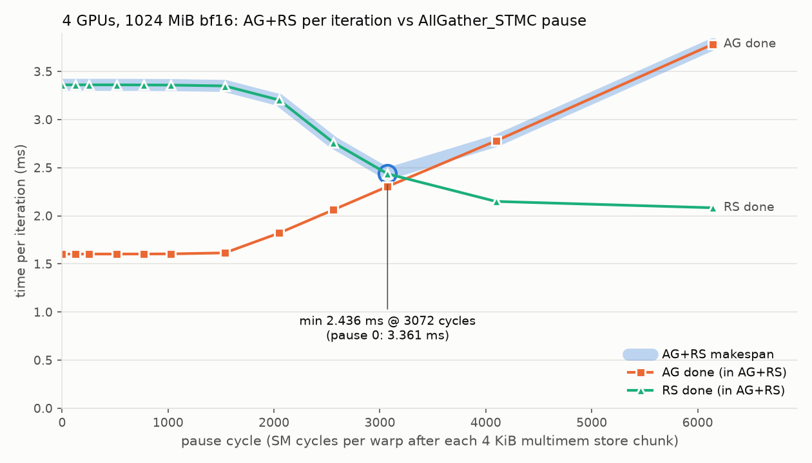
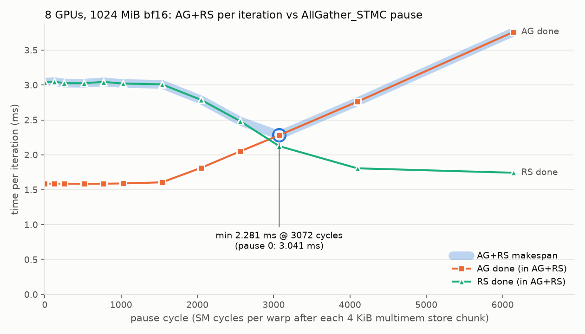
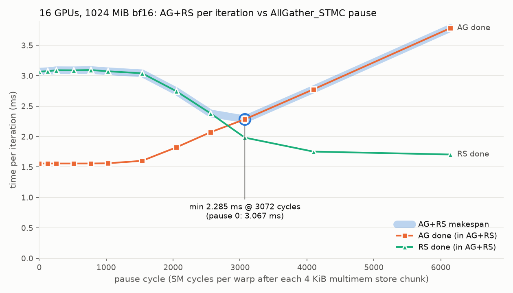
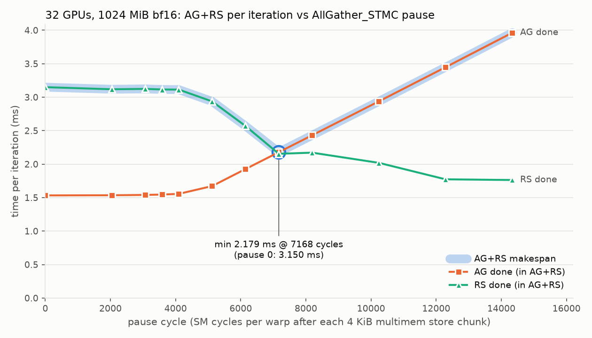
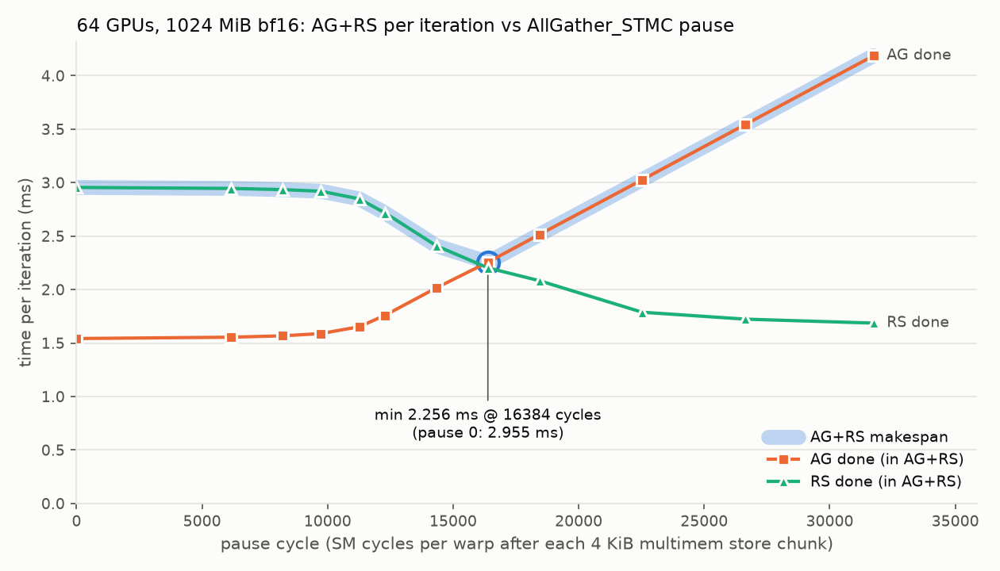

# GB200 NCCL symmetric kernel 与 NVLS：AG / RS / AR 的吞吐、CTA 与重叠

## 0. 结论

主体测试是 32 张 GB200（8 个 tray），位于同一个 NVLink 域；另补充了一轮 64 卡（16 个 tray，同样在一个 NVLink 域内），测了 ring / symm / symm-tma / copy-engine，没有测经典 NVLS。下表的吞吐统一用 **algbw = S/T**（GB/s，10^9），口径见 1.1 节。

| 问题 | 结论 |
| --- | --- |
| 单个 op 谁最快（8–32 卡，≥256 MiB） | **AG**：copy engine 685–780 > symm（`AllGather_STMC`）692–716 ≈ TMA 679–703 > 经典 NVLS 464–604。**RS**：symm（`ReduceScatter_LDMC`）605–683 > 经典 NVLS 381–669。**AR**：symm 465–493 > 经典 NVLS 296–467 > ring 255–380 |
| 64 卡单个 op（≥256 MiB） | **AG**：copy engine 690–779 > symm 688–715 ≈ TMA 682–708，和 32 卡基本相同。**RS**：symm 708–736，比 32 卡快 16–18%。**AR**：symm 487–502，ring 253–341 |
| symm 和 ring 比 | ≥512 MiB 的 AG/RS 和 ring 接近（ring 673–748），RS 甚至是 ring 更快；256 MiB 处 ring 有一段低谷，32 卡时 symm 的 AG/RS 是 ring 的 1.39 / 1.22 倍。8 卡以上的 AR，symm 是 ring 的 1.3–1.4 倍。64 卡时 ring 的低谷移到 256–512 MiB，512 MiB 时 symm 的 AG/RS/AR 是 ring 的 1.41 / 1.43 / 1.96 倍，≥1024 MiB 时 AR 仍是 ring 的 1.47 倍 |
| 8–64 卡 symm AG 的耗时为什么完全一样 | 8–32 卡每卡 CTA 数取 `divUp(32, n)`，CTA × n 恒为 32，**每个 CTA 处理的数据量都是 S/32**，每卡同时有 32 路 multicast 写入。1024 MiB 时 T = 1.51 ms，S/T = 711，与 NCCL 2.32.3 代价模型中 GB200 实测的 multimem AG 峰值 715 GB/s 一致。64 卡时 CTA 数已经到下限 1，CTA × n = 64，每个 CTA 只处理 S/64、速率减半，T 仍是 1.51 ms |
| 711 是被 CTA 数卡住吗 | **不是**。TMA 在 4 卡时只用 16 路就达到 685；STMC 单个 CTA 能跑到 26.4 GB/s，32 路理论上可以超过 711。64 卡时路数翻倍到 64，每卡接收仍是 710。约 710 GB/s 是 kernel 发起 multicast 写时每卡的接收上限 |
| 4 卡 symm 偏慢 | 代价模型只给了 6 个 CTA，只有 24 路，每个 CTA 26.4 GB/s，合计 635，被 CTA 数卡住。TMA（4 个 CTA）是 685，copy engine 是 716 |
| 卡数增加后会怎样 | 每张卡写出的数据量 S/n 变少：copy engine 每个 CE 的写出速率从 179 降到 12 GB/s，每卡的汇聚接收从 716（4 卡）升到 770（32 卡），64 卡停在 766–779，与 2.32.3 CE 代价模型的 779 一致。交换机做 n 倍复制的总量随 n 线性增长（64 卡约 49 TB/s），但每卡接收速率不降，**NVSwitch 的 multicast 复制资源在 64 卡内充足** |
| RS 随卡数的变化 | 8–32 卡变慢：每个 CTA 处理的数据量相同，但 `ld_reduce` 要等 n 个成员都返回，每个 CTA 64 KiB 在途，一轮耗时从 2.85 µs（4 卡）涨到 3.38 µs（32 卡），每个 CTA 的速率从 23.0 降到 19.4 GB/s。**64 卡反而变快**（1024 MiB：620 → 729）：CTA 数到了下限 1，每张卡同时被 64 路 `ld_reduce` 读取，在途量翻倍。说明 8–32 卡的 RS 受在途量限制，而不是带宽 |
| 经典 NVLS 的 AG 是否比 RS 快 | **不一定**。两者都是 24 个 CTA、每 CTA 640 线程，结构上是镜像，各有一次 S 大小的本地 staging 拷贝，RS 的规约在交换机里完成。chunk 相同时 AG 快 2–22%；NCCL 把 chunk 升到 128K 后 RS 跳升 24–29%，AG 不受益，于是 4 卡 ≥1 GiB、8 卡 2 GiB 时 AG 反而更慢；32 卡 ≥1 GiB 时 AG 随大小下降，也慢于 RS |
| symm 的 AG+RS 能否重叠 | **默认配置下不能**（给 AG 限速后可以，见 6.4 节）。≥256 MiB 时 η 只有 0.01–0.07（4 卡 0.14–0.18），T_pair ≈ T_AG + T_RS。换成 TMA 或 copy engine 的 AG 也一样，即使 copy engine 完全不占 SM |
| 调整 CTA 数（4 卡 1024 MiB，2.6 节） | AG 用 4 个 CTA 就到约 711，RS 的吞吐和 CTA 数成正比。**AG 降到 2 个 CTA 时 AG+RS 完全重叠**（η = 1.00），比 default 快 21%：AG 的注入速率低于接收上限时，RS 才能并行 |
| 调整 CTA 数（NCCL 2.32.3，4–32 卡，2.7 节） | AG 吞吐只取决于路数 n × CTA_AG，每路约 50 GB/s，≥16 路到 711；**只有 ≤8 路时 AG+RS 才能重叠**：4 卡 ag2、8 卡 ag1 时 η = 1.00，比 default 快 10–11%，stock NCCL 就能做到。16、32 卡 1 个 CTA 已经写满入口，不能重叠；RS 用超过 `divUp(32, n)` 的 CTA 数后快 11–15%，T_pair 快 7–9%，但需要改 NCCL |
| 给 AG 加 pause cycle（NCCL 2.32.3-pause，4–64 卡，6.4 节） | 用 nsys 拆出 AG+RS 里各自的完成时间：pause 0 时 **AG 优先**，完成时间只比单独运行慢 1–6%，RS 在 AG 运行期间只完成 3–10%，之后才跑完。让 `AllGather_STMC` 每写完 4 KiB 空转一段时间，把 AG 压到约 470 GB/s 后，两者开始重叠：最优 pause cycle（4/8/16 卡 3072，32 卡 7168，64 卡 16384）下 makespan 降 24–31%，η = 0.49–0.68，与 symm AR 只差 0–5%，16–64 卡也有效。最优点左侧 AG 先完成，右侧 RS 先完成，最优点很尖 |
| 硬件能否重叠 | **能**。symm 的 AR 把同样的流量放在一个 kernel 里，η = 0.55–0.70，耗时只有 AG+RS 的 1/1.33–1/1.47 |
| AG+RS 并发谁最快 | 8–16 卡是经典 NVLS（η = 0.48–0.74，1024 MiB 时 424 / 383）；32 卡 64–512 MiB 是 copy engine 的 AG 加 LDMC 的 RS，≥1024 MiB 是经典 NVLS；64 卡 ≥256 MiB 是 copy engine 加 LDMC（372–381，经典 NVLS 未测）；4 卡是 ring |
| 两个组同时 multicast | 两个 16 卡组互不干扰，减速比在 ±4% 以内。两个 32 卡组（用满 64 卡）时 AG、AR 不受影响，RS 两组都慢 2–5% |

---

## 1. 口径与五种实现

### 1.1 统计口径

记 S 为完整张量大小（AG 的输出、RS 的输入、AR 的缓冲区），n 为组内卡数，T 为每轮迭代的耗时。

| 量 | 定义 | 说明 |
| --- | --- | --- |
| **algbw** | **S / T**，AG、RS、AR、AG+RS 都一样（AG+RS 用 S / T_pair，**不乘 2**） | 本报告的主口径。和卡数无关，可以直接比较不同卡数下的耗时 |
| busbw | AG/RS：S(n−1)/n / T；AR：2S(n−1)/n / T | **只在 ring 的表里给出**。ring 每卡真实收发的就是 S(n−1)/n，所以 busbw 等于链路实际速率。multicast 不适用，见下 |
| T_pair/(T_AG+T_RS) | AG 和 RS 同时发起时的耗时 ÷ 两者单独耗时之和 | 1 表示完全串行；完全重叠时等于 max(T_AG, T_RS)/(T_AG+T_RS)，约 0.5 |
| η | (T_AG + T_RS − T) / min(T_AG, T_RS) | 重叠度：0 表示完全串行，1 表示短的那个被完全藏住。T 取 T_pair 衡量 AG+RS；T 取 T_AR 时，把 AR 看成融合在一起的 RS + AG，作为同等流量下的对照 |

在 algbw 口径下，AG+RS 完全串行时为 S/(T_AG+T_RS)，大约是单个 op 的一半；完全重叠时为 S/max(T_AG, T_RS)。

**multicast 内核的实际流量**：busbw 假设自己那 1/n 分片是本地拷贝、不经过链路，这对 ring 成立，对 multicast 不成立。

- AG（`multimem.st`）：交换机把写复制给包括自己在内的 n 个成员，所以每卡实际**收到 S**，发出 S/n。
- RS（`multimem.ld_reduce`）：交换机向包括自己在内的 n 个成员各读一份，所以每卡实际**发出 S**，收到 S/n。
- AR = RS + AG：每个方向都是 S(1 + 1/n)。algbw = S/T 对 multicast AR 低估约 1/n。
- NCCL 源码在代价模型里也注明了这一点：`busBytes = (nRanks-1)*nBytes; // Wrong. Should be nRanks*nBytes`（`nccl-2.29.7/src/sym_kernels.cc`，`queryModel_lsa`）。

所以 multicast AG 的 algbw 就是每卡的入口流量，RS 的 algbw 就是每卡的出口流量。作为参照，GB200 每卡 NVLink 5 的单向标称带宽是 900 GB/s（18 条 × 50 GB/s）。

### 1.2 五种实现

| 名称 | NCCL | AG | RS | AR | 每卡 CTA（4 / 8 / 16 / 32 / 64 卡） | 每 CTA 线程 |
| --- | --- | --- | --- | --- | --- | --- |
| ring | 2.29.7 | RING（LL / LL128 / SIMPLE） | 同左 | 同左 | — | — |
| nvls | 2.29.7 | NVLS / SIMPLE，经本地 staging | 同左 | 同左 | 24 / 24 / 24 / 24 / 未测 | 640 |
| symm | 2.29.7 | `AllGather_STMC` | `ReduceScatter_LDMC` | `AllReduce_RSxLDMC_AGxSTMC` | AG/RS 6 / 4 / 2 / 1 / 1，AR 5 / 4 / 2 / 1 / 1 | 512 |
| symm-tma | 2.32.3 | `AllGather_TmaSTMC` | `ReduceScatter_LDMC` | 未测 | AG 4 / 4 / 2 / 1 / 1，RS 同 symm | 512 |
| copy-engine | 2.32.3 | copy engine 写 multicast 地址，前后各一次 NVLS 同步 | `ReduceScatter_LDMC` | 未测 | AG 不占 SM | — |

- symm-tma 和 copy-engine 只测了 ag 和 ag+rs。NCCL 没有 TMA 或 CE 版的 RS，计算 η 时 T_RS 借用 2.29.7 symm 的 `ReduceScatter_LDMC`（同一个内核、同样的 CTA 数；32 卡那一轮的 16 卡 cross 场景和 64 卡那一轮的 32 卡 cross 场景都校验过，256–2048 MiB 差异在 ±2% 以内，η 误差约 ±0.03）。
- 2.32.3 那一轮跑在另外 8 个 tray 上，和 2.29.7 的对比同时混入了版本、内核、硬件三个变量，±2% 以内的差异不作解读。
- 64 卡是单独的一轮，ring / symm（2.29.7）和 symm-tma / copy-engine（2.32.3）分别跑在两批不同的 16 个 tray 上；64 卡的 T_RS 借用同一轮 2.29.7 symm 的 64 卡数据。2.29.7 的 64 卡用的是新机器，与 4–32 卡的对比混入了硬件差异，见附录 A.1。
- 测试方法、环境变量和内核核对见附录 A、B。

---

## 2. 各实现的完整数据

时间单位为 ms，吞吐为 algbw（GB/s）。

- AG、RS、AR、AG+RS 四列都是 S 除以各自的耗时。
- \* 表示 2048 MiB 时 AG 带宽异常下降（见 8.1 节），这一行的 η 偏高，不代表真实重叠程度。
- † 表示受 host 发射拖慢：各 trial 最大 / 最小比 > 1.3，或发射尾巴长于 GPU 总耗时（见 8.2 节），数值不可靠。

### 2.1 symm（`AllGather_STMC` / `ReduceScatter_LDMC` / `AllReduce_RSxLDMC_AGxSTMC`）

#### 4 卡（AG / RS 6 个 CTA，AR 5 个）

| MiB | T_AG | T_RS | T_AR | T_pair | AG | RS | AR | AG+RS | T_pair/(T_AG+T_RS) | η AG+RS | η AR |
| --- | --- | --- | --- | --- | --- | --- | --- | --- | --- | --- | --- |
| 16 | 0.035 | 0.040 | 0.053 | 0.061 | 474 | 417 | 315 | 274 | 0.81 | 0.41 | 0.63 |
| 32 | 0.059 | 0.070 | 0.091 | 0.116 | 567 | 479 | 369 | 289 | 0.90 | 0.22 | 0.65 |
| 64 | 0.106 | 0.134 | 0.165 | 0.220 | 630 | 502 | 406 | 305 | 0.92 | 0.18 | 0.70 |
| 128 | 0.201 | 0.255 | 0.319 | 0.431 | 668 | 527 | 421 | 311 | 0.95 | 0.12 | 0.68 |
| 256 | 0.411 | 0.498 | 0.642 | 0.851 | 653 | 539 | 418 | 315 | 0.94 | 0.14 | 0.65 |
| 512 | 0.841 | 0.982 | 1.268 | 1.684 | 638 | 547 | 424 | 319 | 0.92 | 0.16 | 0.66 |
| 1024 | 1.692 | 1.949 | 2.517 | 3.352 | 635 | 551 | 427 | 320 | 0.92 | 0.17 | 0.66 |
| 2048 | 3.406 | 3.884 | 5.016 | 6.689 | 630 | 553 | 428 | 321 | 0.92 | 0.18 | 0.67 |

#### 8 卡（4 个 CTA）

| MiB | T_AG | T_RS | T_AR | T_pair | AG | RS | AR | AG+RS | T_pair/(T_AG+T_RS) | η AG+RS | η AR |
| --- | --- | --- | --- | --- | --- | --- | --- | --- | --- | --- | --- |
| 16 | 0.035 | 0.037 | 0.048 | 0.057 | 474 | 452 | 348 | 294 | 0.79 | 0.43 | 0.68 |
| 32 | 0.059 | 0.062 | 0.084 | 0.105 | 566 | 544 | 397 | 318 | 0.87 | 0.26 | 0.62 |
| 64 | 0.107 | 0.112 | 0.154 | 0.201 | 627 | 597 | 436 | 333 | 0.92 | 0.17 | 0.61 |
| 128 | 0.200 | 0.210 | 0.293 | 0.391 | 670 | 639 | 458 | 343 | 0.95 | 0.10 | 0.59 |
| 256 | 0.387 | 0.405 | 0.577 | 0.769 | 693 | 662 | 465 | 349 | 0.97 | 0.06 | 0.56 |
| 512 | 0.761 | 0.804 | 1.138 | 1.527 | 706 | 668 | 472 | 352 | 0.98 | 0.05 | 0.56 |
| 1024 | 1.511 | 1.580 | 2.248 | 3.043 | 711 | 679 | 478 | 353 | 0.98 | 0.03 | 0.56 |
| 2048 | 2.998 | 3.144 | 4.487 | 6.063 | 716 | 683 | 479 | 354 | 0.99 | 0.03 | 0.55 |

#### 16 卡（2 个 CTA）

| MiB | T_AG | T_RS | T_AR | T_pair | AG | RS | AR | AG+RS | T_pair/(T_AG+T_RS) | η AG+RS | η AR |
| --- | --- | --- | --- | --- | --- | --- | --- | --- | --- | --- | --- |
| 16 | 0.036 | 0.038 | 0.048 | 0.059 | 460 | 444 | 348 | 287 | 0.79 | 0.43 | 0.71 |
| 32 | 0.060 | 0.063 | 0.083 | 0.107 | 562 | 534 | 405 | 313 | 0.87 | 0.26 | 0.67 |
| 64 | 0.107 | 0.117 | 0.151 | 0.204 | 626 | 575 | 444 | 329 | 0.91 | 0.19 | 0.68 |
| 128 | 0.200 | 0.218 | 0.287 | 0.398 | 671 | 615 | 467 | 338 | 0.95 | 0.10 | 0.65 |
| 256 | 0.388 | 0.421 | 0.564 | 0.784 | 692 | 637 | 476 | 343 | 0.97 | 0.07 | 0.63 |
| 512 | 0.761 | 0.831 | 1.106 | 1.563 | 705 | 646 | 485 | 343 | 0.98 | 0.04 | 0.64 |
| 1024 | 1.511 | 1.637 | 2.195 | 3.108 | 711 | 656 | 489 | 345 | 0.99 | 0.03 | 0.63 |
| 2048 | 3.544\* | 3.278 | 4.372 | 6.449 | 606\* | 655 | 491 | 333 | 0.95 | 0.11\* | 0.75\* |

#### 32 卡（1 个 CTA）

| MiB | T_AG | T_RS | T_AR | T_pair | AG | RS | AR | AG+RS | T_pair/(T_AG+T_RS) | η AG+RS | η AR |
| --- | --- | --- | --- | --- | --- | --- | --- | --- | --- | --- | --- |
| 16 | 0.035 | 0.038 | 0.048 | 0.058 | 475 | 439 | 348 | 289 | 0.79 | 0.44 | 0.72 |
| 32 | 0.059 | 0.064 | 0.082 | 0.110 | 571 | 527 | 407 | 305 | 0.90 | 0.21 | 0.68 |
| 64 | 0.106 | 0.122 | 0.150 | 0.207 | 633 | 550 | 447 | 324 | 0.91 | 0.20 | 0.74 |
| 128 | 0.200 | 0.227 | 0.286 | 0.405 | 671 | 591 | 469 | 331 | 0.95 | 0.11 | 0.71 |
| 256 | 0.388 | 0.444 | 0.560 | 0.805 | 692 | 605 | 479 | 334 | 0.97 | 0.07 | 0.70 |
| 512 | 0.761 | 0.873 | 1.102 | 1.605 | 705 | 615 | 487 | 334 | 0.98 | 0.04 | 0.70 |
| 1024 | 1.510 | 1.732 | 2.185 | 3.210 | 711 | 620 | 491 | 334 | 0.99 | 0.02 | 0.70 |
| 2048 | 3.961\* | 3.445 | 4.353 | 7.002 | 542\* | 623 | 493 | 307 | 0.95 | 0.12\* | 0.89\* |

#### 64 卡（1 个 CTA，64 卡那一轮）

| MiB | T_AG | T_RS | T_AR | T_pair | AG | RS | AR | AG+RS | T_pair/(T_AG+T_RS) | η AG+RS | η AR |
| --- | --- | --- | --- | --- | --- | --- | --- | --- | --- | --- | --- |
| 16 | 0.036 | 0.037 | 0.047 | 0.057† | 469 | 459 | 354 | 294† | 0.79† | 0.43† | 0.70 |
| 32 | 0.060 | 0.060 | 0.081 | 0.103 | 563 | 559 | 415 | 326 | 0.86 | 0.28 | 0.65 |
| 64 | 0.106 | 0.107 | 0.148 | 0.194 | 633 | 629 | 453 | 346 | 0.91 | 0.18 | 0.61 |
| 128 | 0.200 | 0.200 | 0.282 | 0.379 | 671 | 671 | 476 | 354 | 0.95 | 0.10 | 0.59 |
| 256 | 0.390 | 0.379 | 0.551 | 0.747 | 688 | 708 | 487 | 359 | 0.97 | 0.06 | 0.58 |
| 512 | 0.763 | 0.751 | 1.081 | 1.488 | 704 | 714 | 497 | 361 | 0.98 | 0.04 | 0.58 |
| 1024 | 1.512 | 1.474 | 2.149 | 2.955 | 710 | 729 | 500 | 363 | 0.99 | 0.02 | 0.57 |
| 2048 | 3.002 | 2.918 | 4.278 | 5.884 | 715 | 736 | 502 | 365 | 0.99 | 0.01 | 0.56 |

同一轮里重跑的 16、32 卡，64–2048 MiB 和上面 16、32 卡表的差异都在 −2.5% 到 +0.4% 以内。

要点：

- **AG 8–64 卡的耗时完全相同**（1024 MiB 都是 1.51 ms），只有 4 卡慢 12%。原因见 4.3 节。
- **RS 在 8–32 卡随卡数变慢**（1024 MiB：1.580 → 1.637 → 1.732 ms），**64 卡反而最快**（1.474 ms），见 4.5 节。
- **8–32 卡 AG 始终比 RS 快**：T_AG/T_RS = 0.79–0.96，两者用的 CTA 数相同。`multimem.st` 发出后不用等待，`ld_reduce` 要等 n 个成员的数据返回。64 卡 ≥256 MiB 时 RS 反超 AG 1–3%。
- **AG+RS 的 T_pair/(T_AG+T_RS) ≥ 0.91**（≥64 MiB），基本串行；AR 只有约 0.7 倍的 AG+RS 耗时（64 卡约 0.73 倍）。
- **64 卡 2048 MiB 的 AG 没有掉速**（715）。

### 2.2 经典 NVLS（NVLS / SIMPLE，24 channel）

chunk 列是 NCCL 按消息大小选出的每步数据量（见 5.3 节）。

#### 4 卡

| MiB | chunk | T_AG | T_RS | T_AR | T_pair | AG | RS | AR | AG+RS | T_pair/(T_AG+T_RS) | η AG+RS | η AR |
| --- | --- | --- | --- | --- | --- | --- | --- | --- | --- | --- | --- | --- |
| 16 | 32K | 0.068 | 0.072 | 0.113 | 0.087 | 245 | 234 | 148 | 193 | 0.62 | 0.78 | 0.40 |
| 32 | 32K | 0.111 | 0.115 | 0.199 | 0.144 | 303 | 291 | 168 | 234 | 0.64 | 0.74 | 0.24 |
| 64 | 64K | 0.156 | 0.166 | 0.261 | 0.214 | 429 | 404 | 257 | 313 | 0.66 | 0.69 | 0.40 |
| 128 | 64K | 0.273 | 0.294 | 0.479 | 0.393 | 492 | 457 | 280 | 341 | 0.69 | 0.63 | 0.32 |
| 256 | 64K | 0.499 | 0.535 | 0.904 | 0.745 | 538 | 502 | 297 | 360 | 0.72 | 0.58 | 0.26 |
| 512 | 64K | 0.942 | 1.036 | 1.764 | 1.459 | 570 | 518 | 304 | 368 | 0.74 | 0.55 | 0.23 |
| 1024 | 128K | 1.778 | 1.670 | 2.486 | 2.593 | 604 | 643 | 432 | 414 | 0.75 | 0.51 | 0.58 |
| 2048 | 128K | 3.468 | 3.300 | 4.897 | 5.095 | 619 | 651 | 439 | 421 | 0.75 | 0.51 | 0.57 |

#### 8 卡

| MiB | chunk | T_AG | T_RS | T_AR | T_pair | AG | RS | AR | AG+RS | T_pair/(T_AG+T_RS) | η AG+RS | η AR |
| --- | --- | --- | --- | --- | --- | --- | --- | --- | --- | --- | --- | --- |
| 16 | 32K | 0.063 | 0.063 | 0.096 | 0.077 | 265 | 265 | 174 | 217 | 0.61 | 0.78 | 0.48 |
| 32 | 32K | 0.097 | 0.101 | 0.159 | 0.131 | 344 | 331 | 211 | 257 | 0.66 | 0.70 | 0.41 |
| 64 | 32K | 0.157 | 0.185 | 0.279 | 0.220 | 428 | 363 | 241 | 305 | 0.65 | 0.77 | 0.40 |
| 128 | 64K | 0.265 | 0.297 | 0.394 | 0.379 | 507 | 452 | 341 | 354 | 0.67 | 0.69 | 0.63 |
| 256 | 64K | 0.480 | 0.554 | 0.713 | 0.694 | 559 | 485 | 376 | 387 | 0.67 | 0.71 | 0.67 |
| 512 | 64K | 0.916 | 1.063 | 1.335 | 1.318 | 586 | 505 | 402 | 407 | 0.67 | 0.72 | 0.70 |
| 1024 | 64K | 1.777 | 2.069 | 2.575 | 2.530 | 604 | 519 | 417 | 424 | 0.66 | 0.74 | 0.72 |
| 2048 | 128K | 3.909\* | 3.209 | 4.602 | 5.083 | 549\* | 669 | 467 | 422 | 0.71 | 0.63\* | 0.78\* |

#### 16 卡

| MiB | chunk | T_AG | T_RS | T_AR | T_pair | AG | RS | AR | AG+RS | T_pair/(T_AG+T_RS) | η AG+RS | η AR |
| --- | --- | --- | --- | --- | --- | --- | --- | --- | --- | --- | --- | --- |
| 16 | 16K | 0.078 | 0.069 | 0.111 | 0.087 | 215 | 243 | 152 | 194 | 0.59 | 0.87 | 0.53 |
| 32 | 32K | 0.115 | 0.112 | 0.176 | 0.154 | 293 | 299 | 190 | 219 | 0.68 | 0.65 | 0.45 |
| 64 | 32K | 0.179 | 0.200 | 0.279 | 0.253 | 375 | 335 | 240 | 265 | 0.67 | 0.71 | 0.56 |
| 128 | 32K | 0.295 | 0.352 | 0.458 | 0.433 | 456 | 381 | 293 | 310 | 0.67 | 0.72 | 0.64 |
| 256 | 64K | 0.521 | 0.551 | 0.786 | 0.775 | 515 | 487 | 341 | 346 | 0.72 | 0.57 | 0.55 |
| 512 | 64K | 0.936 | 0.994 | 1.386 | 1.461 | 574 | 540 | 387 | 367 | 0.76 | 0.50 | 0.58 |
| 1024 | 64K | 1.822 | 1.852 | 2.567 | 2.802 | 589 | 580 | 418 | 383 | 0.76 | 0.48 | 0.61 |
| 2048 | 64K | 3.938 | 3.762 | 4.954 | 5.473 | 545 | 571 | 433 | 392 | 0.71 | 0.59 | 0.73 |

#### 32 卡

| MiB | chunk | T_AG | T_RS | T_AR | T_pair | AG | RS | AR | AG+RS | T_pair/(T_AG+T_RS) | η AG+RS | η AR |
| --- | --- | --- | --- | --- | --- | --- | --- | --- | --- | --- | --- | --- |
| 16 | 16K | 0.091 | 0.085 | 0.126 | 0.111 | 185 | 197 | 133 | 151 | 0.63 | 0.76 | 0.59 |
| 32 | 16K | 0.140 | 0.135 | 0.206 | 0.192 | 239 | 249 | 163 | 175 | 0.70 | 0.62 | 0.51 |
| 64 | 32K | 0.239 | 0.244 | 0.337 | 0.308 | 280 | 275 | 199 | 218 | 0.64 | 0.73 | 0.61 |
| 128 | 32K | 0.352 | 0.416 | 0.547 | 0.524 | 382 | 323 | 245 | 256 | 0.68 | 0.69 | 0.63 |
| 256 | 32K | 0.579 | 0.704 | 0.908 | 0.908 | 464 | 381 | 296 | 296 | 0.71 | 0.65 | 0.65 |
| 512 | 64K | 1.020 | 1.144 | 1.664 | 1.624 | 526 | 469 | 323 | 331 | 0.75 | 0.53 | 0.49 |
| 1024 | 64K | 2.190 | 2.054 | 2.805 | 3.030 | 490 | 523 | 383 | 354 | 0.71 | 0.59 | 0.70 |
| 2048 | 64K | 4.569 | 3.986 | 5.127 | 5.855 | 470 | 539 | 419 | 367 | 0.68 | 0.68 | 0.86 |

要点：

- 单个 op 明显慢于 symm：1024 MiB 时 AG 490–604，symm 是 635–711。
- **AG+RS 是三种 multicast 实现里唯一能重叠的**，≥256 MiB 时 T_pair/(T_AG+T_RS) = 0.67–0.76，η = 0.48–0.74。
- AG 和 RS 谁快随 chunk 变化，见第 5 节。

### 2.3 symm-tma（NCCL 2.32.3，`AllGather_TmaSTMC` + `ReduceScatter_LDMC`）

#### 4 卡（4 个 CTA）

| MiB | T_AG | T_RS（2.29.7） | T_pair | AG | AG+RS | T_pair/(T_AG+T_RS) | η AG+RS |
| --- | --- | --- | --- | --- | --- | --- | --- |
| 16 | 0.035 | 0.040 | 0.059 | 479 | 284 | 0.79 | 0.46 |
| 32 | 0.059 | 0.070 | 0.113 | 569 | 297 | 0.88 | 0.27 |
| 64 | 0.108 | 0.134 | 0.217 | 624 | 309 | 0.90 | 0.22 |
| 128 | 0.207 | 0.255 | 0.425 | 650 | 316 | 0.92 | 0.17 |
| 256 | 0.403 | 0.498 | 0.844 | 667 | 318 | 0.94 | 0.14 |
| 512 | 0.791 | 0.982 | 1.678 | 679 | 320 | 0.95 | 0.12 |
| 1024 | 1.567 | 1.949 | 3.348 | 685 | 321 | 0.95 | 0.11 |
| 2048 | 3.126 | 3.884 | 6.681 | 687 | 321 | 0.95 | 0.11 |

#### 8 卡（4 个 CTA）

| MiB | T_AG | T_RS（2.29.7） | T_pair | AG | AG+RS | T_pair/(T_AG+T_RS) | η AG+RS |
| --- | --- | --- | --- | --- | --- | --- | --- |
| 16 | 0.036 | 0.037 | 0.058 | 464 | 292 | 0.79 | 0.43 |
| 32 | 0.059 | 0.062 | 0.106 | 565 | 317 | 0.87 | 0.26 |
| 64 | 0.107 | 0.112 | 0.201 | 626 | 334 | 0.92 | 0.17 |
| 128 | 0.204 | 0.210 | 0.391 | 658 | 343 | 0.94 | 0.11 |
| 256 | 0.395 | 0.405 | 0.769 | 680 | 349 | 0.96 | 0.08 |
| 512 | 0.776 | 0.804 | 1.531 | 692 | 351 | 0.97 | 0.06 |
| 1024 | 1.540 | 1.580 | 3.053 | 697 | 352 | 0.98 | 0.04 |
| 2048 | 3.056 | 3.144 | 6.083 | 703 | 353 | 0.98 | 0.04 |

#### 16 卡（2 个 CTA）

| MiB | T_AG | T_RS（2.29.7） | T_pair | AG | AG+RS | T_pair/(T_AG+T_RS) | η AG+RS |
| --- | --- | --- | --- | --- | --- | --- | --- |
| 16 | 0.036 | 0.038 | 0.063† | 462 | 268† | 0.85† | 0.32† |
| 32 | 0.060 | 0.063 | 0.107 | 562 | 313 | 0.88 | 0.26 |
| 64 | 0.107 | 0.117 | 0.204 | 627 | 329 | 0.91 | 0.19 |
| 128 | 0.204 | 0.218 | 0.399 | 657 | 336 | 0.95 | 0.11 |
| 256 | 0.395 | 0.421 | 0.788 | 679 | 341 | 0.96 | 0.07 |
| 512 | 0.776 | 0.831 | 1.567 | 692 | 343 | 0.98 | 0.05 |
| 1024 | 1.540 | 1.637 | 3.120 | 697 | 344 | 0.98 | 0.04 |
| 2048 | 3.061 | 3.278 | 6.222 | 702 | 345 | 0.98 | 0.04 |

#### 32 卡（1 个 CTA）

| MiB | T_AG | T_RS（2.29.7） | T_pair | AG | AG+RS | T_pair/(T_AG+T_RS) | η AG+RS |
| --- | --- | --- | --- | --- | --- | --- | --- |
| 16 | 0.036 | 0.038 | 0.092† | 471 | 182† | 1.25† | -0.52† |
| 32 | 0.059 | 0.064 | 0.110† | 569 | 306† | 0.89† | 0.22† |
| 64 | 0.106 | 0.122 | 0.206 | 632 | 326 | 0.90 | 0.21 |
| 128 | 0.203 | 0.227 | 0.405 | 660 | 331 | 0.94 | 0.12 |
| 256 | 0.395 | 0.444 | 0.800 | 679 | 335 | 0.95 | 0.10 |
| 512 | 0.775 | 0.873 | 1.599 | 692 | 336 | 0.97 | 0.06 |
| 1024 | 1.540 | 1.732 | 3.191 | 697 | 337 | 0.98 | 0.05 |
| 2048 | 3.060 | 3.445 | 6.362 | 702 | 338 | 0.98 | 0.05 |

#### 64 卡（1 个 CTA，64 卡那一轮）

| MiB | T_AG | T_RS（2.29.7） | T_pair | AG | AG+RS | T_pair/(T_AG+T_RS) | η AG+RS |
| --- | --- | --- | --- | --- | --- | --- | --- |
| 16 | 0.036 | 0.037 | 0.131† | 467 | 128† | 1.81† | -1.63† |
| 32 | 0.060 | 0.060 | 0.104† | 562 | 321† | 0.87† | 0.26† |
| 64 | 0.106 | 0.107 | 0.194 | 632 | 346 | 0.91 | 0.18 |
| 128 | 0.202 | 0.200 | 0.379 | 665 | 354 | 0.94 | 0.12 |
| 256 | 0.394 | 0.379 | 0.746 | 682 | 360 | 0.97 | 0.07 |
| 512 | 0.770 | 0.751 | 1.487 | 697 | 361 | 0.98 | 0.05 |
| 1024 | 1.525 | 1.474 | 2.952 | 704 | 364 | 0.98 | 0.03 |
| 2048 | 3.032 | 2.918 | 5.876 | 708 | 365 | 0.99 | 0.03 |

要点：

- 4 卡 ≥256 MiB 时比 STMC 快 2–9%，而且只用 4 个 CTA（STMC 用 6 个）。
- 8–32 卡时比 STMC 稳定慢 1–2%（1024 MiB：697 对 711），64 卡差距缩小到 1% 以内（704 对 710），但没有 2048 MiB 的掉速。
- AG+RS 仍然串行，η ≤ 0.14（≥256 MiB）。

### 2.4 copy-engine（NCCL 2.32.3，CE multicast AG + `ReduceScatter_LDMC`）

#### 4 卡（AG 不占 SM，RS 为 LDMC）

| MiB | T_AG | T_RS（2.29.7） | T_pair | AG | AG+RS | T_pair/(T_AG+T_RS) | η AG+RS |
| --- | --- | --- | --- | --- | --- | --- | --- |
| 16 | 0.049 | 0.040 | 0.064 | 344 | 262 | 0.72 | 0.62 |
| 32 | 0.072 | 0.070 | 0.121 | 467 | 278 | 0.85 | 0.30 |
| 64 | 0.119 | 0.134 | 0.231 | 566 | 290 | 0.92 | 0.18 |
| 128 | 0.210 | 0.255 | 0.450 | 639 | 298 | 0.97 | 0.07 |
| 256 | 0.395 | 0.498 | 0.888 | 679 | 302 | 0.99 | 0.01 |
| 512 | 0.768 | 0.982 | 1.771 | 699 | 303 | 1.01 | -0.03 |
| 1024 | 1.500 | 1.949 | 3.509 | 716 | 306 | 1.02 | -0.04 |
| 2048 | 2.971 | 3.884 | 6.987 | 723 | 307 | 1.02 | -0.04 |

#### 8 卡（AG 不占 SM，RS 为 LDMC）

| MiB | T_AG | T_RS（2.29.7） | T_pair | AG | AG+RS | T_pair/(T_AG+T_RS) | η AG+RS |
| --- | --- | --- | --- | --- | --- | --- | --- |
| 16 | 0.049 | 0.037 | 0.063 | 343 | 267 | 0.73 | 0.63 |
| 32 | 0.072 | 0.062 | 0.109 | 466 | 308 | 0.81 | 0.40 |
| 64 | 0.117 | 0.112 | 0.205 | 572 | 327 | 0.89 | 0.22 |
| 128 | 0.208 | 0.210 | 0.395 | 646 | 339 | 0.95 | 0.11 |
| 256 | 0.392 | 0.405 | 0.780 | 685 | 344 | 0.98 | 0.05 |
| 512 | 0.761 | 0.804 | 1.555 | 706 | 345 | 0.99 | 0.01 |
| 1024 | 1.499 | 1.580 | 3.103 | 716 | 346 | 1.01 | -0.02 |
| 2048 | 2.950 | 3.144 | 6.196 | 728 | 347 | 1.02 | -0.03 |

#### 16 卡（AG 不占 SM，RS 为 LDMC）

| MiB | T_AG | T_RS（2.29.7） | T_pair | AG | AG+RS | T_pair/(T_AG+T_RS) | η AG+RS |
| --- | --- | --- | --- | --- | --- | --- | --- |
| 16 | 0.052 | 0.038 | 0.065† | 321 | 259† | 0.72† | 0.66† |
| 32 | 0.074 | 0.063 | 0.107 | 451 | 312 | 0.78 | 0.47 |
| 64 | 0.119 | 0.117 | 0.205 | 563 | 328 | 0.87 | 0.27 |
| 128 | 0.208 | 0.218 | 0.395 | 646 | 339 | 0.93 | 0.15 |
| 256 | 0.385 | 0.421 | 0.778 | 697 | 345 | 0.96 | 0.07 |
| 512 | 0.742 | 0.831 | 1.546 | 723 | 347 | 0.98 | 0.04 |
| 1024 | 1.463 | 1.637 | 3.084 | 734 | 348 | 0.99 | 0.01 |
| 2048 | 2.928 | 3.278 | 6.152 | 733 | 349 | 0.99 | 0.02 |

#### 32 卡（AG 不占 SM，RS 为 LDMC）

| MiB | T_AG | T_RS（2.29.7） | T_pair | AG | AG+RS | T_pair/(T_AG+T_RS) | η AG+RS |
| --- | --- | --- | --- | --- | --- | --- | --- |
| 16 | 0.058 | 0.038 | 0.075† | 287 | 223† | 0.78† | 0.56† |
| 32 | 0.082 | 0.064 | 0.108† | 411 | 311† | 0.74† | 0.59† |
| 64 | 0.123 | 0.122 | 0.203 | 543 | 331 | 0.83 | 0.35 |
| 128 | 0.206 | 0.227 | 0.395 | 650 | 340 | 0.91 | 0.19 |
| 256 | 0.379 | 0.444 | 0.776 | 708 | 346 | 0.94 | 0.12 |
| 512 | 0.715 | 0.873 | 1.532 | 751 | 350 | 0.97 | 0.08 |
| 1024 | 1.395 | 1.732 | 3.065 | 770 | 350 | 0.98 | 0.04 |
| 2048 | 2.752 | 3.445 | 6.127 | 780 | 350 | 0.99 | 0.03 |

#### 64 卡（AG 不占 SM，RS 为 LDMC，64 卡那一轮）

| MiB | T_AG | T_RS（2.29.7） | T_pair | AG | AG+RS | T_pair/(T_AG+T_RS) | η AG+RS |
| --- | --- | --- | --- | --- | --- | --- | --- |
| 16 | 0.069 | 0.037 | 0.227† | 244 | 74† | 2.15† | -3.32† |
| 32 | 0.091 | 0.060 | 0.116† | 371 | 289† | 0.77† | 0.58† |
| 64 | 0.133 | 0.107 | 0.219† | 506 | 306† | 0.92† | 0.19† |
| 128 | 0.218 | 0.200 | 0.367 | 615 | 366 | 0.88 | 0.25 |
| 256 | 0.389 | 0.379 | 0.721 | 690 | 372 | 0.94 | 0.12 |
| 512 | 0.727 | 0.751 | 1.431 | 739 | 375 | 0.97 | 0.06 |
| 1024 | 1.402 | 1.474 | 2.836 | 766 | 379 | 0.99 | 0.03 |
| 2048 | 2.757 | 2.918 | 5.640 | 779 | 381 | 0.99 | 0.01 |

要点：

- ≥256 MiB 时 AG 最快，而且 4–32 卡随卡数**真的**变快（1024 MiB：1.500 → 1.395 ms），见 4.4 节。64 卡不再变快（1.402 ms），停在约 779 GB/s。
- ≤128 MiB 时比 kernel 慢，16 MiB 时慢 27–40%（64 卡慢 48%）。每次 AG 有 13–33 µs 的固定开销，来自前后两次跨 rank 同步（`ncclMemOpSync`）和 batch memcpy 的发射，这段开销随卡数增加。
- AG 不占 SM，但 AG+RS 依然串行；4 卡 ≥512 MiB 时 η 甚至为负。

### 2.5 ring（另列 busbw）

#### 4 卡

| MiB | T_AG | T_RS | T_AR | T_pair | AG algbw / busbw | RS algbw / busbw | AR algbw / busbw | AG+RS | T_pair/(T_AG+T_RS) | η AG+RS | η AR |
| --- | --- | --- | --- | --- | --- | --- | --- | --- | --- | --- | --- |
| 16 | 0.059 | 0.055 | 0.099 | 0.072 | 285 / 214 | 303 / 228 | 169 / 253 | 232 | 0.63 | 0.76 | 0.27 |
| 32 | 0.071 | 0.071 | 0.119 | 0.107 | 470 / 352 | 474 / 355 | 281 / 422 | 313 | 0.75 | 0.50 | 0.32 |
| 64 | 0.108 | 0.108 | 0.181 | 0.194 | 622 / 466 | 623 / 467 | 371 / 557 | 345 | 0.90 | 0.20 | 0.32 |
| 128 | 0.198 | 0.204 | 0.346 | 0.362 | 679 / 509 | 657 / 492 | 387 / 581 | 371 | 0.90 | 0.20 | 0.28 |
| 256 | 0.372 | 0.389 | 0.668 | 0.699 | 721 / 541 | 690 / 518 | 402 / 603 | 384 | 0.92 | 0.17 | 0.25 |
| 512 | 0.711 | 0.728 | 1.286 | 1.322 | 756 / 567 | 738 / 553 | 417 / 626 | 406 | 0.92 | 0.16 | 0.21 |
| 1024 | 1.375 | 1.376 | 2.507 | 2.495 | 781 / 585 | 781 / 585 | 428 / 642 | 430 | 0.91 | 0.19 | 0.18 |
| 2048 | 2.660 | 2.617 | 4.858 | 4.831 | 807 / 606 | 821 / 615 | 442 / 663 | 445 | 0.92 | 0.17 | 0.16 |

#### 8 卡

| MiB | T_AG | T_RS | T_AR | T_pair | AG algbw / busbw | RS algbw / busbw | AR algbw / busbw | AG+RS | T_pair/(T_AG+T_RS) | η AG+RS | η AR |
| --- | --- | --- | --- | --- | --- | --- | --- | --- | --- | --- | --- |
| 16 | 0.046 | 0.051 | 0.075 | 0.076 | 362 / 316 | 330 / 288 | 223 / 390 | 222 | 0.78 | 0.46 | 0.47 |
| 32 | 0.117 | 0.112 | 0.131 | 0.141 | 287 / 251 | 301 / 263 | 256 / 448 | 238 | 0.62 | 0.79 | 0.87 |
| 64 | 0.140 | 0.140 | 0.255 | 0.211 | 479 / 419 | 480 / 420 | 263 / 461 | 318 | 0.75 | 0.49 | 0.18 |
| 128 | 0.205 | 0.206 | 0.378 | 0.390 | 654 / 572 | 650 / 569 | 355 / 621 | 345 | 0.95 | 0.11 | 0.16 |
| 256 | 0.399 | 0.400 | 0.751 | 0.787 | 672 / 588 | 671 / 587 | 358 / 626 | 341 | 0.98 | 0.03 | 0.12 |
| 512 | 0.781 | 0.784 | 1.480 | 1.538 | 688 / 602 | 685 / 600 | 363 / 635 | 349 | 0.98 | 0.03 | 0.11 |
| 1024 | 1.507 | 1.494 | 2.894 | 2.958 | 712 / 623 | 719 / 629 | 371 / 649 | 363 | 0.99 | 0.03 | 0.07 |
| 2048 | 2.928 | 2.871 | 5.657 | 5.768 | 733 / 642 | 748 / 655 | 380 / 664 | 372 | 0.99 | 0.01 | 0.05 |

#### 16 卡

| MiB | T_AG | T_RS | T_AR | T_pair | AG algbw / busbw | RS algbw / busbw | AR algbw / busbw | AG+RS | T_pair/(T_AG+T_RS) | η AG+RS | η AR |
| --- | --- | --- | --- | --- | --- | --- | --- | --- | --- | --- | --- |
| 16 | 0.057 | 0.061 | 0.093 | 0.077 | 297 / 278 | 275 / 258 | 180 / 338 | 217 | 0.66 | 0.71 | 0.43 |
| 32 | 0.082 | 0.090 | 0.144 | 0.145 | 408 / 383 | 371 / 348 | 233 / 438 | 231 | 0.84 | 0.33 | 0.35 |
| 64 | 0.135 | 0.177 | 0.268 | 0.271 | 498 / 467 | 379 / 355 | 251 / 470 | 247 | 0.87 | 0.30 | 0.33 |
| 128 | 0.274 | 0.274 | 0.523 | 0.414 | 490 / 460 | 490 / 459 | 257 / 481 | 324 | 0.76 | 0.49 | 0.09 |
| 256 | 0.402 | 0.401 | 0.768 | 0.775 | 668 / 626 | 669 / 628 | 350 / 655 | 346 | 0.96 | 0.07 | 0.09 |
| 512 | 0.797 | 0.788 | 1.526 | 1.595 | 673 / 631 | 681 / 638 | 352 / 660 | 337 | 1.01 | -0.01 | 0.08 |
| 1024 | 1.588 | 1.571 | 3.079 | 3.180 | 676 / 634 | 684 / 641 | 349 / 654 | 338 | 1.01 | -0.01 | 0.05 |
| 2048 | 3.081 | 3.051 | 5.969 | 6.162 | 697 / 653 | 704 / 660 | 360 / 675 | 349 | 1.00 | -0.01 | 0.05 |

#### 32 卡

| MiB | T_AG | T_RS | T_AR | T_pair | AG algbw / busbw | RS algbw / busbw | AR algbw / busbw | AG+RS | T_pair/(T_AG+T_RS) | η AG+RS | η AR |
| --- | --- | --- | --- | --- | --- | --- | --- | --- | --- | --- | --- |
| 16 | 0.093 | 0.090 | 0.164 | 0.129 | 180 / 175 | 187 / 181 | 102 / 198 | 130 | 0.71 | 0.59 | 0.21 |
| 32 | 0.100 | 0.109 | 0.176 | 0.156 | 336 / 326 | 308 / 298 | 190 / 368 | 215 | 0.75 | 0.53 | 0.32 |
| 64 | 0.156 | 0.187 | 0.294 | 0.277 | 430 / 416 | 360 / 348 | 228 / 442 | 242 | 0.81 | 0.42 | 0.31 |
| 128 | 0.256 | 0.343 | 0.528 | 0.517 | 523 / 507 | 391 / 379 | 254 / 493 | 259 | 0.86 | 0.32 | 0.28 |
| 256 | 0.540 | 0.541 | 1.055 | 0.844 | 497 / 482 | 496 / 481 | 255 / 493 | 318 | 0.78 | 0.44 | 0.05 |
| 512 | 0.792 | 0.791 | 1.547 | 1.635 | 678 / 656 | 679 / 658 | 347 / 672 | 328 | 1.03 | -0.07 | 0.05 |
| 1024 | 1.589 | 1.560 | 3.131 | 3.269 | 676 / 655 | 688 / 667 | 343 / 664 | 328 | 1.04 | -0.08 | 0.01 |
| 2048 | 3.181 | 3.122 | 6.278 | 6.487 | 675 / 654 | 688 / 666 | 342 / 663 | 331 | 1.03 | -0.06 | 0.01 |

#### 64 卡（64 卡那一轮）

| MiB | T_AG | T_RS | T_AR | T_pair | AG algbw / busbw | RS algbw / busbw | AR algbw / busbw | AG+RS | T_pair/(T_AG+T_RS) | η AG+RS | η AR |
| --- | --- | --- | --- | --- | --- | --- | --- | --- | --- | --- | --- |
| 16 | 0.123 | 0.118 | 0.222 | 0.128 | 136 / 134 | 143 / 141 | 76 / 149 | 131 | 0.53 | 0.96 | 0.16 |
| 32 | 0.179 | 0.173 | 0.325 | 0.248 | 187 / 184 | 194 / 191 | 103 / 203 | 136 | 0.70 | 0.60 | 0.16 |
| 64 | 0.189 | 0.219 | 0.354 | 0.276 | 355 / 350 | 306 / 301 | 189 / 373 | 243 | 0.68 | 0.70 | 0.29 |
| 128 | 0.299 | 0.384 | 0.600 | 0.534 | 449 / 442 | 350 / 344 | 224 / 441 | 252 | 0.78 | 0.50 | 0.28 |
| 256 | 0.499 | 0.671 | 1.042 | 1.015 | 538 / 530 | 400 / 394 | 258 / 507 | 265 | 0.87 | 0.31 | 0.25 |
| 512 | 1.075 | 1.075 | 2.120 | 1.670 | 499 / 492 | 499 / 492 | 253 / 499 | 322 | 0.78 | 0.45 | 0.03 |
| 1024 | 1.577 | 1.586 | 3.153 | 3.272 | 681 / 670 | 677 / 666 | 341 / 670 | 328 | 1.03 | -0.07 | 0.01 |
| 2048 | 3.206 | 3.097 | 6.291 | 6.650 | 670 / 659 | 693 / 683 | 341 / 672 | 323 | 1.06 | -0.11 | 0.00 |

要点：

- algbw 和 busbw 只差 (n−1)/n。ring 每卡真实收发的量就是 S(n−1)/n，所以 **busbw 就是 ring 的链路实际速率**：≥512 MiB 时 AG/RS 为 553–667 GB/s，是标称 900 的 61–74%（64 卡 ≥1024 MiB 为 659–683）。
- ≥512 MiB 时 T_pair/(T_AG+T_RS) ≈ 1，AR ≈ RS + AG：ring 的每个 op 都把两个方向用满，本来就没有重叠空间。这一点可以作为 η 计算方法本身的反向验证。
- **中等大小有一段低谷**：32 卡 256 MiB 只有 497（128 MiB 是 523，512 MiB 恢复到 678）；8 卡 32 MiB 只有 287。这是 NCCL 协议切换点附近 SIMPLE 的流水线没有填满。32 卡 256 MiB 的 η = 0.44，就是 AG 和 RS 各自的空泡互相填补造成的。
- **64 卡的低谷移到 512 MiB**：64 卡 256 MiB 还在用 LL128，到 512 MiB 才切到 SIMPLE，AG/RS 只有 499，1024 MiB 恢复到约 680。64 卡 ≤256 MiB 的 RS 明显慢于 AG（LL128 下 RS 只有 AG 的 0.74–0.86）。

### 2.6 symm 分别指定 AG / RS 的 CTA 数（`--cta-configs`，1024 MiB）

- **CTA 的设置方式**：每个 op 的通信器用 `ncclConfig_t` 的 `minCTAs = maxCTAs = N` 创建（`nvls_collective_benchmark.py`，`comm_ctas`），不用进程级的 `NCCL_MIN_CTAS` / `NCCL_SYM_CTAS`。
  - 每个 case 的 TUNING 日志里，105 次 launch 的 `nchannels` 都等于请求的 CTA 数；nsys 里的 grid 也已核对。
  - 内核没有变：AG 全部是 `AllGather_STMC`，RS 全部是 `ReduceScatter_LDMC`。
- **配置名**：`agX-rsY` 表示 AG 用 X 个 CTA、RS 用 Y 个 CTA。`default` 不带后缀，由 NCCL 自己选，4 卡时 AG / RS 都是 6 个。
- **AR 的 CTA 数没有改**，default 是 5 个（附录 B）。本轮只跑了 ag、rs、ag+rs，没有跑 AR，所以 AR 一列为"未测"。表格最后一行附上 2.1 节的 4 卡数据作为参照，其中 AR 为 2.517 ms / 427 GB/s。
- **测试条件**：所有 case 都在 nsys 下运行。5 个 trial 的最大 / 最小比 ≤ 1.004。RS 和 AG+RS 的 default 与 2.1 节相差不到 0.6%，说明 nsys 的开销可以忽略，不同配置之间可以直接比较。
- 原始数据在 `results/nvls-collective-1024MiB-4gpu-cta-simplify-1/gpu-num-4/20261022-000712/`，是另一台单 tray 机器，NCCL 2.29.7。

#### 4 卡

**耗时**（ms；括号内是相对 default 的倍数，> 1 表示变慢）

| 配置 | AG CTA | RS CTA | AR CTA | T_AG | T_RS | T_AR | T_pair | T_pair/(T_AG+T_RS) | η AG+RS |
| --- | --- | --- | --- | --- | --- | --- | --- | --- | --- |
| default | 6 | 6 | 5（未改） | 1.514 | 1.952 | 未测 | 3.371 | 0.97 | 0.06 |
| ag5-rs6 | **5** | 6 | 5（未改） | 1.604（1.06×） | 1.954（1.00×） | 未测 | 3.363（1.00×） | 0.95 | 0.12 |
| ag4-rs6 | **4** | 6 | 5（未改） | 1.511（1.00×） | 1.954（1.00×） | 未测 | 3.362（1.00×） | 0.97 | 0.07 |
| ag3-rs6 | **3** | 6 | 5（未改） | 1.790（1.18×） | 1.954（1.00×） | 未测 | 3.204（**0.95×**） | 0.86 | 0.30 |
| ag2-rs6 | **2** | 6 | 5（未改） | 2.675（1.77×） | 1.954（1.00×） | 未测 | 2.677（**0.79×**） | **0.58** | **1.00** |
| ag3-rs3 | **3** | **3** | 5（未改） | 1.789（1.18×） | 3.756（1.92×） | 未测 | 4.366（1.30×） | 0.79 | 0.66 |
| 参照：2.1 节 4 卡 default（另一批机器） | 6 | 6 | 5 | 1.692 | 1.949 | 2.517 | 3.352 | 0.92 | 0.17 |

**吞吐**（algbw = S/T，GB/s；括号内是相对 default 的倍数，> 1 表示变快）。每 CTA 速率 = S/(n·CTA)/T，含义见 4.3 节。

| 配置 | AG | RS | AR | AG+RS | AG 每 CTA 速率 | RS 每 CTA 速率 |
| --- | --- | --- | --- | --- | --- | --- |
| default | 709 | 550 | 未测 | 319 | 29.5 | 22.9 |
| ag5-rs6 | 669（0.94×） | 550（1.00×） | 未测 | 319（1.00×） | 33.5 | 22.9 |
| ag4-rs6 | 711（1.00×） | 550（1.00×） | 未测 | 319（1.00×） | 44.4 | 22.9 |
| ag3-rs6 | 600（0.85×） | 549（1.00×） | 未测 | 335（**1.05×**） | 50.0 | 22.9 |
| ag2-rs6 | 401（0.57×） | 550（1.00×） | 未测 | **401（1.26×）** | 50.2 | 22.9 |
| ag3-rs3 | 600（0.85×） | 286（0.52×） | 未测 | 246（0.77×） | 50.0 | 23.8 |
| 参照：2.1 节 4 卡 default（另一批机器） | 635 | 551 | 427 | 320 | 26.4 | 23.0 |

**AG+RS 同时发起时两个 op 各自的完成时间**（ms/轮；括号内是相对该 op 单独运行的倍数）

| 配置 | AG 完成 | RS 完成 | pair 中 AG 的 S/T | pair 中 RS 的 S/T | 两者之和 |
| --- | --- | --- | --- | --- | --- |
| default | 3.185（2.10×） | 3.370（1.73×） | 337 | 319 | 656 |
| ag5-rs6 | 3.182（1.98×） | 3.363（1.72×） | 337 | 319 | 657 |
| ag4-rs6 | 3.177（2.10×） | 3.362（1.72×） | 338 | 319 | 657 |
| ag3-rs6 | 3.035（1.70×） | 3.203（1.64×） | 354 | 335 | 689 |
| ag2-rs6 | 2.677（**1.00×**） | 2.651（1.36×） | 401 | 405 | **806** |
| ag3-rs3 | 4.049（2.26×） | 4.365（1.16×） | 265 | 246 | 511 |

**结论**：

1. **单独运行的 AG：4 个 CTA 就达到约 711 的上限，6 个 CTA 是多余的。**
   - 4 和 6 个 CTA 的耗时相同（1.511 / 1.514 ms），2.32.3 在 4 卡时也选 4 个 CTA（4.6 节）。
   - 不超过 3 个 CTA 时被 CTA 数卡住：每个 CTA 稳定在约 50 GB/s，3 个 CTA 是 600，2 个 CTA 是 401。这和 2.32.3 代价模型给 STMC 的单 CTA 带宽 50.83 GB/s 一致（`lsa_a2a.cc`）。
   - 超过 4 个 CTA 后，每个 CTA 被接收端反压：一轮 64 KiB 的耗时从 1.31 µs（2–3 个 CTA）涨到 1.48 µs（4 个）和 2.22 µs（6 个）。
   - 711 / 50 ≈ 14 路，所以每卡至少要有 16 路（4 个 CTA × 4 卡）往里写，才能到上限。
   - **5 个 CTA 反而比 4 个慢 6%**（669 对 711）。2.32.3 的 `ncclSymkLsaModel` 注释写着 "Even CTA counts are preferred for optimal performance"，会把 CTA 数取成偶数（`lsa.cc`），原因源码里没有说明。
2. **单独运行的 RS：吞吐和 CTA 数成正比。** 每个 CTA 都是 23 GB/s，3 个 CTA 降到 286，正好是 6 个 CTA 的一半。说明 4 卡 6 个 CTA 时 RS 还没到上限，仍受在途量限制，和 4.5 节的判断一致。
   - 推论：用到 4 卡的上限 8 个 CTA（`divUp(32, 4)`），RS 约 8 × 4 × 23 ≈ 735，需要实测（rs=8）。2.7 节在 2.32.3 上实测为 676，推论偏高。
3. **AG 降到 2 个 CTA 后，AG+RS 第一次完全重叠：η = 1.00，T_pair 比 default 快 21%，吞吐 +26%（319 → 401）。**
   - pair 中 AG 的完成时间和单独运行完全相同（1.00×），RS 被完全藏在 AG 的时间里。pair 的耗时就是单独 AG 的耗时（2.677 对 2.675 ms）。
   - 两个 op 的 S/T 之和从 656 升到 806。每卡每个方向的实际流量 S(1+1/n)/T 从 398 升到 501 GB/s。
   - pair 只比 AR 慢 6%：2.1 节 4 卡的 AR 是 2.517 ms，那是另一批机器。
   - AG 用 3 个 CTA 时只快 5%（3.204 ms）。AG 用 4–6 个 CTA 时，pair 都停在 3.36–3.37 ms，和 default 一样基本串行。
4. **AG 写入越接近接收上限，AG+RS 越串行。** AG 用 4–6 个 CTA 时，每卡入口被 AG 写满（约 711）；用 3 个时是 600；用 2 个时是 401，只有上限的 56%，这时两个 op 才能并行。
   - 它修正了 6.3 节第 4 条：串行不是硬件固有的，取决于 AG 的注入速率，而 CTA 数决定了这个速率。SM 仍然不缺，pair 慢不是因为 CTA 不够用。
   - 机制（推测）：RS 的 `ld_reduce` 受延迟限制（第 2 条）。AG 把入口写满后排队变长，RS 的读请求和规约结果都要经过这个入口，往返延迟变大，所以 RS 变慢。AG 不写满入口时，RS 的往返基本不受影响。可以用 nsys 的 NVLink RX/TX 计数器对比 default 和 ag2-rs6 来确认。
5. **RS 的 CTA 数不能减。** ag3-rs3 比 ag3-rs6 慢 36%（4.366 对 3.204 ms）：RS 降到 286 后成了 pair 的瓶颈，AG 在 pair 中被拖到单独运行的 2.26 倍。
6. **pair 中两个 op 总是几乎同时完成**（AG / RS 完成时间之比 0.95–1.01）。
   - `NCCL_LAUNCH_ORDER_IMPLICIT=1` 让同一张卡上的 NCCL kernel 按发起顺序 launch（`enqueue.cc`，`launchOrder` 等待上一个 kernel 的 launch completion event）。
   - 于是第 i+1 次 AG 要等第 i 次 RS 已经 launch，第 i+1 次 RS 要等第 i+1 次 AG 已经 launch，两个 stream 之间最多相差一轮。
   - 所以 T_pair ≈ 每轮两个 op 中较慢的那个，两个 op 的完成时间也必然接近（6.3 节第 5 条）。
   - 因此 ag2-rs6 中 RS 的 1.36× 包含了等待下一次 AG 发起的时间，不等于 RS kernel 本身慢了 36%。
7. **和前文不一致的地方：本轮 default 6 个 CTA 的 AG 是 709，2.1 节是 635**；RS 和 AG+RS 两边相同。
   - 4.3 节第 3 条和 4.6 节说"4 卡被 CTA 数卡住（6 个 CTA 只有 635）"，在这台机器上不成立：6 个 CTA 已经到上限，4 个就够。
   - 两边的差别在于单 CTA 能力：这里不受反压时每个 CTA 约 50 GB/s，2.1 节那批机器上 6 个 CTA 时每个只有 26.4。
   - 这也加强了 4.3 节第 2 条：按每个 CTA 50 GB/s 算，32 路可以到 1600，而实测 8–64 卡都停在约 711。所以 711 是接收上限，不是 CTA 上限。
   - 原因未定位。需要在 2.1 节那批机器上重跑同一组 `--cta-configs`。
8. **对 8 / 16 / 32 卡的预期**（已在 2.7 节实测，都得到证实）：关键量是往每张卡写的路数 n × CTA_AG。
   - 4 卡 ag2 是 8 路（约 401）。8 卡 ag=1 同样是 8 路，预期 T_pair ≈ T_AG(1 CTA) ≈ 2.7 ms，比 default 的 3.04 ms 快约 12%。
   - 16、32 卡的 AG 用 1 个 CTA 也有 16 / 32 路，按每 CTA 50 GB/s 算会写满入口，预期不能靠减少 AG 的 CTA 来换取重叠。
   - 另外，CTA 数不能超过 `divUp(32, n)`：16 卡最多 2 个，32 卡只有 1 个。

### 2.7 symm 分别指定 AG / RS 的 CTA 数：NCCL 2.32.3，4 / 8 / 16 / 32 卡（1024 MiB）

2.6 节只测了 4 卡，CTA 数也受 NCCL 的 multicast 上限限制。本轮在 4 / 8 / 16 / 32 卡上做了完整的 AG / RS CTA 组合扫描，并且允许 CTA 数超过这个上限。

- **CTA 的设置方式**：和 2.6 节相同，每个 op 的通信器用 `ncclConfig_t` 的 `minCTAs = maxCTAs = N` 创建。
  - stock NCCL 会把三个 multicast 内核的 CTA 数截断到 `divUp(32, n)`（4.2 节），4 / 8 / 16 / 32 卡分别是 8 / 4 / 2 / 1。
  - 本轮通过 `LD_PRELOAD` 换成 `nccl-2.32.3-cta`，允许 `minCTAs` 超过这个上限，最多 64。表中 ‡ 表示该 CTA 数超过了 stock NCCL 的上限，只有用这个版本才能跑出来。
  - 表中的 CTA 数是 comm rank 0 的 TUNING 日志里每次 launch 的实测值，都等于请求值。
- **default 的含义**：`NCCL_SYM_TMA_ENABLE=0`，并把 `NCCL_SYM_CE_THRESHOLD` 设为 int64 最大值，关掉了 2.32.3 的 TMA 和 copy engine 路径。所以 default 是 2.32.3 代价模型在这两个约束下自己选的 CTA 数，不是开箱即用的 2.32.3 默认行为。
  - default 的 CTA 数：AG 14 / 2 / 1 / 1，RS 6 / 4 / 2 / 1，AR 6 / 4 / 2 / 1。2.29.7 是 AG / RS 6 / 4 / 2 / 1，AR 5 / 4 / 2 / 1（1.2 节）。
  - **4 卡 default 的 AG 是 `AllGather_ST`**（14 个 CTA，不走 multicast），AG+RS 中的 AG 也是。其余所有 case 的 AG 都是 `AllGather_STMC`，RS 都是 `ReduceScatter_LDMC`。
- **扫描范围**：`agX-rsY`，1 ≤ X ≤ Y ≤ 8，共 36 组，没有测 X > Y 的组合。
  - 单独运行 AG 时只有 X 起作用，单独运行 RS 时只有 Y 起作用。所以 X 相同的各行，T_AG 是同一个配置的独立重复测量（Y 相同时 T_RS 也一样），彼此相差不到 0.5%。
- **AR 的 CTA 数没有改**，每一轮 37 次测量都相同：4 / 8 / 16 / 32 卡分别是 2.402 / 2.244 / 2.200 / 2.178 ms（447 / 478 / 488 / 493 GB/s），CTA 数 6 / 4 / 2 / 1。CTA 扫描表中不再列出 AR；每个卡数的扫描表前单独列出 default AR，并附上 2.1 / 2.2 / 2.5 节的历史数据作为对照。历史数据是 NCCL 2.29.7、另一批 tray，和本轮的差异同时混入了版本与硬件（1.2 节）。
- **测试条件**：所有 case 都在 nsys 下运行，每个 case 5 个 trial × 20 次迭代，表中取 trial 的中位数。
  - 4 卡和 32 卡所有 case 的最大 / 最小比 ≤ 1.05。
  - 8 卡和 16 卡各 148 个 case 中，分别有 8 个和 6 个出现单个慢 trial（最大 / 最小比 1.06–2.31），中位数和相邻配置一致，不受影响。
- 原始数据在 `results/nvls-collective-1024MiB-cta-2.32.3-nvl72-simplify-1/gpu-num-<n>/<时间戳>/`，NCCL 2.32.3，同一个 NVL72 机柜内。
- **表格口径**：时间单位为 ms，吞吐为 algbw（GB/s）。
  - 括号内是相对同一卡数 default 的倍数：时间 > 1 表示变慢，吞吐 > 1 表示变快。
  - η 用同一配置下单独运行的 T_AG、T_RS 计算（1.1 节）。
  - 加粗的是该卡数下 T_pair 最短的配置。

#### 4 卡（default：AG 14 个 CTA，`AllGather_ST`；RS 6 个；上限 8 个）

**default AR**（1024 MiB，各实现由 NCCL 自选 CTA 数；最后一列是本表最快的 AG+RS，T_pair = 2.678 ms，除以该行 T_AR）

| 来源 | 实现 | AR CTA | T_AR | AR | 最快 T_pair ÷ T_AR |
| --- | --- | --- | --- | --- | --- |
| 本轮（2.32.3） | symm `AllReduce_RSxLDMC_AGxSTMC` | 6 | 2.402 | 447 | 1.11 |
| 2.1 节（2.29.7） | symm `AllReduce_RSxLDMC_AGxSTMC` | 5 | 2.517 | 427 | 1.06 |
| 2.2 节（2.29.7） | 经典 NVLS / SIMPLE | 24 | 2.486 | 432 | 1.08 |
| 2.5 节（2.29.7） | ring | — | 2.507 | 428（busbw 642） | 1.07 |

**AG / RS CTA 扫描**

| 配置 | AG CTA | RS CTA | T_AG | T_RS | T_pair | AG | RS | AG+RS | η AG+RS |
| --- | --- | --- | --- | --- | --- | --- | --- | --- | --- |
| default | 14（`AllGather_ST`） | 6 | 1.282 | 1.949 | 2.962 | 838 | 551 | 363 | 0.21 |
| ag1-rs1 | 1 | 1 | 5.335（4.16×） | 10.821（5.55×） | 11.054（3.73×） | 201（0.24×） | 99（0.18×） | 97（0.27×） | 0.96 |
| ag1-rs2 | 1 | 2 | 5.335（4.16×） | 5.524（2.83×） | 5.710（1.93×） | 201（0.24×） | 194（0.35×） | 188（0.52×） | 0.97 |
| ag1-rs3 | 1 | 3 | 5.336（4.16×） | 3.752（1.93×） | 5.338（1.80×） | 201（0.24×） | 286（0.52×） | 201（0.55×） | 1.00 |
| ag1-rs4 | 1 | 4 | 5.338（4.16×） | 2.852（1.46×） | 5.341（1.80×） | 201（0.24×） | 376（0.68×） | 201（0.55×） | 1.00 |
| ag1-rs5 | 1 | 5 | 5.336（4.16×） | 2.306（1.18×） | 5.339（1.80×） | 201（0.24×） | 466（0.85×） | 201（0.55×） | 1.00 |
| ag1-rs6 | 1 | 6 | 5.337（4.16×） | 1.949（1.00×） | 5.338（1.80×） | 201（0.24×） | 551（1.00×） | 201（0.55×） | 1.00 |
| ag1-rs7 | 1 | 7 | 5.335（4.16×） | 1.712（0.88×） | 5.338（1.80×） | 201（0.24×） | 627（1.14×） | 201（0.55×） | 1.00 |
| ag1-rs8 | 1 | 8 | 5.337（4.16×） | 1.589（0.82×） | 5.339（1.80×） | 201（0.24×） | 676（1.23×） | 201（0.55×） | 1.00 |
| ag2-rs2 | 2 | 2 | 2.677（2.09×） | 5.525（2.83×） | 5.678（1.92×） | 401（0.48×） | 194（0.35×） | 189（0.52×） | 0.94 |
| ag2-rs3 | 2 | 3 | 2.677（2.09×） | 3.751（1.92×） | 3.892（1.31×） | 401（0.48×） | 286（0.52×） | 276（0.76×） | 0.95 |
| ag2-rs4 | 2 | 4 | 2.676（2.09×） | 2.851（1.46×） | 3.005（1.01×） | 401（0.48×） | 377（0.68×） | 357（0.99×） | 0.94 |
| ag2-rs5 | 2 | 5 | 2.678（2.09×） | 2.305（1.18×） | **2.678（0.90×）** | 401（0.48×） | 466（0.85×） | **401（1.11×）** | 1.00 |
| ag2-rs6 | 2 | 6 | 2.676（2.09×） | 1.949（1.00×） | **2.678（0.90×）** | 401（0.48×） | 551（1.00×） | **401（1.11×）** | 1.00 |
| ag2-rs7 | 2 | 7 | 2.676（2.09×） | 1.711（0.88×） | **2.678（0.90×）** | 401（0.48×） | 628（1.14×） | **401（1.11×）** | 1.00 |
| ag2-rs8 | 2 | 8 | 2.677（2.09×） | 1.589（0.82×） | 2.679（0.90×） | 401（0.48×） | 676（1.23×） | 401（1.11×） | 1.00 |
| ag3-rs3 | 3 | 3 | 1.790（1.40×） | 3.751（1.92×） | 4.355（1.47×） | 600（0.72×） | 286（0.52×） | 247（0.68×） | 0.66 |
| ag3-rs4 | 3 | 4 | 1.790（1.40×） | 2.852（1.46×） | 3.719（1.26×） | 600（0.72×） | 376（0.68×） | 289（0.80×） | 0.52 |
| ag3-rs5 | 3 | 5 | 1.790（1.40×） | 2.305（1.18×） | 3.399（1.15×） | 600（0.72×） | 466（0.85×） | 316（0.87×） | 0.39 |
| ag3-rs6 | 3 | 6 | 1.790（1.40×） | 1.949（1.00×） | 3.214（1.09×） | 600（0.72×） | 551（1.00×） | 334（0.92×） | 0.29 |
| ag3-rs7 | 3 | 7 | 1.791（1.40×） | 1.710（0.88×） | 3.041（1.03×） | 600（0.72×） | 628（1.14×） | 353（0.97×） | 0.27 |
| ag3-rs8 | 3 | 8 | 1.790（1.40×） | 1.589（0.82×） | 2.936（0.99×） | 600（0.72×） | 676（1.23×） | 366（1.01×） | 0.28 |
| ag4-rs4 | 4 | 4 | 1.510（1.18×） | 2.852（1.46×） | 4.234（1.43×） | 711（0.85×） | 376（0.68×） | 254（0.70×） | 0.08 |
| ag4-rs5 | 4 | 5 | 1.511（1.18×） | 2.305（1.18×） | 3.701（1.25×） | 711（0.85×） | 466（0.85×） | 290（0.80×） | 0.08 |
| ag4-rs6 | 4 | 6 | 1.510（1.18×） | 1.950（1.00×） | 3.361（1.13×） | 711（0.85×） | 551（1.00×） | 319（0.88×） | 0.07 |
| ag4-rs7 | 4 | 7 | 1.510（1.18×） | 1.711（0.88×） | 3.133（1.06×） | 711（0.85×） | 628（1.14×） | 343（0.95×） | 0.06 |
| ag4-rs8 | 4 | 8 | 1.510（1.18×） | 1.589（0.82×） | 3.015（1.02×） | 711（0.85×） | 676（1.23×） | 356（0.98×） | 0.06 |
| ag5-rs5 | 5 | 5 | 1.602（1.25×） | 2.304（1.18×） | 3.698（1.25×） | 670（0.80×） | 466（0.85×） | 290（0.80×） | 0.13 |
| ag5-rs6 | 5 | 6 | 1.602（1.25×） | 1.950（1.00×） | 3.362（1.14×） | 670（0.80×） | 551（1.00×） | 319（0.88×） | 0.12 |
| ag5-rs7 | 5 | 7 | 1.603（1.25×） | 1.710（0.88×） | 3.138（1.06×） | 670（0.80×） | 628（1.14×） | 342（0.94×） | 0.11 |
| ag5-rs8 | 5 | 8 | 1.597（1.25×） | 1.589（0.82×） | 2.977（1.01×） | 672（0.80×） | 676（1.23×） | 361（0.99×） | 0.13 |
| ag6-rs6 | 6 | 6 | 1.514（1.18×） | 1.950（1.00×） | 3.371（1.14×） | 709（0.85×） | 551（1.00×） | 319（0.88×） | 0.06 |
| ag6-rs7 | 6 | 7 | 1.515（1.18×） | 1.710（0.88×） | 3.143（1.06×） | 709（0.85×） | 628（1.14×） | 342（0.94×） | 0.05 |
| ag6-rs8 | 6 | 8 | 1.515（1.18×） | 1.588（0.81×） | 3.022（1.02×） | 709（0.85×） | 676（1.23×） | 355（0.98×） | 0.05 |
| ag7-rs7 | 7 | 7 | 1.511（1.18×） | 1.711（0.88×） | 3.144（1.06×） | 711（0.85×） | 628（1.14×） | 342（0.94×） | 0.05 |
| ag7-rs8 | 7 | 8 | 1.512（1.18×） | 1.588（0.81×） | 3.009（1.02×） | 710（0.85×） | 676（1.23×） | 357（0.98×） | 0.06 |
| ag8-rs8 | 8 | 8 | 1.510（1.18×） | 1.588（0.81×） | 3.021（1.02×） | 711（0.85×） | 676（1.23×） | 355（0.98×） | 0.05 |

- **default 的 AG 比所有 STMC 配置都快**：`AllGather_ST` 是 838，STMC 最多 711。ST 不经过 multicast，每张卡自己那 1/n 分片是本地拷贝，链路上实际只收 S(n−1)/n，折合 838 × 3/4 ≈ 628 GB/s，低于 STMC 约 711 的入口上限。2.29.7 在 4 卡选的是 STMC（6 个 CTA），所以 2.32.3 的 default AG+RS（2.962 ms）本身就比 2.6 节的 default（3.371 ms）快 12%。
- **最快的是 ag2 加 rs ≥ 5**：T_pair = 2.678 ms，比 default 快 10%，η = 1.00。AG 降到 2 个 CTA（8 路，401）后 RS 被完全藏住，前提是 RS 单独运行不比 AG 慢（rs5 的 2.305 ms < 2.676 ms）。ag2-rs4 的 RS 要 2.851 ms，T_pair 就回到 3.005 ms。这些配置都没有超过上限，stock NCCL 也能用。
- RS 到 8 个 CTA 时是 676（1.589 ms），还在随 CTA 数增长，每个 CTA 从 6 个时的 23.0 降到 21.1 GB/s。

#### 8 卡（default：AG 2 个 CTA，RS 4 个；上限 4 个）

**default AR**（1024 MiB，各实现由 NCCL 自选 CTA 数；最后一列是本表最快的 AG+RS，T_pair = 2.686 ms，除以该行 T_AR）

| 来源 | 实现 | AR CTA | T_AR | AR | 最快 T_pair ÷ T_AR |
| --- | --- | --- | --- | --- | --- |
| 本轮（2.32.3） | symm `AllReduce_RSxLDMC_AGxSTMC` | 4 | 2.244 | 478 | 1.20 |
| 2.1 节（2.29.7） | symm `AllReduce_RSxLDMC_AGxSTMC` | 4 | 2.248 | 478 | 1.19 |
| 2.2 节（2.29.7） | 经典 NVLS / SIMPLE | 24 | 2.575 | 417 | 1.04 |
| 2.5 节（2.29.7） | ring | — | 2.894 | 371（busbw 649） | 0.93 |

**AG / RS CTA 扫描**

| 配置 | AG CTA | RS CTA | T_AG | T_RS | T_pair | AG | RS | AG+RS | η AG+RS |
| --- | --- | --- | --- | --- | --- | --- | --- | --- | --- |
| default | 2 | 4 | 1.511 | 1.570 | 3.034 | 711 | 684 | 354 | 0.03 |
| ag1-rs1 | 1 | 1 | 2.685（1.78×） | 5.655（3.60×） | 5.811（1.92×） | 400（0.56×） | 190（0.28×） | 185（0.52×） | 0.94 |
| ag1-rs2 | 1 | 2 | 2.685（1.78×） | 2.891（1.84×） | 3.026（1.00×） | 400（0.56×） | 371（0.54×） | 355（1.00×） | 0.95 |
| ag1-rs3 | 1 | 3 | 2.685（1.78×） | 2.009（1.28×） | **2.686（0.89×）** | 400（0.56×） | 534（0.78×） | **400（1.13×）** | 1.00 |
| ag1-rs4 | 1 | 4 | 2.686（1.78×） | 1.589（1.01×） | 2.687（0.89×） | 400（0.56×） | 676（0.99×） | 400（1.13×） | 1.00 |
| ag1-rs5 | 1 | 5‡ | 2.684（1.78×） | 1.536（0.98×） | **2.686（0.89×）** | 400（0.56×） | 699（1.02×） | **400（1.13×）** | 1.00 |
| ag1-rs6 | 1 | 6‡ | 2.685（1.78×） | 1.529（0.97×） | **2.686（0.89×）** | 400（0.56×） | 702（1.03×） | **400（1.13×）** | 1.00 |
| ag1-rs7 | 1 | 7‡ | 2.685（1.78×） | 1.516（0.97×） | 2.687（0.89×） | 400（0.56×） | 708（1.04×） | 400（1.13×） | 1.00 |
| ag1-rs8 | 1 | 8‡ | 2.684（1.78×） | 1.509（0.96×） | 2.687（0.89×） | 400（0.56×） | 712（1.04×） | 400（1.13×） | 1.00 |
| ag2-rs2 | 2 | 2 | 1.511（1.00×） | 2.903（1.85×） | 4.317（1.42×） | 711（1.00×） | 370（0.54×） | 249（0.70×） | 0.06 |
| ag2-rs3 | 2 | 3 | 1.511（1.00×） | 2.007（1.28×） | 3.417（1.13×） | 711（1.00×） | 535（0.78×） | 314（0.89×） | 0.07 |
| ag2-rs4 | 2 | 4 | 1.511（1.00×） | 1.570（1.00×） | 3.044（1.00×） | 711（1.00×） | 684（1.00×） | 353（1.00×） | 0.02 |
| ag2-rs5 | 2 | 5‡ | 1.511（1.00×） | 1.537（0.98×） | 2.977（0.98×） | 711（1.00×） | 699（1.02×） | 361（1.02×） | 0.05 |
| ag2-rs6 | 2 | 6‡ | 1.511（1.00×） | 1.529（0.97×） | 2.957（0.97×） | 711（1.00×） | 702（1.03×） | 363（1.03×） | 0.05 |
| ag2-rs7 | 2 | 7‡ | 1.511（1.00×） | 1.516（0.97×） | 2.932（0.97×） | 711（1.00×） | 708（1.04×） | 366（1.03×） | 0.06 |
| ag2-rs8 | 2 | 8‡ | 1.512（1.00×） | 1.508（0.96×） | 2.912（0.96×） | 710（1.00×） | 712（1.04×） | 369（1.04×） | 0.07 |
| ag3-rs3 | 3 | 3 | 1.511（1.00×） | 1.978（1.26×） | 3.460（1.14×） | 711（1.00×） | 543（0.79×） | 310（0.88×） | 0.02 |
| ag3-rs4 | 3 | 4 | 1.511（1.00×） | 1.571（1.00×） | 3.031（1.00×） | 711（1.00×） | 683（1.00×） | 354（1.00×） | 0.03 |
| ag3-rs5 | 3 | 5‡ | 1.511（1.00×） | 1.537（0.98×） | 2.985（0.98×） | 711（1.00×） | 699（1.02×） | 360（1.02×） | 0.04 |
| ag3-rs6 | 3 | 6‡ | 1.512（1.00×） | 1.529（0.97×） | 2.962（0.98×） | 710（1.00×） | 702（1.03×） | 363（1.02×） | 0.05 |
| ag3-rs7 | 3 | 7‡ | 1.511（1.00×） | 1.517（0.97×） | 2.939（0.97×） | 711（1.00×） | 708（1.03×） | 365（1.03×） | 0.06 |
| ag3-rs8 | 3 | 8‡ | 1.511（1.00×） | 1.508（0.96×） | 2.917（0.96×） | 711（1.00×） | 712（1.04×） | 368（1.04×） | 0.07 |
| ag4-rs4 | 4 | 4 | 1.511（1.00×） | 1.571（1.00×） | 3.032（1.00×） | 711（1.00×） | 683（1.00×） | 354（1.00×） | 0.03 |
| ag4-rs5 | 4 | 5‡ | 1.511（1.00×） | 1.537（0.98×） | 2.986（0.98×） | 711（1.00×） | 699（1.02×） | 360（1.02×） | 0.04 |
| ag4-rs6 | 4 | 6‡ | 1.511（1.00×） | 1.528（0.97×） | 2.964（0.98×） | 711（1.00×） | 703（1.03×） | 362（1.02×） | 0.05 |
| ag4-rs7 | 4 | 7‡ | 1.512（1.00×） | 1.514（0.96×） | 2.941（0.97×） | 710（1.00×） | 709（1.04×） | 365（1.03×） | 0.06 |
| ag4-rs8 | 4 | 8‡ | 1.511（1.00×） | 1.510（0.96×） | 2.923（0.96×） | 711（1.00×） | 711（1.04×） | 367（1.04×） | 0.06 |
| ag5-rs5 | 5‡ | 5‡ | 1.511（1.00×） | 1.535（0.98×） | 2.991（0.99×） | 711（1.00×） | 700（1.02×） | 359（1.01×） | 0.04 |
| ag5-rs6 | 5‡ | 6‡ | 1.511（1.00×） | 1.528（0.97×） | 2.970（0.98×） | 711（1.00×） | 703（1.03×） | 362（1.02×） | 0.05 |
| ag5-rs7 | 5‡ | 7‡ | 1.511（1.00×） | 1.516（0.97×） | 2.947（0.97×） | 711（1.00×） | 708（1.04×） | 364（1.03×） | 0.05 |
| ag5-rs8 | 5‡ | 8‡ | 1.511（1.00×） | 1.509（0.96×） | 2.927（0.96×） | 711（1.00×） | 712（1.04×） | 367（1.04×） | 0.06 |
| ag6-rs6 | 6‡ | 6‡ | 1.512（1.00×） | 1.526（0.97×） | 2.970（0.98×） | 710（1.00×） | 704（1.03×） | 362（1.02×） | 0.04 |
| ag6-rs7 | 6‡ | 7‡ | 1.512（1.00×） | 1.515（0.96×） | 2.947（0.97×） | 710（1.00×） | 709（1.04×） | 364（1.03×） | 0.05 |
| ag6-rs8 | 6‡ | 8‡ | 1.512（1.00×） | 1.507（0.96×） | 2.924（0.96×） | 710（1.00×） | 713（1.04×） | 367（1.04×） | 0.06 |
| ag7-rs7 | 7‡ | 7‡ | 1.511（1.00×） | 1.516（0.97×） | 2.947（0.97×） | 711（1.00×） | 708（1.04×） | 364（1.03×） | 0.05 |
| ag7-rs8 | 7‡ | 8‡ | 1.511（1.00×） | 1.509（0.96×） | 2.929（0.97×） | 711（1.00×） | 712（1.04×） | 367（1.04×） | 0.06 |
| ag8-rs8 | 8‡ | 8‡ | 1.511（1.00×） | 1.508（0.96×） | 2.930（0.97×） | 711（1.00×） | 712（1.04×） | 366（1.04×） | 0.06 |

- **最快的是 ag1 加 rs ≥ 3**：T_pair = 2.686 ms，比 default 快 11%，η = 1.00。和 4 卡 ag2 一样是 8 路（400），pair 的耗时就是单独 AG 的耗时。ag1-rs3 没有超过上限，stock NCCL 也能用；ag1-rs2 的 RS 要 2.891 ms，T_pair 回到 3.026 ms。
- AG 用 2–8 个 CTA 都是 1.511 ms（16 路以上就到上限）；在这个范围内，AG+RS 只靠 RS 变快，ag2-rs8 也只比 default 快 4%（2.912 ms），η ≤ 0.07。
- RS 超过上限后还能再快 4%：rs4 是 684，rs8 是 712。

#### 16 卡（default：AG 1 个 CTA，RS 2 个；上限 2 个）

**default AR**（1024 MiB，各实现由 NCCL 自选 CTA 数；最后一列是本表最快的 AG+RS，T_pair = 2.859 ms，除以该行 T_AR）

| 来源 | 实现 | AR CTA | T_AR | AR | 最快 T_pair ÷ T_AR |
| --- | --- | --- | --- | --- | --- |
| 本轮（2.32.3） | symm `AllReduce_RSxLDMC_AGxSTMC` | 2 | 2.200 | 488 | 1.30 |
| 2.1 节（2.29.7） | symm `AllReduce_RSxLDMC_AGxSTMC` | 2 | 2.195 | 489 | 1.30 |
| 2.2 节（2.29.7） | 经典 NVLS / SIMPLE | 24 | 2.567 | 418 | 1.11 |
| 2.5 节（2.29.7） | ring | — | 3.079 | 349（busbw 654） | 0.93 |

**AG / RS CTA 扫描**

| 配置 | AG CTA | RS CTA | T_AG | T_RS | T_pair | AG | RS | AG+RS | η AG+RS |
| --- | --- | --- | --- | --- | --- | --- | --- | --- | --- |
| default | 1 | 2 | 1.511 | 1.640 | 3.064 | 711 | 655 | 350 | 0.06 |
| ag1-rs1 | 1 | 1 | 1.511（1.00×） | 2.958（1.80×） | 4.379（1.43×） | 711（1.00×） | 363（0.55×） | 245（0.70×） | 0.06 |
| ag1-rs2 | 1 | 2 | 1.511（1.00×） | 1.634（1.00×） | 3.040（0.99×） | 711（1.00×） | 657（1.00×） | 353（1.01×） | 0.07 |
| ag1-rs3 | 1 | 3‡ | 1.511（1.00×） | 1.501（0.92×） | 2.945（0.96×） | 711（1.00×） | 715（1.09×） | 365（1.04×） | 0.04 |
| ag1-rs4 | 1 | 4‡ | 1.511（1.00×） | 1.491（0.91×） | 2.920（0.95×） | 711（1.00×） | 720（1.10×） | 368（1.05×） | 0.05 |
| ag1-rs5 | 1 | 5‡ | 1.511（1.00×） | 1.482（0.90×） | 2.901（0.95×） | 711（1.00×） | 725（1.11×） | 370（1.06×） | 0.06 |
| ag1-rs6 | 1 | 6‡ | 1.511（1.00×） | 1.478（0.90×） | 2.886（0.94×） | 711（1.00×） | 726（1.11×） | 372（1.06×） | 0.07 |
| ag1-rs7 | 1 | 7‡ | 1.511（1.00×） | 1.478（0.90×） | 2.873（0.94×） | 711（1.00×） | 726（1.11×） | 374（1.07×） | 0.08 |
| ag1-rs8 | 1 | 8‡ | 1.511（1.00×） | 1.477（0.90×） | **2.859（0.93×）** | 711（1.00×） | 727（1.11×） | **376（1.07×）** | 0.09 |
| ag2-rs2 | 2 | 2 | 1.511（1.00×） | 1.612（0.98×） | 3.085（1.01×） | 711（1.00×） | 666（1.02×） | 348（0.99×） | 0.03 |
| ag2-rs3 | 2 | 3‡ | 1.511（1.00×） | 1.502（0.92×） | 2.960（0.97×） | 711（1.00×） | 715（1.09×） | 363（1.04×） | 0.04 |
| ag2-rs4 | 2 | 4‡ | 1.511（1.00×） | 1.490（0.91×） | 2.936（0.96×） | 711（1.00×） | 721（1.10×） | 366（1.04×） | 0.04 |
| ag2-rs5 | 2 | 5‡ | 1.510（1.00×） | 1.481（0.90×） | 2.921（0.95×） | 711（1.00×） | 725（1.11×） | 368（1.05×） | 0.05 |
| ag2-rs6 | 2 | 6‡ | 1.511（1.00×） | 1.479（0.90×） | 2.905（0.95×） | 711（1.00×） | 726（1.11×） | 370（1.05×） | 0.06 |
| ag2-rs7 | 2 | 7‡ | 1.511（1.00×） | 1.480（0.90×） | 2.893（0.94×） | 711（1.00×） | 726（1.11×） | 371（1.06×） | 0.07 |
| ag2-rs8 | 2 | 8‡ | 1.511（1.00×） | 1.477（0.90×） | 2.878（0.94×） | 711（1.00×） | 727（1.11×） | 373（1.06×） | 0.07 |
| ag3-rs3 | 3‡ | 3‡ | 1.511（1.00×） | 1.498（0.91×） | 2.961（0.97×） | 711（1.00×） | 717（1.09×） | 363（1.03×） | 0.03 |
| ag3-rs4 | 3‡ | 4‡ | 1.511（1.00×） | 1.490（0.91×） | 2.941（0.96×） | 711（1.00×） | 721（1.10×） | 365（1.04×） | 0.04 |
| ag3-rs5 | 3‡ | 5‡ | 1.511（1.00×） | 1.482（0.90×） | 2.924（0.95×） | 711（1.00×） | 725（1.11×） | 367（1.05×） | 0.05 |
| ag3-rs6 | 3‡ | 6‡ | 1.511（1.00×） | 1.480（0.90×） | 2.907（0.95×） | 711（1.00×） | 726（1.11×） | 369（1.05×） | 0.06 |
| ag3-rs7 | 3‡ | 7‡ | 1.511（1.00×） | 1.478（0.90×） | 2.896（0.95×） | 711（1.00×） | 726（1.11×） | 371（1.06×） | 0.06 |
| ag3-rs8 | 3‡ | 8‡ | 1.511（1.00×） | 1.477（0.90×） | 2.881（0.94×） | 711（1.00×） | 727（1.11×） | 373（1.06×） | 0.07 |
| ag4-rs4 | 4‡ | 4‡ | 1.510（1.00×） | 1.488（0.91×） | 2.942（0.96×） | 711（1.00×） | 722（1.10×） | 365（1.04×） | 0.04 |
| ag4-rs5 | 4‡ | 5‡ | 1.511（1.00×） | 1.482（0.90×） | 2.925（0.95×） | 711（1.00×） | 725（1.11×） | 367（1.05×） | 0.05 |
| ag4-rs6 | 4‡ | 6‡ | 1.511（1.00×） | 1.480（0.90×） | 2.910（0.95×） | 711（1.00×） | 726（1.11×） | 369（1.05×） | 0.05 |
| ag4-rs7 | 4‡ | 7‡ | 1.511（1.00×） | 1.477（0.90×） | 2.898（0.95×） | 711（1.00×） | 727（1.11×） | 371（1.06×） | 0.06 |
| ag4-rs8 | 4‡ | 8‡ | 1.511（1.00×） | 1.476（0.90×） | 2.883（0.94×） | 711（1.00×） | 727（1.11×） | 372（1.06×） | 0.07 |
| ag5-rs5 | 5‡ | 5‡ | 1.511（1.00×） | 1.482（0.90×） | 2.928（0.96×） | 711（1.00×） | 725（1.11×） | 367（1.05×） | 0.04 |
| ag5-rs6 | 5‡ | 6‡ | 1.510（1.00×） | 1.480（0.90×） | 2.912（0.95×） | 711（1.00×） | 726（1.11×） | 369（1.05×） | 0.05 |
| ag5-rs7 | 5‡ | 7‡ | 1.511（1.00×） | 1.478（0.90×） | 2.904（0.95×） | 711（1.00×） | 726（1.11×） | 370（1.06×） | 0.06 |
| ag5-rs8 | 5‡ | 8‡ | 1.511（1.00×） | 1.476（0.90×） | 2.887（0.94×） | 711（1.00×） | 727（1.11×） | 372（1.06×） | 0.07 |
| ag6-rs6 | 6‡ | 6‡ | 1.511（1.00×） | 1.479（0.90×） | 2.915（0.95×） | 711（1.00×） | 726（1.11×） | 368（1.05×） | 0.05 |
| ag6-rs7 | 6‡ | 7‡ | 1.511（1.00×） | 1.479（0.90×） | 2.904（0.95×） | 711（1.00×） | 726（1.11×） | 370（1.06×） | 0.06 |
| ag6-rs8 | 6‡ | 8‡ | 1.511（1.00×） | 1.475（0.90×） | 2.890（0.94×） | 711（1.00×） | 728（1.11×） | 372（1.06×） | 0.07 |
| ag7-rs7 | 7‡ | 7‡ | 1.511（1.00×） | 1.478（0.90×） | 2.906（0.95×） | 711（1.00×） | 726（1.11×） | 369（1.05×） | 0.06 |
| ag7-rs8 | 7‡ | 8‡ | 1.511（1.00×） | 1.476（0.90×） | 2.893（0.94×） | 711（1.00×） | 727（1.11×） | 371（1.06×） | 0.06 |
| ag8-rs8 | 8‡ | 8‡ | 1.511（1.00×） | 1.476（0.90×） | 2.891（0.94×） | 711（1.00×） | 727（1.11×） | 371（1.06×） | 0.07 |

- AG 用 1 个 CTA 已经是 16 路、到上限（711），**没有哪个配置能让 AG+RS 重叠**，η 只有 0.03–0.09。
- 收益全部来自 RS：rs ≥ 3 后 RS 从 655 升到 715–728（快 9–11%），T_pair 最快是 ag1-rs8 的 2.859 ms，比 default 快 7%。这些都超过了上限（2 个），stock NCCL 下最好只有 ag1-rs2 的 3.040 ms（0.99×）。

#### 32 卡（default：AG 1 个 CTA，RS 1 个；上限 1 个）

**default AR**（1024 MiB，各实现由 NCCL 自选 CTA 数；最后一列是本表最快的 AG+RS，T_pair = 2.859 ms，除以该行 T_AR）

| 来源 | 实现 | AR CTA | T_AR | AR | 最快 T_pair ÷ T_AR |
| --- | --- | --- | --- | --- | --- |
| 本轮（2.32.3） | symm `AllReduce_RSxLDMC_AGxSTMC` | 1 | 2.178 | 493 | 1.31 |
| 2.1 节（2.29.7） | symm `AllReduce_RSxLDMC_AGxSTMC` | 1 | 2.185 | 491 | 1.31 |
| 2.2 节（2.29.7） | 经典 NVLS / SIMPLE | 24 | 2.805 | 383 | 1.02 |
| 2.5 节（2.29.7） | ring | — | 3.131 | 343（busbw 664） | 0.91 |

**AG / RS CTA 扫描**

| 配置 | AG CTA | RS CTA | T_AG | T_RS | T_pair | AG | RS | AG+RS | η AG+RS |
| --- | --- | --- | --- | --- | --- | --- | --- | --- | --- |
| default | 1 | 1 | 1.511 | 1.678 | 3.145 | 711 | 640 | 341 | 0.03 |
| ag1-rs1 | 1 | 1 | 1.511（1.00×） | 1.668（0.99×） | 3.155（1.00×） | 711（1.00×） | 644（1.01×） | 340（1.00×） | 0.02 |
| ag1-rs2 | 1 | 2‡ | 1.511（1.00×） | 1.473（0.88×） | 2.943（0.94×） | 711（1.00×） | 729（1.14×） | 365（1.07×） | 0.03 |
| ag1-rs3 | 1 | 3‡ | 1.511（1.00×） | 1.467（0.87×） | 2.920（0.93×） | 711（1.00×） | 732（1.14×） | 368（1.08×） | 0.04 |
| ag1-rs4 | 1 | 4‡ | 1.511（1.00×） | 1.465（0.87×） | 2.906（0.92×） | 711（1.00×） | 733（1.15×） | 369（1.08×） | 0.05 |
| ag1-rs5 | 1 | 5‡ | 1.511（1.00×） | 1.465（0.87×） | 2.895（0.92×） | 711（1.00×） | 733（1.15×） | 371（1.09×） | 0.06 |
| ag1-rs6 | 1 | 6‡ | 1.511（1.00×） | 1.464（0.87×） | 2.883（0.92×） | 711（1.00×） | 733（1.15×） | 372（1.09×） | 0.06 |
| ag1-rs7 | 1 | 7‡ | 1.511（1.00×） | 1.465（0.87×） | 2.872（0.91×） | 711（1.00×） | 733（1.15×） | 374（1.10×） | 0.07 |
| ag1-rs8 | 1 | 8‡ | 1.511（1.00×） | 1.462（0.87×） | **2.859（0.91×）** | 711（1.00×） | 734（1.15×） | **376（1.10×）** | 0.08 |
| ag2-rs2 | 2‡ | 2‡ | 1.511（1.00×） | 1.473（0.88×） | 2.946（0.94×） | 711（1.00×） | 729（1.14×） | 364（1.07×） | 0.03 |
| ag2-rs3 | 2‡ | 3‡ | 1.511（1.00×） | 1.466（0.87×） | 2.926（0.93×） | 711（1.00×） | 732（1.14×） | 367（1.07×） | 0.03 |
| ag2-rs4 | 2‡ | 4‡ | 1.511（1.00×） | 1.465（0.87×） | 2.913（0.93×） | 711（1.00×） | 733（1.15×） | 369（1.08×） | 0.04 |
| ag2-rs5 | 2‡ | 5‡ | 1.511（1.00×） | 1.465（0.87×） | 2.901（0.92×） | 711（1.00×） | 733（1.15×） | 370（1.08×） | 0.05 |
| ag2-rs6 | 2‡ | 6‡ | 1.511（1.00×） | 1.464（0.87×） | 2.889（0.92×） | 711（1.00×） | 733（1.15×） | 372（1.09×） | 0.06 |
| ag2-rs7 | 2‡ | 7‡ | 1.511（1.00×） | 1.466（0.87×） | 2.879（0.92×） | 711（1.00×） | 732（1.14×） | 373（1.09×） | 0.07 |
| ag2-rs8 | 2‡ | 8‡ | 1.511（1.00×） | 1.462（0.87×） | 2.868（0.91×） | 711（1.00×） | 734（1.15×） | 374（1.10×） | 0.07 |
| ag3-rs3 | 3‡ | 3‡ | 1.511（1.00×） | 1.465（0.87×） | 2.927（0.93×） | 711（1.00×） | 733（1.15×） | 367（1.07×） | 0.03 |
| ag3-rs4 | 3‡ | 4‡ | 1.511（1.00×） | 1.465（0.87×） | 2.914（0.93×） | 711（1.00×） | 733（1.15×） | 368（1.08×） | 0.04 |
| ag3-rs5 | 3‡ | 5‡ | 1.511（1.00×） | 1.466（0.87×） | 2.904（0.92×） | 711（1.00×） | 732（1.14×） | 370（1.08×） | 0.05 |
| ag3-rs6 | 3‡ | 6‡ | 1.511（1.00×） | 1.464（0.87×） | 2.892（0.92×） | 711（1.00×） | 733（1.15×） | 371（1.09×） | 0.06 |
| ag3-rs7 | 3‡ | 7‡ | 1.511（1.00×） | 1.466（0.87×） | 2.885（0.92×） | 711（1.00×） | 732（1.14×） | 372（1.09×） | 0.06 |
| ag3-rs8 | 3‡ | 8‡ | 1.511（1.00×） | 1.462（0.87×） | 2.873（0.91×） | 711（1.00×） | 734（1.15×） | 374（1.09×） | 0.07 |
| ag4-rs4 | 4‡ | 4‡ | 1.511（1.00×） | 1.464（0.87×） | 2.916（0.93×） | 711（1.00×） | 733（1.15×） | 368（1.08×） | 0.04 |
| ag4-rs5 | 4‡ | 5‡ | 1.511（1.00×） | 1.465（0.87×） | 2.906（0.92×） | 711（1.00×） | 733（1.15×） | 369（1.08×） | 0.05 |
| ag4-rs6 | 4‡ | 6‡ | 1.511（1.00×） | 1.464（0.87×） | 2.896（0.92×） | 711（1.00×） | 733（1.15×） | 371（1.09×） | 0.05 |
| ag4-rs7 | 4‡ | 7‡ | 1.511（1.00×） | 1.466（0.87×） | 2.889（0.92×） | 711（1.00×） | 732（1.14×） | 372（1.09×） | 0.06 |
| ag4-rs8 | 4‡ | 8‡ | 1.511（1.00×） | 1.463（0.87×） | 2.876（0.91×） | 711（1.00×） | 734（1.15×） | 373（1.09×） | 0.07 |
| ag5-rs5 | 5‡ | 5‡ | 1.511（1.00×） | 1.465（0.87×） | 2.912（0.93×） | 711（1.00×） | 733（1.15×） | 369（1.08×） | 0.04 |
| ag5-rs6 | 5‡ | 6‡ | 1.511（1.00×） | 1.465（0.87×） | 2.901（0.92×） | 711（1.00×） | 733（1.15×） | 370（1.08×） | 0.05 |
| ag5-rs7 | 5‡ | 7‡ | 1.511（1.00×） | 1.464（0.87×） | 2.892（0.92×） | 711（1.00×） | 733（1.15×） | 371（1.09×） | 0.06 |
| ag5-rs8 | 5‡ | 8‡ | 1.511（1.00×） | 1.465（0.87×） | 2.880（0.92×） | 711（1.00×） | 733（1.15×） | 373（1.09×） | 0.07 |
| ag6-rs6 | 6‡ | 6‡ | 1.511（1.00×） | 1.464（0.87×） | 2.902（0.92×） | 711（1.00×） | 733（1.15×） | 370（1.08×） | 0.05 |
| ag6-rs7 | 6‡ | 7‡ | 1.511（1.00×） | 1.466（0.87×） | 2.894（0.92×） | 711（1.00×） | 732（1.14×） | 371（1.09×） | 0.06 |
| ag6-rs8 | 6‡ | 8‡ | 1.511（1.00×） | 1.462（0.87×） | 2.882（0.92×） | 711（1.00×） | 734（1.15×） | 373（1.09×） | 0.06 |
| ag7-rs7 | 7‡ | 7‡ | 1.511（1.00×） | 1.464（0.87×） | 2.894（0.92×） | 711（1.00×） | 733（1.15×） | 371（1.09×） | 0.06 |
| ag7-rs8 | 7‡ | 8‡ | 1.511（1.00×） | 1.463（0.87×） | 2.882（0.92×） | 711（1.00×） | 734（1.15×） | 373（1.09×） | 0.06 |
| ag8-rs8 | 8‡ | 8‡ | 1.512（1.00×） | 1.463（0.87×） | 2.880（0.92×） | 710（1.00×） | 734（1.15×） | 373（1.09×） | 0.06 |

- 和 16 卡一样不能重叠，η 只有 0.02–0.08。
- RS 用 2 个 CTA 就从 640 升到 729（快 14%），再加 CTA 只多 1%。T_pair 最快是 ag1-rs8 的 2.859 ms，比 default 快 9%，和 16 卡的最快值相同。stock NCCL 下只有 ag1-rs1 一种配置，就是 default。

**结论**：

1. **STMC 的 AG 吞吐只取决于往每张卡写的路数 n × CTA_AG**，每路约 50 GB/s，16 路以上到约 711 的上限：

   | 路数 | 配置 | AG |
   | --- | --- | --- |
   | 4 | 4 卡 ag1 | 201 |
   | 8 | 4 卡 ag2、8 卡 ag1 | 400–401 |
   | 12 | 4 卡 ag3 | 600 |
   | 16 | 4 卡 ag4、8 卡 ag2、16 卡 ag1 | 711 |
   | 20 | 4 卡 ag5 | 670–672 |
   | ≥ 24 | 其余 | 709–711 |

   - 4 卡 ag5 比 ag4 慢 6%，和 2.6 节一致；但 ag7 并不慢（711），8 卡的 ag5 也不慢，所以这不是简单的奇偶问题。原因未定位。
2. **RS 的吞吐随 CTA 数增长，到 712–734 饱和；stock NCCL 的上限让 RS 没跑满。**
   - 上限对应的都是 32 路，此时 RS 随卡数下降：4 卡 rs8 676、8 卡 rs4 684、16 卡 rs2 655、32 卡 rs1 640，和 4.5 节"`ld_reduce` 要等 n 个成员返回"的判断一致。
   - 超过上限后，8 / 16 / 32 卡分别到 712 / 727 / 734，比 default 快 4% / 11% / 15%。说明 8–32 卡的 RS 在上限处仍受在途量限制，64 卡 RS 变快（4.5 节）也是同一个原因。
   - 饱和值和 AG 的约 711 接近。RS 的 algbw 就是每卡的出口流量（1.1 节），推测约 710–730 GB/s 是 multicast 方向上每卡的出口上限。
3. **AG+RS 只有在 AG 不超过 8 路时才能重叠。**
   - 8 路（4 卡 ag2、8 卡 ag1）时，只要 RS 单独运行不比 AG 慢，η = 1.00，T_pair = T_AG ≈ 2.68 ms。4 卡 ag1（4 路）也是 η = 1.00，但 AG 本身要 5.34 ms。
   - 12 路（4 卡 ag3）时 η = 0.27–0.66，RS 越快 η 越低。≥ 16 路时 η ≤ 0.13。
   - 16、32 卡的 AG 最少也有 16、32 路，所有配置的 η ≤ 0.09。这证实了 2.6 节第 4 条：串行是因为 AG 把入口写满了，减少 AG 的 CTA 降低注入速率，RS 才能并行；卡数多时 1 个 CTA 就已经写满。
4. **各卡数最快的 AG+RS 与 default 对比**：

   | 卡数 | default 的 CTA（AG / RS） | default T_pair | 最快配置 | 最快 T_pair | 相对 default | 机制 | stock NCCL 能否用 | 相对 AR |
   | --- | --- | --- | --- | --- | --- | --- | --- | --- |
   | 4 | 14（ST）/ 6 | 2.962 | ag2-rs5（到 rs7） | 2.678 | 0.90×（363 → 401） | 完全重叠 | 能 | 1.11× |
   | 8 | 2 / 4 | 3.034 | ag1-rs3（到 rs8） | 2.686 | 0.89×（354 → 400） | 完全重叠 | 能 | 1.20× |
   | 16 | 1 / 2 | 3.064 | ag1-rs8 | 2.859 | 0.93×（350 → 376） | RS 变快 | 不能（最好 0.99×） | 1.30× |
   | 32 | 1 / 1 | 3.145 | ag1-rs8 | 2.859 | 0.91×（341 → 376） | RS 变快 | 不能（只有 default） | 1.31× |

   - "相对 AR"是最快 T_pair ÷ 同卡数 AR 的耗时：即使调好 CTA，AG+RS 仍比同样流量的 AR 慢 11–31%。
   - 和各卡数表前的历史 AR 比：调好 CTA 的 AG+RS 在 8–32 卡比 ring 的 AR 快 7–9%（4 卡慢 7%），和经典 NVLS 的 AR 相近（慢 2–11%），只是还追不上 symm 的 AR。
   - 16、32 卡单独运行的 RS 饱和以后，T_pair 还会随 RS 的 CTA 数继续缓慢下降（16 卡 rs3 → rs8：RS 只快 1.6%，T_pair 快 2.9%），AG 用 1 个 CTA 也略好于更多 CTA，但差别都在 1–3% 以内。
5. **和 2.6 节（NCCL 2.29.7、另一台单 tray 机器）的对比**：
   - 同样的 STMC / LDMC 配置，4 卡的结果几乎相同：T_AG（ag2 / ag3 / ag5 / ag6）2.676 / 1.790 / 1.602 / 1.514 对 2.675 / 1.790 / 1.604 / 1.514 ms；RS（rs6）1.949 对 1.954；T_pair（ag2-rs6 / ag3-rs6 / ag3-rs3）2.678 / 3.214 / 4.355 对 2.677 / 3.204 / 4.366 ms，最多相差 0.3%。
   - 2.6 节第 2 条的推论"rs = 8 约 735"偏高，实测是 676：每个 CTA 的速率从 23.0 降到 21.1，增长略低于线性。
   - 2.6 节第 8 条的预期都得到证实：8 卡 ag1 的 T_pair 是 2.686 ms（预期约 2.7 ms），比 default 快 11%（预期约 12%）；16、32 卡不能靠减少 AG 的 CTA 来换取重叠。
6. **对训练的含义**：
   - 4、8 卡：stock NCCL 就可以把 AG 的 CTA 降到 8 路（4 卡 2 个、8 卡 1 个），RS 保持不少于 default，AG+RS 快约 10%。代价是 AG 单独运行时慢 1.8–2.1 倍，只适合 AG 和 RS 总是同时发起的场景。
   - 16、32 卡：只能让 RS 用超过上限的 CTA 数，T_pair 快 7–9%，需要改 NCCL；单独运行的 RS 快 11–15%。

---

## 3. 横向对比：256 / 1024 / 2048 MiB

每格按 nvls / symm / tma / ce 的顺序排列，加粗为该格中最高的 algbw。tma 和 ce 来自 2.32.3，并且跑在另一批 tray 上（1.2 节）。64 卡来自单独的一轮，没有测经典 NVLS，记为 —。tma 和 ce 的 η 用的是 2.29.7 symm 的 T_RS。ring 不在表中，单独列在表下作为参考。

### 3.1 256 MiB

| 卡数 | AG（nvls / symm / tma / ce） | RS（nvls / symm） | AR（nvls / symm） | AG+RS（nvls / symm / tma / ce） | η AG+RS（nvls / symm / tma / ce） | η AR（nvls / symm） |
| --- | --- | --- | --- | --- | --- | --- |
| 4 | 538 / 653 / 667 / **679** | 502 / **539** | 297 / **418** | **360** / 315 / 318 / 302 | 0.58 / 0.14 / 0.14 / 0.01 | 0.26 / 0.65 |
| 8 | 559 / **693** / 680 / 685 | 485 / **662** | 376 / **465** | **387** / 349 / 349 / 344 | 0.71 / 0.06 / 0.08 / 0.05 | 0.67 / 0.56 |
| 16 | 515 / 692 / 679 / **697** | 487 / **637** | 341 / **476** | **346** / 343 / 341 / 345 | 0.57 / 0.07 / 0.07 / 0.07 | 0.55 / 0.63 |
| 32 | 464 / 692 / 679 / **708** | 381 / **605** | 296 / **479** | 296 / 334 / 335 / **346** | 0.65 / 0.07 / 0.10 / 0.12 | 0.65 / 0.70 |
| 64 | — / 688 / 682 / **690** | — / **708** | — / **487** | — / 359 / 360 / **372** | — / 0.06 / 0.07 / 0.12 | — / 0.58 |

ring 参考（AG / RS / AR / AG+RS algbw）：4 卡 721 / 690 / 402 / 384；8 卡 672 / 671 / 358 / 341；16 卡 668 / 669 / 350 / 346；32 卡 497 / 496 / 255 / 318；64 卡 538 / 400 / 258 / 265

### 3.2 1024 MiB

| 卡数 | AG（nvls / symm / tma / ce） | RS（nvls / symm） | AR（nvls / symm） | AG+RS（nvls / symm / tma / ce） | η AG+RS（nvls / symm / tma / ce） | η AR（nvls / symm） |
| --- | --- | --- | --- | --- | --- | --- |
| 4 | 604 / 635 / 685 / **716** | **643** / 551 | **432** / 427 | **414** / 320 / 321 / 306 | 0.51 / 0.17 / 0.11 / -0.04 | 0.58 / 0.66 |
| 8 | 604 / 711 / 697 / **716** | 519 / **679** | 417 / **478** | **424** / 353 / 352 / 346 | 0.74 / 0.03 / 0.04 / -0.02 | 0.72 / 0.56 |
| 16 | 589 / 711 / 697 / **734** | 580 / **656** | 418 / **489** | **383** / 345 / 344 / 348 | 0.48 / 0.03 / 0.04 / 0.01 | 0.61 / 0.63 |
| 32 | 490 / 711 / 697 / **770** | 523 / **620** | 383 / **491** | **354** / 334 / 337 / 350 | 0.59 / 0.02 / 0.05 / 0.04 | 0.70 / 0.70 |
| 64 | — / 710 / 704 / **766** | — / **729** | — / **500** | — / 363 / 364 / **379** | — / 0.02 / 0.03 / 0.03 | — / 0.57 |

ring 参考（AG / RS / AR / AG+RS algbw）：4 卡 781 / 781 / 428 / 430；8 卡 712 / 719 / 371 / 363；16 卡 676 / 684 / 349 / 338；32 卡 676 / 688 / 343 / 328；64 卡 681 / 677 / 341 / 328

### 3.3 2048 MiB

| 卡数 | AG（nvls / symm / tma / ce） | RS（nvls / symm） | AR（nvls / symm） | AG+RS（nvls / symm / tma / ce） | η AG+RS（nvls / symm / tma / ce） | η AR（nvls / symm） |
| --- | --- | --- | --- | --- | --- | --- |
| 4 | 619 / 630 / 687 / **723** | **651** / 553 | **439** / 428 | **421** / 321 / 321 / 307 | 0.51 / 0.18 / 0.11 / -0.04 | 0.57 / 0.67 |
| 8 | 549 / 716 / 703 / **728** | 669 / **683** | 467 / **479** | **422** / 354 / 353 / 347 | 0.63 / 0.03 / 0.04 / -0.03 | 0.78 / 0.55 |
| 16 | 545 / 606 / 702 / **733** | 571 / **655** | 433 / **491** | **392** / 333 / 345 / 349 | 0.59 / 0.11 / 0.04 / 0.02 | 0.73 / 0.75 |
| 32 | 470 / 542 / 702 / **780** | 539 / **623** | 419 / **493** | **367** / 307 / 338 / 350 | 0.68 / 0.12 / 0.05 / 0.03 | 0.86 / 0.89 |
| 64 | — / 715 / 708 / **779** | — / **736** | — / **502** | — / 365 / 365 / **381** | — / 0.01 / 0.03 / 0.01 | — / 0.56 |

ring 参考（AG / RS / AR / AG+RS algbw）：4 卡 807 / 821 / 442 / 445；8 卡 733 / 748 / 380 / 372；16 卡 697 / 704 / 360 / 349；32 卡 675 / 688 / 342 / 331；64 卡 670 / 693 / 341 / 323

**单个 op**

1. **AG**：8–32 卡时 copy engine 最快，而且卡数越多领先越多（1024 MiB：比 symm 快 +1% / +3% / +8%）。64 卡领先幅度不再扩大（+8%，766 对 710），256 MiB 时三者几乎持平（688–690）。symm 和 TMA 在 8–64 卡上都停在约 700，见 4.3 节。经典 NVLS 最慢，32 卡只有 464–490。
2. **RS**：symm 全面领先经典 NVLS（4 卡 ≥1 GiB 除外），8–32 卡随卡数下降，64 卡又回升到 708–736，见 4.5 节。
3. **AR**：8 卡以上 symm 最快。4 卡时 symm 的 AR 只有 5 个 CTA，和经典 NVLS、ring 持平（427 / 432 / 428）。64 卡 symm 的 AR 是 ring 的 1.47–1.96 倍（256–512 MiB 时 ring 处于低谷，倍数最大）。

**AG+RS**

4. 8–16 卡时，经典 NVLS 在三种大小上都最高。它的单个 op 慢，但能重叠。
5. 32 卡 256 MiB 时，经典 NVLS 反而最低（296），因为它的单个 op 在 32 卡上最慢。≥1024 MiB 时它又回到最高，此时 copy engine 只差 1–5%。
6. 8–32 卡时 symm、tma、ce 三者的 AG+RS 吞吐都在 334–354 之间（2048 MiB 掉速点除外），差别只来自 AG 单独运行时的快慢（6.3 节）。64 卡三者都升到 359–381，因为 64 卡的 RS 变快了。
7. 和 ring 比：≥1024 MiB 的 4 卡是 ring 最快（430 / 445）；8 卡以上 ring 的 AG+RS（323–372）不如经典 NVLS；64 卡时 ring 的 AG+RS（265–328）也不如 symm 的三种实现（359–381）。

---

## 4. symmetric kernel 的 CTA：每个 CTA 处理多少数据

### 4.1 symmetric kernel 里的 CTA 是什么

- **一次集合通信只启动一个 kernel**，grid = nBlocks，每个 CTA 16 个 warp，即 512 线程。
  - `enqueue.cc` 中 `grid = {nChannels,1,1}`，其中 `nChannels = countOneBits(plan->channelMask)`；
  - `sym_kernels.cc` 中 `*nWarps = 16`。
- **TUNING 日志里的 `nchannels` 就是 CTA 数**。
  - 对称路径的 "channel" 只是 `blockIdx.x`，不是经典路径的 `ncclChannel`：没有 ring/tree 连接，也没有 proxy；
  - 调度器直接用 `plan->channelMask = uint64_t(-1) >> (64 - curChannel)` 生成连续的 CTA（`scheduler/symmetric_sched.cc`）。
  - 所以"每个 channel 一个 kernel"的说法不成立。**symmetric kernel 是一个 kernel、多个 CTA，每个 CTA 对应一个 channel 编号**。
- **数据按 4 KiB 交错分给各个 CTA**，不是连续切块。
  - 线程编号为 `t = lane + 32·(block + nBlocks·warp)`；
  - 每个线程一轮处理 8 个 16 B 的 pack（`UnrollPacks = 8`），所以每个 warp 一轮 4 KiB，每个 CTA 一轮 64 KiB；
  - 第 c 个 4 KiB 分给 CTA `c mod nBlocks`，再分给该 CTA 中的 warp `(c / nBlocks) mod 16`（`device/symmetric/primitives.cuh`，`bcastMultimem`）。
- **各内核每轮做什么**：
  - STMC：每个线程先从本地 input 读 8 个 pack，再发 8 条 `multimem.st.global.v4`，写到 `output + rank·shard` 的 multicast 地址。
  - LDMC：每个线程先发 8 条 `multimem.ld_reduce.relaxed.sys.global.add.acc::f32.v4.bf16x2`，等数据返回后写本地 output。
  - AR：同一个线程先 `ld_reduce` 再 `multimem.st`，数据按 rank、CTA 两级交错分配。
- **kernel 内只有首尾两次 barrier，循环中没有任何同步**。
  - barrier 按 CTA 配对：rank r 的 CTA b 只和其他 rank 的 CTA b 同步，用 `multimem.red` 给 multicast 计数器加 1，再在本地自旋等到 n。
  - AG 的结束 barrier 是 release 语义，保证远端写可见；RS 两次都是 relaxed，因为它只写本地。

### 4.2 CTA 上限 `divUp(32, n)`：CTA × n 恒为 32

```c
// nccl-2.29.7/src/sym_kernels.cc，queryModel_lsa
int nMaxBlocksNvls = divUp((comm->cudaArch < 1000 ? 16 : 32), nRanks);
```

- 只有三个 multicast 内核（STMC、LDMC、AR_RSxLDMC_AGxSTMC）使用这个上限，非 multicast 内核的上限是 64。
- **源码和提交记录里都没有说明这个上限的由来**。它从 2.27.3 起就是这个值，数值和经典 NVLS 在 Blackwell 上的 channel 预算相同：`NVLS_NCHANNELS_SM100 32`（Hopper 是 16，对称内核的上限在 Hopper 上同样是 16）。
- 它的效果是让**整个 multicast 组的 CTA 总数恒为 32**：
  - multicast 时，任何一个 CTA 写出的字节都会落到全部 n 张卡上。每卡入口 = n × nBlocks × 单个 CTA 的写出速率。
  - 让 n × nBlocks 恒定，就是让"往每张卡写数据的 CTA 路数"恒定为 32，与卡数无关。
  - 这是根据效果做的推断，源码里没有写。
  - 64 卡时 `divUp(32, 64) = 1`，CTA 数已经不能再减，CTA × n = 64，"恒为 32"不再成立（日志确认 64 卡的 AG、RS、AR 都是 `nchannels 1`）。这正好提供了一组 32 路与 64 路的对照，见 4.3、4.5 节。
- 只有 `NCCL_SYM_CTAS` 能强制改变 CTA 数。`NCCL_MIN_CTAS=4` 在 16、32、64 卡上不生效：上限（2、1）比下限还小时，搜索循环 `for (bn = nMinBlocks; bn < nMaxBlocks; …)` 一次都不执行，直接取上限。
- 用于对照的 barrier 资源与卡数无关：
  - LSA barrier 数固定为 64（`lsaBarrierCount = ncclSymkMaxBlocks`），每个 CTA 有独立的槽位；
  - 所以这个上限不是 barrier 数量造成的。

### 4.3 每个 CTA 的数据量与速率（1024 MiB）

记每个 CTA 处理的数据量 = S/(n·nBlocks)，它就是每个 CTA 从本卡分片中分到的字节。

- 每 CTA 速率 = 该数据量 ÷ T。对 AG 来说，这是 multicast 复制前的写出速率；对 RS 来说，是规约结果的读回速率。
- 每 CTA 一轮在途 64 KiB，所以"一轮耗时" = 64 KiB ÷ 每 CTA 速率（Little 定律）。

| 内核 | 卡数 | CTA/卡 | CTA × n | 每 CTA 数据量 | T (ms) | 每 CTA 速率 (GB/s) | 一轮 64 KiB 耗时 (µs) | 每卡 S/T |
| --- | --- | --- | --- | --- | --- | --- | --- | --- |
| AG STMC | 4 | 6 | **24** | 42.7 MiB | 1.692 | **26.4** | 2.48 | 635 |
| | 8 | 4 | 32 | **32 MiB** | 1.511 | 22.2 | 2.95 | **711** |
| | 16 | 2 | 32 | **32 MiB** | 1.511 | 22.2 | 2.95 | **711** |
| | 32 | 1 | 32 | **32 MiB** | 1.510 | 22.2 | 2.95 | **711** |
| | 64 | 1 | **64** | 16 MiB | 1.512 | 11.1 | 5.91 | **710** |
| AG TmaSTMC（2.32.3） | 4 | 4 | **16** | 64 MiB | 1.567 | **42.8** | 1.53 | 685 |
| | 8 / 16 / 32 | 4 / 2 / 1 | 32 | 32 MiB | 1.540 | 21.8 | 3.01 | 697 |
| | 64 | 1 | **64** | 16 MiB | 1.525 | 11.0 | 5.96 | 704 |
| RS LDMC | 4 | 6 | 24 | 42.7 MiB | 1.949 | 23.0 | 2.85 | 551 |
| | 8 | 4 | 32 | 32 MiB | 1.580 | 21.2 | 3.09 | 679 |
| | 16 | 2 | 32 | 32 MiB | 1.637 | 20.5 | 3.20 | 656 |
| | 32 | 1 | 32 | 32 MiB | 1.732 | 19.4 | 3.38 | 620 |
| | 64 | 1 | **64** | 16 MiB | 1.474 | 11.4 | 5.76 | **729** |
| AR | 4 | 5 | 20 | 51.2 MiB | 2.517 | 21.3 | 3.08 | 427 |
| | 8 | 4 | 32 | 32 MiB | 2.248 | 14.9 | 4.40 | 478 |
| | 16 | 2 | 32 | 32 MiB | 2.195 | 15.3 | 4.28 | 489 |
| | 32 | 1 | 32 | 32 MiB | 2.185 | 15.4 | 4.26 | 491 |
| | 64 | 1 | **64** | 16 MiB | 2.149 | 7.8 | 8.40 | 500 |

64 卡的行来自 64 卡那一轮（2.29.7 是另一批机器），同一轮重跑的 32 卡 AG / RS / AR 为 711 / 620 / 490，与上表一致，所以 64 卡的差异来自卡数，不是硬件。

256 MiB 和 2048 MiB 的规律相同：8–32 卡时每个 CTA 都分到 S/32，STMC 每个 CTA 都是 21.6–22.4 GB/s（2048 MiB 的 16、32 卡掉速除外）。

**解读**：

1. **8–32 卡 AG 耗时相同，是因为每个 CTA 的工作量相同。** 卡数翻倍时，每卡的分片 S/n 减半，CTA 数也减半，每个 CTA 都分到 32 MiB，单个 CTA 速率都是 22.2 GB/s，所以 T 相同。
2. **8–32 卡的 711 不是被 CTA 卡住的，而是每卡的接收上限。**
   - STMC 在 4 卡时单个 CTA 能跑到 26.4 GB/s。假如 8–32 卡受 CTA 限制，32 路应该能到 32 × 26.4 = 845，实测只有 711。
   - TMA 在 4 卡时只有 16 路，就跑到了 685，接近同一个上限。
   - NCCL 2.32.3 代价模型里，GB200 的 multimem AG 实测表把 STMC 和 TmaSTMC 的 peak 都定为 **715.1 GB/s**（`src/tuning/sym_model/lsa_a2a.cc`，注释说明 peak 是 "aggregate traffic"）。实测 711 与之一致。
   - **64 卡是直接的验证**：往每张卡写的 CTA 路数从 32 翻倍到 64，每卡接收仍是 710（2048 MiB 715）。每个 CTA 的速率正好减半（22.2 → 11.1 GB/s），一轮耗时翻倍（2.95 → 5.91 µs），即每个 CTA 被接收端反压。TMA 也一样（697 → 704）。
   - 这个上限只针对 SM 发起的 multicast 写。copy engine 的 AG 能到 716–780（4.4 节），所以它不是 NVLink 端口的物理极限（标称 900）。
3. **4 卡被 CTA 数卡住。** 24 路 × 26.4 = 635，低于 711。按每个 CTA 26.4 GB/s 推算，8 个 CTA（32 路）就能碰到上限。2.32.3 的 TMA 以每 CTA 42.8 GB/s 的速率，用 4 个 CTA 就到了 685。
4. **单个 CTA 的速率由在途量决定。** 每个 CTA 一轮只有 64 KiB 在途，STMC 一轮要先等本地 load 返回再发 store，到达上限时一轮约 2.5–3 µs。TMA 每个 warp 只用 lane 0 发 bulk copy，数据经 shared memory 中转，4 卡时一轮只要 1.53 µs，所以单个 CTA 快得多。

### 4.4 卡数增加：每个 CTA / CE 搬运的数据减少，NVSwitch 的广播资源是否充足

AG 的总量 S 固定时，卡数增加，每张卡要写出的数据量 S/n 减少，交换机复制出的总量 n × S/T 增加。

| AG 实现（1024 MiB） | 卡数 | 每卡写出 S/n | 每个发送单元的数据量 | 每个发送单元的写出速率 | 每卡接收 S/T | 整个组每秒复制出的数据 n·S/T |
| --- | --- | --- | --- | --- | --- | --- |
| STMC | 4 | 256 MiB | 42.7 MiB / CTA | 26.4 GB/s | 635 | 2.5 TB/s |
| | 8 | 128 MiB | 32 MiB / CTA | 22.2 GB/s | 711 | 5.7 TB/s |
| | 16 | 64 MiB | 32 MiB / CTA | 22.2 GB/s | 711 | 11.4 TB/s |
| | 32 | 32 MiB | 32 MiB / CTA | 22.2 GB/s | 711 | 22.8 TB/s |
| | 64 | 16 MiB | 16 MiB / CTA | 11.1 GB/s | 710 | 45.4 TB/s |
| copy engine | 4 | 256 MiB | 256 MiB / CE | 179 GB/s | 716 | 2.9 TB/s |
| | 8 | 128 MiB | 128 MiB / CE | 89.5 GB/s | 716 | 5.7 TB/s |
| | 16 | 64 MiB | 64 MiB / CE | 45.9 GB/s | 734 | 11.7 TB/s |
| | 32 | 32 MiB | 32 MiB / CE | 24.1 GB/s | **770** | **24.6 TB/s** |
| | 64 | 16 MiB | 16 MiB / CE | 12.0 GB/s | 766 | **49.0 TB/s** |

- **copy engine**：每张卡只发一次拷贝，写出速率随 1/n 下降（179 → 12 GB/s），每卡的接收速率在 4–32 卡反而上升（716 → 770，2048 MiB 时 723 → 780）。
  - 卡数越多，同时往一张卡写的源越多。说明 4–8 卡时，接收端还没有被喂满。
  - 64 卡不再上升（1024 MiB 766，2048 MiB 779）。CE 的接收在 32 卡左右就到顶了。
  - NCCL 2.32.3 的 CE 代价模型给 sm_100 的带宽是 779 GB/s（`src/tuning/ce_model.cc`），和 32 卡 2048 MiB 的 780、64 卡 2048 MiB 的 779 一致。
- **kernel**：8–32 卡每个 CTA 的数据量和速率都不随卡数变化；64 卡每个 CTA 的数据量和速率都减半。两种情况下接收速率都停在约 711。
- **广播资源充足**：从 4 卡到 64 卡，交换机每秒复制出的总量增加了约 18 倍（2.5 → 45.4 TB/s，CE 2.9 → 49.0 TB/s），每卡的接收速率却不降反升。
  - 第 7 节两个组同时做 multicast（16 + 16 卡、32 + 32 卡），AG 两组合计都正好是单组的 2 倍，也说明交换机侧还有余量。
  - **所以瓶颈在每张卡的端点（SM 发起 multicast 写的速率，或接收端口），而不在 NVSwitch 的 multicast 复制。**
- 2.32.3 的 STMC 和 LDMC 新增了"按 rank 错开起始地址"（`ncclSymkMcPerRankOffsetBytes = 32 MiB`，注释为 "avoid contention"），说明 NCCL 也观察到了多个源同时写同一段地址时的竞争。这次没有测 2.32.3 的 STMC，无法确认它的效果。

### 4.5 RS 和 AR 随卡数的变化

- **RS**：每个 CTA 处理的数据量同样是 S/32，但单个 CTA 的速率随 n 下降：23.0（4 卡）→ 21.2 → 20.5 → 19.4 GB/s。
  - `ld_reduce` 是带返回值的 load：交换机要向 n 个成员各读一份，规约后才返回。每个线程 8 条在途，每个 CTA 64 KiB，一轮的耗时就是 load 的往返延迟。
  - 一轮耗时从 2.85 µs 涨到 3.38 µs：n 越大，要等的回应越多，最慢的那个越晚到。
  - AG 的 `multimem.st` 发出后不用等，没有这个问题，所以 8–32 卡的 AG 不变慢。
- **RS 在 64 卡变快**：CTA 数到了下限 1，每张卡同时被 64 个 CTA 的 `ld_reduce` 读取（8–32 卡是 32 个），在途量翻倍。
  - 单个 CTA 的一轮耗时从 3.38 µs 涨到 5.76 µs（1.70 倍），但路数是 2 倍，所以每卡总速率从 620 升到 729（+18%），2048 MiB 为 736。
  - 这说明 **8–32 卡的 RS 不是带宽受限，而是在途量（延迟）受限**：路数加倍，吞吐就跟着上去，64 卡时到 708–736，和 AG 的约 711 上限相当。
  - 推论：32 卡用 `NCCL_SYM_CTAS=2`（同样是 64 路）应该能把 RS 提到约 730，需要实测验证（第 10 节第 2 条）。
  - 64 卡 ≥256 MiB 时 RS 比 AG 快 1–3%，是本报告中唯一 RS 快于 AG 的 symm 配置。
- **AR**：8–32 卡单个 CTA 约 15 GB/s，一轮约 4.3 µs，小于 AG 一轮（2.95）加 RS 一轮（3.09–3.38）之和 6.0–6.3 µs。说明 AR 内核中 `ld_reduce` 和 `multimem.st` 在同一个 CTA 里交错推进，load 的等待被 store 藏住了一部分（η AR = 0.55–0.70）。
  - 64 卡单个 CTA 7.8 GB/s，一轮 8.4 µs，每卡 500，只比 32 卡高 2%。AR 中的 RS 部分虽然在途量也翻倍，但 AG 部分已经顶在接收上限，所以整体只略有提升，η AR 降到 0.56–0.58。

### 4.6 4 卡为什么只选了 6 个 CTA

选择逻辑在 `sym_kernels.cc` 的 `queryModel_lsa` 和 `model` 中：

1. 上限 `nMaxBlocks = divUp(32, 4) = 8`；下限 `nMinBlocks = 4`，来自 `NCCL_MIN_CTAS=4`。
2. 代价模型 `T = baseLat + busBytes / bw`，`bw = softmin(blocks × smBw × busMultiplier, peakBw)`。Blackwell 上的参数：
   - smBw = 55 GiB/s；
   - AG_STMC / RS_LDMC：busMultiplier = 0.55·n，peakBw = 600 GiB/s；
   - AR：busMultiplier = n，peakBw = 1000 GiB/s。
3. 从下限往上找，取第一个"预测耗时 ≤ 用满上限时的 1.025 倍"的 block 数。

按 NCCL 源码用 Python 复现（AG_STMC，4 卡，1024 MiB）：

| blocks | 模型带宽 | 模型耗时 | 相对 8 个 block |
| --- | --- | --- | --- |
| 4 | 478 GiB/s | 1582 µs | 1.253 |
| 5 | 564 GiB/s | 1341 µs | 1.063 |
| **6** | **595 GiB/s** | **1273 µs** | **1.009 ≤ 1.025，选中** |
| 8 | 600 GiB/s | 1262 µs | 1.000 |

- RS_LDMC 参数相同，也选 6；AR 在 5 个 block 时就到了 1.008 倍，选 5。三者都和日志一致。
- **模型高估了单个 CTA**：模型认为每个 CTA 能提供 55 × 0.55 × 4 = 121 GiB/s 的"总线带宽"，6 个就接近 600 GiB/s 的峰值。实测每个 CTA 的写出速率只有 26.4 GB/s，6 个合计 635 GB/s 入口。T_AG 实测 1692 µs，模型预测 1273 µs。
- 2.32.3 在 GB200 上把 AG 改用实测表（每 CTA 50.8 GB/s、peak 715 GB/s），并且偏好偶数 CTA。按新规则复算，4 卡的 AG 选 4、RS 选 6、AR 选 6，和 2.32.3 日志里 TmaSTMC 用 4 个 CTA 一致。
- 8 卡以上不受模型影响：8 卡时上下限都是 4；16、32 卡的上限比下限还小。

---

## 5. 经典 NVLS：AG 为什么不比 RS 快

直觉上 AG 只是搬运、RS 还要规约，AG 应该更快。symm 确实如此（2.1 节，T_AG/T_RS = 0.79–0.96），经典 NVLS 却不一定。

### 5.1 数据：AG/RS 吞吐比与 chunk

| 卡数 | chunk = 32K | chunk = 64K | chunk = 128K |
| --- | --- | --- | --- |
| 4 | 16–32 MiB：1.04–1.05 | 64–512 MiB：1.06–1.10 | 1024 / 2048 MiB：**0.94 / 0.95** |
| 8 | 16–64 MiB：1.00–1.18 | 128–1024 MiB：1.12–1.16 | 2048 MiB：**0.82** |
| 16 | 32–128 MiB：0.98–1.20 | 256–2048 MiB：1.06 / 1.06 / 1.02 / **0.96** | — |
| 32 | 64–256 MiB：1.02–1.22 | 512 / 1024 / 2048 MiB：1.12 / **0.94** / **0.87** | — |

表中数字是 AG algbw ÷ RS algbw，大于 1 表示 AG 更快。

- **chunk 相同、消息不太大时，AG 快 2–22%**，和直觉一致。
- **chunk 从 64K 升到 128K 时，RS 跳升，AG 不受益**：
  - 4 卡 512 → 1024 MiB：RS 518 → 643（+24%），AG 570 → 604（+6%）；
  - 8 卡 1024 → 2048 MiB：RS 519 → 669（+29%），AG 604 → 549（−9%）。
- **16、32 卡在 chunk 不变时，AG 随消息变大而下降**：32 卡 526 → 490 → 470（512 → 2048 MiB），RS 则是 469 → 523 → 539。

### 5.2 kernel 结构：AG 和 RS 互为镜像

两者使用的 CTA 和线程完全一样：

- 24 个 CTA（`NVLS_NCHANNELS_SM100_NVL = 24`，`transport/nvls.cc`），每个 CTA 640 线程，即 20 个 warp；
- `NCCL_MIN_NCHANNELS` / `NCCL_MIN_CTAS` 对 NVLS 不起作用；
- 本次 buffer 没有注册给 NVLS，所以走的是经过 staging 的路径。

每个 CTA 内的分工（`device/all_gather.h`，`device/reduce_scatter.h`）：

| | AG | RS |
| --- | --- | --- |
| 重活角色 | **gather**，8 warp：从本地 staging 用普通 load/store 把 n 份 chunk 拷到 output（S） | **scatter**，8 warp（7 个 worker）：把 input 的 n 份用普通 load/store 拷到本地 staging（S） |
| multicast 角色 | **bcast**，12 warp（11 个 worker）：读 input，`multimem.st` 到 multicast staging（S/n，交换机复制成每卡收到 S） | **reduce**，12 warp：对 multicast staging 做 `multimem.ld_reduce`（交换机从每卡读走 S），结果写 output（S/n） |
| 重活在流水线中的位置 | **消费端**：每一步都要等全部 n 个远端 bcast 写到才能开始 | **生产端**：只受 8 槽 credit 窗口约束 |
| 每步的远端同步 | bcast 写完一步后执行 `fence.acq_rel.sys`，等自己的 multicast 写在 n 张卡上都完成，再用 multicast store 发 flag | reduce 每步用 `multimem.ld_reduce.min.acquire` 轮询全组最慢的 producer（一次远端往返） |
| 本地 HBM | 读 S/n + S，写 S + S | 读 S + S（交换机读走），写 S + S/n |
| NVLink | 收 S，发 S/n | 发 S，收 S/n |

- **RS 的规约在交换机里完成，SM 只执行 load**，所以 RS 没有"多做规约"的代价。两边都有一次 S 大小的本地 staging 拷贝，拷贝都只有 8 个 warp。
- 每个 warp 一轮 8 × 32 × 16 B = 4 KiB，每个 CTA 的拷贝角色约 28–32 KiB 在途，24 个 CTA 合计约 0.7–0.8 MiB。要跑到 600 GB/s，访存往返延迟不能超过约 1.3 µs。所以拷贝角色的 LSU 在途量很可能和 NVLink 一起构成瓶颈，这是推断。
- symm 的 STMC / LDMC 没有 staging，直接 input → multicast → output，也没有逐步的 flag 和 fence，8–32 卡 1024 MiB 时单 op 比经典 NVLS 快 13–45%。

### 5.3 chunk 大小由 NCCL 按消息大小选择

`enqueue.cc`（`calcCollChunking`，NVLS 分支）：

```c
uint64_t concurrentOps = nChannels * comm->channels[0].nvls.nHeads;   // 24 × n
if ((nBytes < (64 * (concurrentOps * chunkSize))) && (chunkSize > 65536)) chunkSize = 65536;
if ((nBytes < (8 * (concurrentOps * chunkSize))) && (chunkSize > 32768)) chunkSize = 32768;
if ((nBytes < (2 * (concurrentOps * chunkSize))) && (chunkSize > 16384)) chunkSize = 16384;
```

- 初值 `NCCL_NVLS_CHUNKSIZE` = 128 KiB；`nBytes` 取完整的 S。
- 要保留 128K，需要 S ≥ 64 × 24 × n × 128 KiB，即 4 卡 ≥ 768 MiB、8 卡 ≥ 1.5 GiB、16 卡 ≥ 3 GiB。
- 所以本次只有 4 卡 1024 / 2048 MiB 和 8 卡 2048 MiB 用到了 128K，正是 RS 跳升的位置。
- 每个 CTA 每个 head 走 S/(24·n·chunk) 步。例如 1 GiB 时，4 / 8 / 16 / 32 卡分别约 85 / 85 / 43 / 21 步。

### 5.4 解释

AG 和 RS 的 CTA 数、warp 数、拷贝量完全相同，差别在同步方式和关键路径。以下是基于代码的解释，除注明外都没有用 profiler 验证。

1. **chunk 变大时 RS 受益更多（CTA 内的 barrier 和远端轮询）。**
   - RS 的 reduce 角色每一步都要先做一次远端 `ld_reduce.min` 轮询，再做 `ld_reduce`，两段远端往返串在关键路径上，此外还有命名 barrier（`barrier()`）。
   - chunk 从 64K 翻倍到 128K，步数减半，这些每步的固定开销也减半，RS 因此跳升 24–29%。
   - AG 的重活 gather 只读本地 staging，每步只是本地轮询 n 个 flag，固定开销本来就小，翻倍 chunk 对它几乎没有帮助。
2. **AG 的重活在消费端，要等最慢的远端（max-of-n）。**
   - gather 每一步要等全部 n 个 bcast 都写到，任何一个远端的抖动都会让瓶颈角色空转。n 越大，"n 个里最慢的那个"越慢。
   - RS 的重活 scatter 是生产端，远端抖动只拖慢轻活 reduce，被 8 槽窗口吸收。
   - 这能解释 16、32 卡大消息时 AG 落后，但不能解释 32 卡 chunk 不变时 AG 随消息变大而下降（步数变多应该更好摊销）。
3. **AG 每步的 fence 要等远端完成（barrier / fence 角度）。**
   - bcast 每一步执行一次 `fence.acq_rel.sys`，要等这一步的 multicast 写在 n 张卡上都完成；RS scatter 的 fence 只等本地写。
   - 这个 fence 由单独的 post warp 执行，能和下一步部分重叠，但下一次 `barrier()` 仍要等它完成，n 越大越慢。
4. **staging 的 L2 命中（推测）。**
   - AG 的 gather 读的是刚被 NVLink 写进来的 staging。在途的 staging 窗口为 24·n·8·chunk：8 卡 128K 时 192 MiB，32 卡 64K 时 384 MiB，可能超出 L2，gather 退化为读 HBM。
   - 8 卡 2048 MiB AG 下降（604 → 549）恰好和窗口从 96 MiB 翻到 192 MiB 同时出现，但 16 卡 1024 MiB 窗口也是 192 MiB 却没有下降，所以这只是候选原因之一。
5. **大消息、多卡时 AG 下降，可能和 symm 2048 MiB 的掉速同源。**
   - 两者都只出现在 AG，RS 不受影响；都在 16、32 卡、大消息时出现。原因未定位（见 8.1 节）。

**结论**：经典 NVLS 的 AG 没有结构性优势：两边各做一次本地拷贝，RS 的规约由交换机完成。chunk 小时，AG 靠轻量的本地等待略快；chunk 变大或卡数变多时，RS 每步的远端往返被摊薄，AG 的 max-of-n 等待和远端 fence 又暴露出来，于是 RS 反超。2.32.3 中单节点 NVLS 的 AG/RS 设备代码与 2.29.7 相同，这个结论不随版本变化。

**验证方法**：

- 用 ncu 对比 AG 的 gather warp 和 RS 的 scatter warp 的 stall 原因：barrier / 等待 flag，还是访存。
- 固定 `NCCL_NVLS_CHUNKSIZE=65536` 和 `131072` 各跑一遍 AG/RS，直接验证第 1 条。

---

## 6. AG + RS 的重叠

### 6.1 理论上 multicast 的 AG 和 RS 可以重叠

每卡的链路流量（`src/device/symmetric/` 下的 kernel 源码）：

| 内核 | 出方向 | 入方向 |
| --- | --- | --- |
| AG_STMC | S/n | **S** |
| RS_LDMC | **S** | S/n |
| AG + RS 同时 | S + S/n | S + S/n |
| AR_RSxLDMC_AGxSTMC | S + S/n | S + S/n |

- AG 主要占入方向，RS 主要占出方向，正好互补。如果只受链路限制，T_pair ≈ max(T_AG, T_RS)·(1 + 1/n)，32 卡时只比单个 op 多 3%。
- AR 的流量和 AG + RS 完全相同，只是放在同一个 kernel 里交错执行，所以是最干净的对照组。

### 6.2 结果：≥256 MiB 时的 η

2048 MiB 掉速的点除外。

| 实现 | 4 卡 | 8 卡 | 16 卡 | 32 卡 | 64 卡 |
| --- | --- | --- | --- | --- | --- |
| symm（STMC + LDMC） | 0.14–0.18 | 0.03–0.06 | 0.03–0.07 | 0.02–0.07 | 0.01–0.06 |
| symm-tma（TmaSTMC + LDMC） | 0.11–0.14 | 0.04–0.08 | 0.04–0.07 | 0.05–0.10 | 0.03–0.07 |
| copy-engine（CE + LDMC） | −0.04–0.01 | −0.03–0.05 | 0.01–0.07 | 0.03–0.12 | 0.01–0.12 |
| 经典 NVLS | 0.51–0.58 | 0.71–0.74 | 0.48–0.59 | 0.53–0.68 | 未测 |
| ring（对照，应接近 0） | 0.16–0.19 | 0.01–0.03 | −0.01–0.07 | −0.08–0.44（0.44 是 256 MiB 低谷造成的） | −0.11–0.45（0.31、0.45 是 256、512 MiB 低谷造成的） |
| **symm AR（融合对照）** | **0.65–0.67** | **0.55–0.56** | **0.63–0.64** | **0.70** | **0.56–0.58** |

### 6.3 解读

1. **symm、TMA、CE 的 AG+RS 都基本串行。** T_pair ≈ T_AG + T_RS，AG+RS 的吞吐只比串行参考高 1–10%。小消息时 η 有 0.2–0.44，那只是藏住了每次约 13–20 µs 的启动和 barrier 延迟，不是带宽层面的重叠。
2. **pair 的提升只来自 AG 本身变快。** 32 卡 1024 MiB：
   - CE 的 pair 比 symm 快 0.145 ms，CE 单独运行的 AG 比 symm 快 0.115 ms；
   - TMA 单独 AG 慢 0.030 ms，pair 快 0.019 ms；
   - 两边的差异都在 ±0.03 ms 以内，没有额外的重叠。
3. **硬件做得到。** 同样的流量，AR 只用了 AG+RS 的 1/1.33–1/1.47 的时间（64 卡 1/1.36–1/1.38），η 稳定在 0.55–0.70。
   - 按实际字节算，32 卡 1024 MiB 时 AR 每方向约 507 GB/s，双向约 1014；
   - AG+RS 每方向只有约 345 GB/s，双向约 690，还不到 AG 单独运行时一个方向的量（711）。
4. **瓶颈在同一张 GPU 本地，而且不是 SM、CTA 数或 kernel 发射能力。**
   - split / cross 测试中，一组 16 卡跑 AG、另一组 16 卡跑 RS，两组都接近全速（第 7 节），交换网整体容量够用。
   - 32、64 卡时 AG 和 RS 各只用 1 个 CTA，SM 不缺。
   - copy engine 的 AG 完全不经过 SM，也照样串行。
   - 经典 NVLS 在同样的 `NCCL_LAUNCH_ORDER_IMPLICIT=1` 下能重叠，所以也不是 launch 顺序约束造成的。
   - 剩下的候选是：同一张卡上两条独立的 multicast 流（一条 st、一条 ld_reduce）共用的某种端点资源，比如 NVLink 端口上的 multimem 请求处理。AR 能重叠，可能是因为它的 load 和 store 在同一个线程里交错，请求流的形态不同。这一点需要 nsys 的 NVLink 计数器确认。
5. **完成时间无法区分"同时运行、平分带宽"和"逐轮交替"。**
   - 32 卡 1024 MiB 时，AG+RS 中 AG 和 RS 的完成时间分别是 3.040 和 3.210 ms/轮；平分模型预测 3.02 / 3.24，交替模型预测 3.16 / 3.24。
   - 8、16 卡的实测 AG 完成时间（2.89、2.95）比两个模型都早。
   - 只靠完成时间下不了结论，需要 nsys 时间线。
   - **6.4 节用 nsys 回答了这一条**（NCCL 2.32.3，lockstep）：两种模型都不对，是 AG 优先。AG 的完成时间只比单独运行慢 1–6%，RS 基本在 AG 结束后才跑。另外，lockstep 下 `compare.md` 的 "AG in pair / RS in pair" 是累计值，不能当作单次迭代的完成时间（6.4.1 节）。
6. **经典 NVLS 为什么能重叠。**
   - 它的单个 op 本来就没有用满端点：1024 MiB 时 AG 490–604，低于 711 的上限；
   - kernel 内部有大量逐步等待（5.2 节），一个 op 停顿时另一个 op 的 24 个 CTA 可以补上；
   - 所以 1024 MiB 时它的 AG+RS algbw（354–424）高于单个 op 的一半，比 symm 的 AG+RS（334–353）还高。
7. **64 卡的 AG 和 RS 单独运行时都接近 710–730，AG+RS 依然串行**（η ≤ 0.06，≥256 MiB）。64 卡时 RS 的路数翻倍、单 op 也到了上限，两个 op 在端点上都饱和，仍然不能叠加，和 6.3 节第 4 条的判断一致。

### 6.4 给 `AllGather_STMC` 加 pause cycle：AG+RS 里 AG 和 RS 各自何时完成（NCCL 2.32.3-pause，1024 MiB）

- **做法**：preload `nccl-2.32.3-pause`（stock 2.32.3 加一个环境变量 `NCCL_SYM_AG_STMC_PAUSE_CYCLES`）。设置后，`AllGather_STMC` 的每个 warp 每写完一个 4 KiB 的 multimem 分块，就用 `clock64` 空转 N 个 SM 周期，这个 N 就是下文的 **pause cycle**。`ReduceScatter_LDMC` 不受影响。
- **配置**：CTA 数都用 NCCL 默认值（`--symm-kernel mc --cta-configs default`），每个 CTA 512 线程，也就是 16 个 warp。AG / RS 的 CTA 数如下：

  | 卡数 | 4 | 8 | 16 | 32 | 64 |
  | --- | --- | --- | --- | --- | --- |
  | AG / RS 的 CTA 数 | 4 / 6 | 2 / 4 | 1 / 2 | 1 / 1 | 1 / 1 |

- **测试条件**：每个 pause cycle 测 ag、rs、ag+rs 三个 case，每个 case 5 个 trial × 20 次迭代，全部在 nsys 下运行。
- **pause cycle 的取值**：

  | 卡数 | pause cycle |
  | --- | --- |
  | 4 / 8 / 16 | 0, 128, 256, 512, 768, 1024, 1536, 2048, 2560, 3072, 4096, 6144 |
  | 32 | 0, 2048, 3072, 3584, 4096, 5120, 6144, 7168, 8192, 10240, 12288, 14336 |
  | 64 | 0, 6144, 8192, 9728, 11264, 12288, 14336, 16384, 18432, 22528, 26624, 31744 |

- **原始数据**：`results/nvls-collective-1024MiB-2.32.3-pause-simplify-1/gpu-num-<n>/<时间戳>-pause<C>cyc/`。
- **提取脚本**：`examples/gb200/nvls-collective/plot_pause_sweep.py`，它生成下面的图、`pause_sweep_summary.csv` 和逐次迭代的 `pause_sweep_iterations.csv`，都放在 `documents/gb200/figures/03-pause-cycle/`。

#### 6.4.1 现有数据里 ag+rs 的 AG / RS 完成时间不能直接用

- `results.jsonl` 中 ag+rs 记录的 `ag_ms` / `rs_ms`，以及 `compare.md` 的 "AG in pair / RS in pair"，**都不是单次迭代里 AG / RS 的完成时间**。
- 原因是 ag+rs 以 lockstep 方式运行（`_run_timed(lockstep=True)`）：上一轮的 AG 和 RS 都结束之后，下一轮的 AG 和 RS 才一起启动。
- 而 `<op>_ms` 的算法是"从 trial 开始到该 op 最后一次结束的时间 ÷ iters"，所以它包含了前 `iters − 1` 轮的完整 makespan，即 `ag_ms ≈ (19 × makespan + AG 完成) / 20`。
  - 例：32 卡 pause 0，按这个式子算出 (19 × 3.150 + 1.533) / 20 = 3.069，与记录的 `ag_ms` = 3.069 一致；实际 AG 在每轮开始后 1.533 ms 就完成了。
  - 所以这两个字段只能说明"谁最后结束"，看不出 AG 比 RS 早多少。
- **改用 nsys**：读取 rank 0 的 ag+rs 报告（用 Nsight Systems 的 `DumpTimeline`，取 `[All Streams]` 行中的 kernel），以每个 trial 开头的 gate all-reduce 切分 trial。每次迭代的计算方法：

  ```
  origin   = 上一次迭代 max(AG 结束, RS 结束)（第一次迭代为 gate 结束）
  AG 完成  = AG kernel 结束 − origin
  RS 完成  = RS kernel 结束 − origin
  makespan = max(AG 完成, RS 完成)
  ```

  每个 trial 先对 20 次迭代取平均，再取 5 个 trial 的中位数。
- **核对**：
  - 全部 60 个 case 中，nsys 重建的 makespan 与 `results.jsonl` 里按 event 计时的 `makespan_ms` 相差 ≤ 0.7 µs。
  - AG kernel 在 origin 之后 3–6 µs 启动，RS 在 9–11 µs 后启动，所以两个 op 每轮基本同时开始，"完成时间"可以直接比较。
- **局限**：只取了 rank 0；所有数据都是在 nsys 下测的，而且是 2.32.3-pause 这个构建。

#### 6.4.2 图：三条曲线随 pause cycle 的变化

- **蓝色宽带**：AG+RS 的 makespan，就是两个 op 中较晚完成的那个，所以它总和其中一条线重合。
- **橙色方块**：AG+RS 里 AG 的完成时间。
- **绿色三角**：AG+RS 里 RS 的完成时间。
- **圆圈**：makespan 的最小值。







#### 6.4.3 数据（ms / 次迭代）

- AG 完成、RS 完成、makespan 都在 ag+rs case 里测得（nsys）。
- "先完成"是 100 次迭代（5 × 20）中先结束的那个 op：每个 pause cycle 下 100 次全部一致，没有混合的情况。
- AG 单独、RS 单独是同一 pause cycle 下 ag、rs case 的 makespan。
- 加粗行是 makespan 最小的 pause cycle。
- **symm AR**：同样 1024 MiB 下 symm 的 all-reduce 耗时，内核是 `AllReduce_RSxLDMC_AGxSTMC`（RS 走 LDMC，AG 走 STMC，从 TUNING 日志核对）。每个卡数只有一个值，不随 pause cycle 变化，所以整列相同。
  - 来源：`results/nvls-collective-1024MiB-2.29.7-all-algo-simplify-1/gpu-num-<n>/<时间戳>/symm/results.jsonl`，NCCL 2.29.7，默认 CTA 数（AR 5 / 4 / 2 / 1 个 CTA，对应 4 / 8 / 16 / 32 卡），5 个 trial × 20 次迭代取中位数，也是在 nsys 下测的。
  - **AG+RS / AR − 1** = 本行 AG+RS makespan ÷ symm AR − 1。负数表示 AG+RS 比 AR 还快。
  - 和本节 2.32.3-pause 不是同一轮：4 卡是同一批 GPU，8–32 卡是另一批（按 GPU UUID 核对）。两轮都测了 STMC 单独、LDMC 单独和 pause 0 的 AG+RS，三者相差 ≤ 1%（8 卡 AG 除外，那一轮是 4 个 CTA，本节是 2 个），所以 ±1% 以内的差异不作解读。
  - 64 卡缺这一组测量，待补测。

##### 4 卡（AG 4 / RS 6 个 CTA）

| pause cycle | AG+RS makespan | AG 完成 | RS 完成 | 先完成 | AG 单独 | RS 单独 | symm AR | AG+RS / AR − 1 |
| ---: | ---: | ---: | ---: | --- | ---: | ---: | ---: | ---: |
| 0 | 3.361 | 1.602 | 3.361 | AG | 1.510 | 1.950 | 2.506 | +34.1% |
| 128 | 3.361 | 1.602 | 3.361 | AG | 1.510 | 1.950 | 2.506 | +34.1% |
| 256 | 3.361 | 1.603 | 3.361 | AG | 1.510 | 1.949 | 2.506 | +34.1% |
| 512 | 3.361 | 1.602 | 3.361 | AG | 1.510 | 1.950 | 2.506 | +34.1% |
| 768 | 3.360 | 1.603 | 3.360 | AG | 1.510 | 1.949 | 2.506 | +34.1% |
| 1024 | 3.358 | 1.604 | 3.358 | AG | 1.511 | 1.949 | 2.506 | +34.0% |
| 1536 | 3.349 | 1.614 | 3.349 | AG | 1.565 | 1.949 | 2.506 | +33.6% |
| 2048 | 3.203 | 1.820 | 3.203 | AG | 1.792 | 1.950 | 2.506 | +27.8% |
| 2560 | 2.762 | 2.062 | 2.762 | AG | 2.026 | 1.950 | 2.506 | +10.2% |
| **3072** | **2.436** | **2.304** | **2.436** | **AG** | **2.260** | **1.949** | **2.506** | **−2.8%** |
| 4096 | 2.778 | 2.778 | 2.149 | RS | 2.753 | 1.949 | 2.506 | +10.9% |
| 6144 | 3.783 | 3.783 | 2.083 | RS | 3.767 | 1.949 | 2.506 | +51.0% |

##### 8 卡（AG 2 / RS 4 个 CTA）

| pause cycle | AG+RS makespan | AG 完成 | RS 完成 | 先完成 | AG 单独 | RS 单独 | symm AR | AG+RS / AR − 1 |
| ---: | ---: | ---: | ---: | --- | ---: | ---: | ---: | ---: |
| 0 | 3.041 | 1.589 | 3.041 | AG | 1.539 | 1.586 | 2.259 | +34.6% |
| 128 | 3.048 | 1.587 | 3.048 | AG | 1.536 | 1.591 | 2.259 | +34.9% |
| 256 | 3.027 | 1.587 | 3.027 | AG | 1.535 | 1.570 | 2.259 | +34.0% |
| 512 | 3.026 | 1.585 | 3.026 | AG | 1.534 | 1.569 | 2.259 | +33.9% |
| 768 | 3.045 | 1.587 | 3.045 | AG | 1.534 | 1.572 | 2.259 | +34.8% |
| 1024 | 3.022 | 1.590 | 3.022 | AG | 1.534 | 1.571 | 2.259 | +33.7% |
| 1536 | 3.010 | 1.607 | 3.010 | AG | 1.555 | 1.571 | 2.259 | +33.2% |
| 2048 | 2.788 | 1.814 | 2.788 | AG | 1.784 | 1.572 | 2.259 | +23.4% |
| 2560 | 2.484 | 2.050 | 2.484 | AG | 2.019 | 1.570 | 2.259 | +9.9% |
| **3072** | **2.281** | **2.281** | **2.125** | **RS** | **2.253** | **1.594** | **2.259** | **+1.0%** |
| 4096 | 2.761 | 2.761 | 1.807 | RS | 2.738 | 1.571 | 2.259 | +22.2% |
| 6144 | 3.761 | 3.761 | 1.744 | RS | 3.745 | 1.571 | 2.259 | +66.5% |

##### 16 卡（AG 1 / RS 2 个 CTA）

| pause cycle | AG+RS makespan | AG 完成 | RS 完成 | 先完成 | AG 单独 | RS 单独 | symm AR | AG+RS / AR − 1 |
| ---: | ---: | ---: | ---: | --- | ---: | ---: | ---: | ---: |
| 0 | 3.067 | 1.559 | 3.067 | AG | 1.511 | 1.601 | 2.197 | +39.6% |
| 128 | 3.075 | 1.558 | 3.075 | AG | 1.511 | 1.609 | 2.197 | +40.0% |
| 256 | 3.091 | 1.558 | 3.091 | AG | 1.511 | 1.602 | 2.197 | +40.7% |
| 512 | 3.090 | 1.558 | 3.090 | AG | 1.511 | 1.616 | 2.197 | +40.6% |
| 768 | 3.094 | 1.559 | 3.094 | AG | 1.511 | 1.593 | 2.197 | +40.9% |
| 1024 | 3.074 | 1.562 | 3.074 | AG | 1.511 | 1.586 | 2.197 | +39.9% |
| 1536 | 3.041 | 1.602 | 3.041 | AG | 1.556 | 1.600 | 2.197 | +38.4% |
| 2048 | 2.747 | 1.823 | 2.747 | AG | 1.785 | 1.598 | 2.197 | +25.0% |
| 2560 | 2.382 | 2.072 | 2.382 | AG | 2.039 | 1.620 | 2.197 | +8.4% |
| **3072** | **2.285** | **2.285** | **1.983** | **RS** | **2.258** | **1.636** | **2.197** | **+4.0%** |
| 4096 | 2.777 | 2.777 | 1.754 | RS | 2.756 | 1.598 | 2.197 | +26.4% |
| 6144 | 3.783 | 3.783 | 1.706 | RS | 3.769 | 1.619 | 2.197 | +72.2% |

##### 32 卡（AG 1 / RS 1 个 CTA）

| pause cycle | AG+RS makespan | AG 完成 | RS 完成 | 先完成 | AG 单独 | RS 单独 | symm AR | AG+RS / AR − 1 |
| ---: | ---: | ---: | ---: | --- | ---: | ---: | ---: | ---: |
| 0 | 3.150 | 1.533 | 3.150 | AG | 1.511 | 1.662 | 2.176 | +44.7% |
| 2048 | 3.118 | 1.535 | 3.118 | AG | 1.511 | 1.652 | 2.176 | +43.3% |
| 3072 | 3.124 | 1.540 | 3.124 | AG | 1.511 | 1.617 | 2.176 | +43.5% |
| 3584 | 3.115 | 1.546 | 3.115 | AG | 1.511 | 1.635 | 2.176 | +43.1% |
| 4096 | 3.114 | 1.556 | 3.114 | AG | 1.511 | 1.624 | 2.176 | +43.1% |
| 5120 | 2.937 | 1.672 | 2.937 | AG | 1.653 | 1.631 | 2.176 | +35.0% |
| 6144 | 2.570 | 1.926 | 2.570 | AG | 1.908 | 1.661 | 2.176 | +18.1% |
| **7168** | **2.179** | **2.179** | **2.155** | **RS** | **2.162** | **1.645** | **2.176** | **+0.1%** |
| 8192 | 2.431 | 2.431 | 2.171 | RS | 2.416 | 1.655 | 2.176 | +11.7% |
| 10240 | 2.938 | 2.938 | 2.019 | RS | 2.930 | 1.614 | 2.176 | +35.0% |
| 12288 | 3.448 | 3.448 | 1.773 | RS | 3.442 | 1.614 | 2.176 | +58.4% |
| 14336 | 3.963 | 3.963 | 1.763 | RS | 3.958 | 1.614 | 2.176 | +82.1% |

##### 64 卡（AG 1 / RS 1 个 CTA）

| pause cycle | AG+RS makespan | AG 完成 | RS 完成 | 先完成 | AG 单独 | RS 单独 | symm AR | AG+RS / AR − 1 |
| ---: | ---: | ---: | ---: | --- | ---: | ---: | ---: | ---: |
| 0 | 2.955 | 1.542 | 2.955 | AG | 1.511 | 1.475 | 待补测 | 待补测 |
| 6144 | 2.946 | 1.555 | 2.946 | AG | 1.511 | 1.474 | 待补测 | 待补测 |
| 8192 | 2.935 | 1.567 | 2.935 | AG | 1.511 | 1.474 | 待补测 | 待补测 |
| 9728 | 2.919 | 1.588 | 2.919 | AG | 1.511 | 1.474 | 待补测 | 待补测 |
| 11264 | 2.848 | 1.652 | 2.848 | AG | 1.610 | 1.474 | 待补测 | 待补测 |
| 12288 | 2.716 | 1.759 | 2.716 | AG | 1.735 | 1.475 | 待补测 | 待补测 |
| 14336 | 2.409 | 2.016 | 2.409 | AG | 1.993 | 1.474 | 待补测 | 待补测 |
| **16384** | **2.256** | **2.256** | **2.203** | **RS** | **2.249** | **1.474** | **待补测** | **待补测** |
| 18432 | 2.514 | 2.514 | 2.083 | RS | 2.506 | 1.475 | 待补测 | 待补测 |
| 22528 | 3.026 | 3.026 | 1.788 | RS | 3.021 | 1.474 | 待补测 | 待补测 |
| 26624 | 3.542 | 3.542 | 1.724 | RS | 3.537 | 1.474 | 待补测 | 待补测 |
| 31744 | 4.187 | 4.187 | 1.686 | RS | 4.183 | 1.474 | 待补测 | 待补测 |

#### 6.4.4 解读

1. **pause 0 时 AG 优先，RS 基本在 AG 结束后才开始跑**。这回答了 6.3 节第 5 条：既不是"平分带宽"，也不是"逐轮交替"。
   - AG 在 AG+RS 里的完成时间只比单独运行慢 1.4–6.1%：

     | 卡数 | AG 完成（AG+RS 中） | AG 单独 |
     | --- | --- | --- |
     | 4 | 1.602 | 1.510 |
     | 8 | 1.589 | 1.539 |
     | 16 | 1.559 | 1.511 |
     | 32 | 1.533 | 1.511 |
     | 64 | 1.542 | 1.511 |

   - AG 运行期间，RS 只完成了自己工作量的 9.8 / 8.4 / 5.8 / 2.7 / 4.2%（4 / 8 / 16 / 32 / 64 卡）。计算方式是 1 − (RS 完成 − AG 完成) / RS 单独。
   - AG 结束之后，RS 的剩余部分基本按单独运行的速度跑完，所以 makespan 只比 AG 单独 + RS 单独少 0.7–2.9%。
   - 6.3 节第 5 条的完成时间来自 2.29.7、非 lockstep 的旧计时，本节是 2.32.3 下 lockstep + nsys 的结果。
   - 机制（推测）：AG 的 `multimem.st` 是 posted 写，可以不断注入；RS 的 `ld_reduce` 是要等返回的读，每个 CTA 的在途量有限（4.5 节）。AG 把接收侧的队列写满后，RS 的往返延迟被拉长，几乎拿不到带宽，这与 2.6 节第 4 条的推测一致。

2. **较小的 pause cycle 不起作用；超过某个阈值后，AG 的耗时随 pause cycle 线性增长。**
   - 4 / 8 / 16 卡在 pause ≤ 1024、32 卡在 ≤ 4096、64 卡在 ≤ 9728 时，三条曲线都是平的。
   - 原因：这时每个 4 KiB 分块的时间仍由接收侧约 711 GB/s 的上限决定，多出来的空转被排队时间吸收了。
   - 超过阈值之后，AG 单独运行的耗时可以拟合成：

     ```
     T_AG ≈ N_chunk × (约 0.7 µs + pause / f_SM)
     N_chunk = S / (n × CTA_AG × 16 warp × 4 KiB)
     ```

     | 卡数 | 4 / 8 / 16 | 32 | 64 |
     | --- | --- | --- | --- |
     | 每个 warp 的分块数 N_chunk | 1024 | 512 | 256 |
     | 斜率（µs / cycle） | 0.49 | 0.25 | 0.13 |
     | 对应的 f_SM（GHz） | 2.07 | 2.03 | 2.03 |
     | 截距（ms） | 0.73 | 0.35 | 0.18 |

     截距都相当于每个分块约 0.7 µs。
   - 4 / 8 / 16 卡的 n × CTA_AG 都是 16，每个 warp 处理的数据量相同，所以这三张图几乎一样。
   - 阈值的估算：令 N_chunk × (0.7 µs + p / f) = 1.51 ms，得到 p ≈ 1580 / 4600 / 10600（4 / 32 / 64 卡），与实测的拐点（约 1536 / 5120 / 11264）一致。

3. **AG 被放慢以后，RS 才开始和它重叠**。makespan 最小的点出现在 AG 和 RS 完成时间交叉的位置：

   | 卡数 | 最优 pause cycle | makespan | pause 0 | 变化 | AG 完成 / RS 完成 | AG algbw | η |
   | --- | --- | --- | --- | --- | --- | --- | --- |
   | 4 | 3072 | **2.436** | 3.361 | −27.5% | 2.304 / 2.436 | 466 | 0.68 |
   | 8 | 3072 | **2.281** | 3.041 | −25.0% | 2.281 / 2.125 | 471 | 0.55 |
   | 16 | 3072 | **2.285** | 3.067 | −25.5% | 2.285 / 1.983 | 470 | 0.55 |
   | 32 | 7168 | **2.179** | 3.150 | −30.8% | 2.179 / 2.155 | 493 | 0.66 |
   | 64 | 16384 | **2.256** | 2.955 | −23.7% | 2.256 / 2.203 | 476 | 0.49 |

   - 表中 AG algbw = S / AG 完成，单位 GB/s。
   - 表中 η 按 1.1 节计算，T_AG、T_RS 取 pause 0 时单独运行的值。
   - 把 AG 的注入速率压到接收上限的约 2/3（466–493 GB/s）后，RS 就能同时推进。到交叉点时，AG 只比 pause 0 单独运行慢 44–53%，RS 比单独运行慢 21–49%，两者的完成时间都远小于串行时的 makespan。
   - η 达到 0.49–0.68，与融合的 symm AR（0.55–0.70，6.2 节）同一水平。

4. **与 AR 和 2.7 节的 CTA 调参相比**：

   | 卡数 | 最优 pause 的 makespan | 2.32.3 AR | 倍数 | 2.7 节最优 CTA 的 T_pair | 相比提升 |
   | --- | --- | --- | --- | --- | --- |
   | 4 | 2.436 | 2.402 | 1.01× | 2.678 | 9.0% |
   | 8 | 2.281 | 2.244 | 1.02× | 2.686 | 15.1% |
   | 16 | 2.285 | 2.200 | 1.04× | 2.859 | 20.1% |
   | 32 | 2.179 | 2.178 | 1.00× | 2.859 | 23.8% |
   | 64 | 2.256 | 2.149 | 1.05× | 未测 | — |

   - 64 卡的 AR 是 2.1 节 2.29.7 的数值。
   - 也就是说，AG+RS 的 makespan 基本追平了 AR。
   - 2.7 节靠减少 AG 的 CTA 来限速，只在 ≤8 路时有效；16、32 卡的 AG 已经只有 1 个 CTA，降无可降。pause cycle 可以连续地给 AG 限速，所以 16 / 32 / 64 卡也能重叠。
   - 2.7 节 4 卡的 default 是 `AllGather_ST`，本节固定为 STMC，两者的 default 不同，这里只比较绝对耗时。

5. **哪个 op 先完成：只取决于 pause cycle 在交叉点的哪一侧，每个 pause cycle 下 100 次迭代全部一致。**

   | 卡数 | AG 先完成 | RS 先完成 |
   | --- | --- | --- |
   | 4 | pause ≤ 3072 | ≥ 4096 |
   | 8 / 16 | ≤ 2560 | ≥ 3072 |
   | 32 | ≤ 6144 | ≥ 7168 |
   | 64 | ≤ 14336 | ≥ 16384 |

   - **交叉点左侧**：makespan = RS 完成，随 pause cycle 增大而下降，因为 AG 让出的带宽越来越多。
   - **交叉点右侧**：makespan = AG 完成，与同一 pause cycle 下 AG 单独运行的耗时只差 0.1–1.3%，几乎不受 RS 影响，并随 pause cycle 线性上升。这一侧的 RS 完成时间逐渐接近 RS 单独运行，但仍高出 5–49%，pause cycle 越大差距越小。
   - 最优点因此落在两侧之间，而且很尖：偏离一档（4 / 8 / 16 卡 ±512–1024 cycle，32 卡 ±1024，64 卡 ±2048），makespan 就变差 4–22%。
   - 所以 pause cycle 需要按卡数、CTA 数和消息大小（决定 N_chunk）来选，还要考虑 SM 频率。

6. **实用意义与限制**：
   - 这是改了 NCCL 的实验构建，固定 pause cycle 只对 1024 MiB、默认 CTA 数和当时的 SM 频率（约 2.05 GHz）成立。
   - 真正可用的做法应该是按目标速率限速，比如按 S、n 和 CTA 数换算出每个分块的最小间隔，而不是固定周期数。
   - 另外，最优点上 AG 单独运行时只有约 470 GB/s。如果训练中 AG 不和 RS 并发，这个限速会让 AG 的耗时增加约 50%，所以只应在 AG 与 RS 同时运行时打开。

---

## 7. split：两个组同时运行

7.1–7.4 节是 32 卡那一轮的两个 16 卡组，7.5 节是 64 卡那一轮的两个 32 卡组。

- **拆分方式**：A 组为 rank 0–15（第 0–3 个 tray），B 组为 rank 16–31（第 4–7 个 tray）。每张 GPU 只属于一个组，单卡负载和单独运行时相同。这组测试检验的是：两组共用 NVSwitch、各自建立 multicast 组时，会不会互相拖慢。
- **单独运行的对照**：16 卡 single，即 rank 0–15，和 A 组是同一批 GPU。
- **减速比** = 同时运行的耗时 ÷ 单独运行的耗时，1 表示没有影响。

### 7.1 减速比范围

symm、nvls、ring 的范围取 16–2048 MiB；tma、ce 取 256–2048 MiB，因为小消息受 host 发射影响（8.2 节）。

| 实现 | AG | RS | AR | AG+RS | A 组 AG + B 组 RS |
| --- | --- | --- | --- | --- | --- |
| symm | 0.959–1.000 | 0.961–1.010 | 0.992–1.008 | 0.985–1.002 | A 0.973–1.000，B 0.958–1.001 |
| nvls | 0.978–1.026 | 0.973–1.006 | 0.976–1.002 | 0.974–1.009 | A 0.988–1.011，B 0.974–0.998 |
| ring | 0.998–1.005 | 0.994–1.007 | 0.998–1.015 | 0.983–**1.060** | 0.997–1.007 |
| symm-tma | 0.998–1.000 | — | — | 0.982–1.001 | A 0.998–1.000，B 0.970–1.004 |
| copy-engine | 0.990–0.996 | — | — | 0.972–1.004 | A 0.993–0.996，B 0.977–1.000 |

### 7.2 两组合计吞吐（1024 MiB，A 与 B 的 algbw 之和，GB/s）

| 实现 | AG | RS | AR | AG+RS | 单组 16 卡（AG / RS / AR / AG+RS） |
| --- | --- | --- | --- | --- | --- |
| symm | 1422 | 1328 | 975 | 690 | 711 / 656 / 489 / 345 |
| nvls | 1177 | 1161 | 837 | 769 | 589 / 580 / 418 / 383 |
| ring | 1350 | 1369 | 695 | 674 | 676 / 684 / 349 / 338 |
| symm-tma | 1395 | — | — | 689 | 697 / — / — / 344 |
| copy-engine | 1474 | — | — | 704 | 734 / — / — / 348 |

### 7.3 symm 明细（algbw，GB/s，单独 / A / B）

| MiB | AG | RS | AR | AG+RS |
| --- | --- | --- | --- | --- |
| 16 | 460 / 469 / 472 | 444 / 454 / 454 | 348 / 350 / 351 | 287 / 288 / 290 |
| 64 | 626 / 630 / 631 | 575 / 582 / 596 | 444 / 446 / 445 | 329 / 331 / 334 |
| 256 | 692 / 693 / 694 | 637 / 635 / 640 | 476 / 476 / 472 | 343 / 342 / 345 |
| 512 | 705 / 706 / 706 | 646 / 648 / 673 | 485 / 485 / 482 | 343 / 344 / 345 |
| 1024 | 711 / 711 / 711 | 656 / 649 / 679 | 489 / 489 / 485 | 345 / 345 / 345 |
| 2048 | 606 / 625 / 632 | 655 / 657 / 653 | 491 / 491 / 487 | 333 / 335 / 334 |

### 7.4 解读

1. **共用交换网不会造成干扰。**
   - split 阶段同时存在至少 6 个 16 卡 multicast 通信器（每组 ag / rs / ar 各一个），NVLS 场景下每个 16 卡通信器都分配了 768 MiB 的 NVLS 缓冲，日志中没有分配失败或回退。
   - 两组同时满负荷时（每卡约 700 GB/s 入口），速度和单独运行相同，合计正好是单组的 2 倍。
2. **减速比小于 1，主要是因为 B 组用的是另一批硬件。** A 组的减速比基本是 1.000；B 组的 RS 在两种形式下都快 2–4%。所以 ±4% 应视为 tray 之间的差异。严格比较需要单独再跑一次 rank 16–31 作为 B 组的对照。
3. **组内 AG+RS 的重叠度不变**：symm 1024 MiB 时 η 为 0.03 → 0.03 / 0.02，nvls 为 0.48 → 0.48，ring 约为 0。
4. **cross 场景的 concurrency 小于 1，不代表有干扰。** concurrency 是两组耗时之比（短 ÷ 长），AG 和 RS 本身耗时不同就会小于 1。
5. **ring 的 AG+RS 在 B 组有 3–6% 的减速**（128 MiB 1.038，256 MiB 1.060，2048 MiB 1.031），是唯一明显超过噪声的情况，原因未定位。
6. **64 卡那一轮重跑的两个 16 卡组结论相同**：symm 的 AG、RS、AR、AG+RS 减速比为 0.95–1.01（AG 只在 2048 MiB 掉速点偏离），ring 为 0.99–1.03。
7. **未验证的情况**：
   - 交错切分（同一个 tray 的 GPU 分到两个组）；
   - 更多组同时运行（如 4 × 8 卡），NVSwitch 的 multicast 组数量有限。

### 7.5 两个 32 卡组同时运行（64 卡那一轮）

- **拆分方式**：A 组为 rank 0–31（第 0–7 个 tray），B 组为 rank 32–63（第 8–15 个 tray），合起来用满 64 卡。
- **单独运行的对照**：同一轮的 32 卡 single，即 rank 0–31，和 A 组是同一批 GPU。
- 范围取法同 7.1 节。symm-tma、copy-engine 的 cross 中 B 组 RS 与 2.29.7 那一批机器的 32 卡 RS 比较，跨了硬件。

| 实现 | AG | RS | AR | AG+RS | A 组 AG + B 组 RS |
| --- | --- | --- | --- | --- | --- |
| symm | 0.999–1.003（2048 MiB 1.025 / 1.044） | **1.024–1.054** | 1.001–1.011 | 1.009–1.026 | A 0.999–1.002（2048 MiB 1.042），B 0.973–1.006 |
| ring | 0.995–1.017 | 0.998–1.013 | 0.996–1.015 | 0.939–1.022 | A 0.997–1.005，B 0.999–1.014 |
| symm-tma | 1.000 | — | — | 1.009–1.021 | A 1.000，B 0.969–0.999 |
| copy-engine | 0.997–1.000 | — | — | 1.012–1.028 | A 1.000–1.001，B 0.974–0.986 |

两组合计吞吐（1024 MiB，A 与 B 的 algbw 之和，GB/s）：

| 实现 | AG | RS | AR | AG+RS | 单组 32 卡（AG / RS / AR / AG+RS） |
| --- | --- | --- | --- | --- | --- |
| symm | 1422 | 1201 | 978 | 657 | 711 / 620 / 490 / 335 |
| ring | 1346 | 1383 | 688 | 654 | 676 / 694 / 345 / 332 |
| symm-tma | 1395 | — | — | 659 | 697 / — / — / 335 |
| copy-engine | 1544 | — | — | 683 | 772 / — / — / 347 |

symm 明细（algbw，GB/s，单独 / A / B）：

| MiB | AG | RS | AR | AG+RS |
| --- | --- | --- | --- | --- |
| 16 | 476 / 476 / 476 | 446 / 431 / 435 | 349 / 347 / 346 | 290 / 284 / 286 |
| 64 | 633 / 633 / 632 | 559 / 538 / 538 | 447 / 446 / 446 | 327 / 319 / 319 |
| 256 | 692 / 692 / 692 | 620 / 596 / 601 | 479 / 478 / 478 | 334 / 330 / 330 |
| 512 | 705 / 705 / 705 | 621 / 589 / 597 | 487 / 485 / 485 | 334 / 327 / 329 |
| 1024 | 711 / 711 / 711 | 620 / 596 / 605 | 490 / 489 / 489 | 335 / 328 / 329 |
| 2048 | 554 / 530 / 540 | 622 / 597 / 605 | 492 / 490 / 490 | 307 / 301 / 302 |

解读：

1. **multicast AG 和 ring 仍然互不干扰。** 两组同时满负荷时 AG 合计正好是单组的 2 倍（symm 1422，copy engine 1544），ring 的四种负载都在 ±2% 以内。
2. **symm 的 RS 两组同时运行时都慢 2–5%，所有大小都是如此。** 这是 split 测试中唯一稳定超出噪声的减速：
   - A 组和单独运行用的是同一批 GPU，也慢了 4–5%，所以不是 tray 之间的差异；
   - 两个 16 卡组同时跑 RS 时没有这个现象（同一轮 A 组 0.98–1.01）；
   - cross 场景（只有 B 组做 RS，A 组做 AG）中 RS 不变慢；
   - 所以它只在 64 张卡同时做 `ld_reduce` 时出现。`ld_reduce` 的规约在交换机里完成，候选原因是 NVSwitch 侧的规约资源在 64 卡全部并发时开始出现竞争。这是推测，需要 nsys / 交换机计数器确认。
3. **AG+RS 的减速（1–3%）来自其中的 RS。** AR 也含 `ld_reduce`，但只慢 0–1%，可能因为 AR 的瓶颈在 AG 部分（4.5 节）。
4. 2048 MiB 的 AG 是 8.1 节的掉速点，两组同时运行时 530 / 540，单独运行 554。

---

## 8. 异常与数据质量

### 8.1 2048 MiB 时 AG 带宽下降

- 只出现在 multicast 的 AG 上：
  - symm 32 卡 711 → 542，16 卡 711 → 606；
  - 经典 NVLS 8 卡 604 → 549。
- ring 和所有 RS 都不受影响，symm 8 卡、2.32.3 的 TMA 和 CE 也不降。
- trial 间方差很小，是真实现象。
- 下降程度每次运行不一样：split 中 A 组用的 GPU 和 16 卡单独运行完全相同，但 2048 MiB 的 AG 是 625 对 606。
- **64 卡不掉速**（715），64 卡的 TMA、CE 也不降。
- 掉速的配置是 16、32 卡（每卡 2、1 个 CTA，每个 CTA 分到 64 MiB）。不掉速的有：4 卡（6 个 CTA，每个 85 MiB）、8 卡（4 个 CTA，每个 64 MiB）、64 卡（1 个 CTA，每个 32 MiB）。目前只看出"每卡 CTA 数 ≤ 2 且每个 CTA ≥ 64 MiB"时掉速，还不能定位原因。
- 可能的原因（推测）：
  - 2 GiB 的 multicast 输出缓冲本身：可以排除，4、8、64 卡同样是 2 GiB 输出，都不掉速；
  - 多个 rank 同时从各自分片的开头往同一个 multicast 输出写，产生竞争。2.32.3 为 STMC 加了按 rank 错开 32 MiB 的起始地址（4.4 节），本次没有测 2.32.3 的 STMC，无法确认。

### 8.2 host 发射时间

- **2.29.7**：31 条 ag+rs 记录被标为 `host_bound`。这些 case 的发射时间中位数是 4.2–4.9 ms，都低于 5 ms 的 GPU sleep，对结论没有影响。
- **2.32.3**：每个 op 的 enqueue 从 0.12 ms 涨到 0.17–0.23 ms，一个 trial 的 ag+rs（40 次 launch）要 6.9–7.4 ms，超过了 5 ms 的 GPU sleep。
  - 只有 GPU 总耗时短于这段发射尾巴的 case 真正受影响：16 卡 16 MiB 和 32 卡 ≤32 MiB 的 ag+rs，在表中标为 †。
  - 例如 symm-tma 32 卡 16 MiB 的 ag+rs，最快的 trial 和 2.29.7 完全相同。所以那里的差距是测量造成的，不是性能回退。
  - 大消息的 `host_bound` 标记是误报。enqueue 变慢的原因未定位。
- **64 卡那一轮**：2.32.3 的 ag+rs 发射时间为 4.3–9.8 ms，2.29.7 为 4.1–6.2 ms。
  - 64 卡表中标 † 的是：symm 16 MiB（5 个 trial 中有 1 个慢 2 倍，中位数不受影响）、symm-tma ≤32 MiB、copy-engine ≤64 MiB 的 ag+rs。
  - copy-engine 64 卡 16、64 MiB 的 trial 之间很一致，但发射尾巴（发射时间 − 5 ms）长于 GPU 总耗时，整组都被拖慢，所以也标 †。

### 8.3 其他

- 624 条记录中，只有 4 条的 5 个 trial 最大 / 最小比超过 1.05，中位数不受影响。
- 64 卡那一轮 800 条记录中有 28 条超过 1.05，全部是 ≤64 MiB 的 ag+rs，都属于 8.2 节的 host 发射问题。
- `compare.md` 中有三处文字不准，代码本身没有问题：
  - 表头"两个 op 的 busbw 之和 / makespan"应为"两个 op 的 bus 字节之和 / makespan"；
  - 2.32.3 的 kernel 说明里"换算成 NCCL 2.29.7 实际运行的函数名"是旧版本残留；
  - `metadata.json` 中的 `NCCL_VERSION=2.29.2.18` 是容器自带的环境变量，实际加载的库以 `"nccl"` 字段为准。

---

## 9. 对训练配置的启示

Megatron 分布式优化器在 DP > 1 时默认 `bucket_size = 128M` 个参数，bf16 下约 256 MiB 一个桶。

- **DP = 16 或 32 时，默认的 256 MiB 桶正好落在 ring 的低谷里。** 这时 symm 的 AG 是 ring 的 1.39 倍（692 对 497），RS 是 1.22 倍（605 对 496）。两个办法：
  - 开启 symm（`NCCL_WIN_ENABLE=1`，并把缓冲区注册为 symmetric window）；
  - 或者把桶放大到 512 MiB 以上。
- **DP = 64 时 ring 的低谷移到 256–512 MiB**（AG 538 / 499，RS 400 / 499），只放大到 512 MiB 不够，要到 1024 MiB 以上才能恢复到约 680。开启 symm 更直接：256–512 MiB 时 AG 是 ring 的 1.28–1.41 倍，RS 是 1.43–1.77 倍。
- **单独发起的参数 AG**（例如分布式优化器在更新后发起的参数 AG）：
  - ≥256 MiB 走 copy engine 的 multicast：32 卡 1024 MiB 比 symm kernel 快 8%，比 ring 快 14%（770 对 676）；64 卡相同（766 对 710 / 681），但 256 MiB 时三者持平，要到 512 MiB 才明显领先；
  - 小于 128 MiB 时继续用 kernel，TMA 和 STMC 差不多。
- **NCCL 默认的 CE 阈值和本次实测的交叉点不一致**（根据源码推断，未实测验证）：
  - 有 multicast 同步时，NCCL 在每卡 count 超过 8M 元素（bf16 下 16 MiB）时改走 CE（`enqueue.cc`，`symCeAllGatherThreshold`），比较是严格大于；
  - 实测 CE 超过 kernel 的交叉点：4、16、32 卡在 S = 256 MiB，8 卡在 512 MiB，换算成每卡分片分别为 64 / 64 / 16 / 8 MiB（4 / 8 / 16 / 32 卡）；
  - 结果：4 卡在 128 MiB 时会过早走 CE，慢 4%（639 对 668）；32 卡在 256–512 MiB 时不会走 CE，少拿 2–7%；
  - 默认情况下 CE 选 multicast 还是单播由代价模型决定，本次是强制 multicast，默认行为没有测。
- **梯度 all-reduce**（不开分布式优化器，或 TP 的 AR）：优先用 symm，8–32 卡稳定是 ring 的 1.3–1.4 倍，64 卡是 1.47–1.96 倍。
- **FSDP 这类参数 AG 和梯度 RS 同时进行的场景**：
  - symm、TMA、CE 的 AG 和 LDMC 的 RS 放在不同 stream 上并发，大消息下拿不到重叠收益；
  - 8–16 卡大消息优先用经典 NVLS；
  - 32 卡 ≤512 MiB 用 CE（AG）加 LDMC（RS）最快，≥1024 MiB 两者持平；
  - 64 卡 ≥256 MiB 用 CE 加 LDMC 最快（372–381），比 symm 高 4%，比 ring 高 16–40%（经典 NVLS 未测）；
  - 如果可以改成一次 AR（例如 DDP 式的梯度同步），symm AR 比 AG+RS 快 1.33–1.47 倍。
- **4 卡（一个 tray）的通信组**：
  - symm 被 CTA 数卡住，AG/RS 不如 ring（1024 MiB 时 ring 781，symm 635 / 551）；
  - 可以先试 `NCCL_SYM_CTAS=8`（第 10 节第 2 条），或者 AG 改用 TMA / CE（685 / 716）。
- **按 tray 连续切分出的两个 16 卡组可以同时通信**，按单组带宽估算即可。两个 32 卡组（用满 64 卡）同时通信时，AG 和 AR 按单组估算；symm 的 RS 要预留约 5% 的余量（7.5 节）。

---

## 10. 后续工作

1. **用 nsys 抓 symm 和 copy-engine 32 卡 1024 MiB 的 ag+rs**，配合 NVLink RX/TX 计数器，确认两个 op 在时间线上是否重叠，并定位 6.3 节第 4 条所说的共享资源：

   ```bash
   bash examples/gb200/nvls-collective/run_nvls_collective_benchmark.sh --nnodes 8 \
       --algos symm --group-sizes 32 --workloads ag+rs --sizes-mib 1024 --nsys
   bash examples/gb200/nvls-collective/analyse_nsys.sh --output-dir <run dir>
   ```

   - 部分完成：6.4 节已经用 nsys 时间线确认 symm 的 AG+RS 是"AG 优先、RS 随后"，并且给 AG 限速就能重叠。NVLink RX/TX 计数器和 copy-engine 的时间线还没看。

2. **扫 `NCCL_SYM_CTAS=2/4/8`**，分别测 AG、RS、AR、AG+RS：
   - 4 卡：8 个 CTA 时 T_AG 能否从 1.69 ms 降到约 1.51 ms，验证 4.3 节第 3 条；
   - 32 卡：2 个 CTA 时 AG 是否仍停在约 711，验证"711 是接收上限而不是 CTA 上限"（4.3 节第 2 条，64 卡数据已经间接支持）；RS 能否像 64 卡那样升到约 730（4.5 节）；AG+RS 的 η 是否变化；
   - `NCCL_SYM_CTAS` 对所有卡数生效，需要按卡数分开跑。
3. **经典 NVLS 固定 `NCCL_NVLS_CHUNKSIZE=65536 / 131072`**，验证 5.4 节第 1 条；用 ncu 看 AG gather warp 和 RS scatter warp 的 stall 原因。
4. **在 2.32.3 上补跑 ring、nvls、symm**（同一批机器），并在 symm-tma 和 copy-engine 的 pass 里单独测一次 RS，把版本、硬件和内核的影响分开；顺便确认 2.32.3 STMC 的地址错开能否消除 2048 MiB 的掉速。
5. **补测 1536、3072 MiB**，并多跑几次，确定 2048 MiB AG 下降从哪里开始、是否稳定；再配合 `NCCL_SYM_CTAS=2/4`，看 16、32 卡的掉速是否和"每个 CTA 64 MiB、CTA 数 ≤ 2"有关。
6. **ring 低谷**：固定 `NCCL_PROTO=LL128` 或调大 `NCCL_BUFFSIZE`，重测 128–256 MiB（64 卡为 256–512 MiB）。
7. **split 补测**：`--split-layouts interleaved`；单独运行 rank 16–31 作为 B 组对照；4 × 8 卡同时运行。
8. ~~**64 卡**：检查 CE 的接收上限是否还会随卡数升高~~。已完成：不再升高，停在约 779（4.4 节）。新问题：两个 32 卡组同时做 RS 慢 2–5%（7.5 节），可以用 nsys 的 NVLink 计数器对比单组和双组；另外补测 64 卡的经典 NVLS。
9. **测默认的 CE 路径**（不设 `NCCL_CE_COLL_AG_MULTICAST_THRESHOLD`，也不改 `NCCL_SYM_CE_THRESHOLD`）。
10. **benchmark 侧**：给 `run_nvls_collective_benchmark.sh` 增加 `--launch-delay-ms` 透传，用 15 ms 左右重测 ≤32 MiB 的 ag+rs；改正 `compare.md` 的表头措辞，并把统计口径改成本报告的 algbw。

---

## 附录 A：测试方法

### A.1 环境

- **硬件**：8 个 GB200 compute tray（每个 4 × GB200），共 32 卡，位于同一个 NVLink 域（MNNVL，NCCL 报告 `nNodes 1`），不经过 IB。
- **软件**：
  - ring / nvls / symm：NCCL 2.29.7，PyTorch 2.13.0+cu130，CUDA 13.0；原始数据在 `results/nvls-collective-2.29.7/gpu-num-32/20261018-074015/`。
  - symm-tma / copy-engine：NCCL 2.32.3，其余相同，跑在另外 8 个 tray 上；原始数据在 `results/nvls-collective-2.32.3/gpu-num-32/20261019-183619/`。
- **64 卡那一轮**：16 个 tray（64 卡），同样在一个 NVLink 域内（`nNodes 1`，`MNNVL 1`），软件版本相同。
  - ring / symm（2.29.7）：原始数据在 `results/nvls-collective-test-03-nccl-2.29.7/gpu-num-64/20261019-201712/`；
  - symm-tma / copy-engine（2.32.3）：原始数据在 `results/nvls-collective-test-03-nccl-2.32.3/gpu-num-64/20261019-201015/`；
  - 两者用的是两批不同的 16 个 tray（按 GPU UUID 核对）。2.29.7 的 16 个 tray 和 32 卡那一轮的 8 个 tray 没有重叠；2.32.3 的前 8 个 tray（rank 0–31）就是 32 卡那一轮 2.32.3 的机器，rank 到 GPU 的映射也相同；
  - 同一轮里重跑的 16、32 卡，64–2048 MiB 与 32 卡那一轮的差异：symm −2.5% 到 +0.4%，ring −1.8% 到 +2.0%，TMA −0.2% 到 +0.7%，CE −2.1% 到 +1.1%（CE 64 MiB 为 −6.4%）；
  - 参数：`--group-sizes 16,32,64 --split-totals 32,64`，经典 NVLS 没有跑。
- **测试框架**：`examples/gb200/nvls-collective/`，`run_nvls_collective_benchmark.sh --nnodes 8`（64 卡为 `--nnodes 16`）。

### A.2 各实现的环境变量

每种实现单独起一个 torchrun 作业，因为 `NCCL_ALGO` 在通信器创建时就固定了。

| 实现 | 关键环境变量 |
| --- | --- |
| ring | `NCCL_ALGO=Ring`，`NCCL_NVLS_ENABLE=0` |
| nvls | `NCCL_ALGO=NVLS`，`NCCL_NVLS_ENABLE=1` |
| symm | `NCCL_ALGO` 不设，`NCCL_NVLS_ENABLE=1`，`NCCL_WIN_ENABLE=1`，`NCCL_SYM_CE_THRESHOLD=INT64_MAX` |
| symm-tma | `NCCL_WIN_ENABLE=1`，`NCCL_NVLS_ENABLE=1`，`NCCL_SYM_KERNEL="allgather:AllGather_TmaSTMC;reducescatter:ReduceScatter_LDMC"`，`NCCL_SYM_CE_THRESHOLD=INT64_MAX` |
| copy-engine | `NCCL_WIN_ENABLE=1`，`NCCL_NVLS_ENABLE=1`，`NCCL_SYM_CE_THRESHOLD=0`，`NCCL_CE_COLL_AG_MULTICAST_THRESHOLD=2^62`，`NCCL_SYM_KERNEL="reducescatter:ReduceScatter_LDMC"` |

- symm / symm-tma / copy-engine 的缓冲区用 `ncclMemAlloc` 分配，并注册为 `NCCL_WIN_COLL_SYMMETRIC` window，NCCL 才会选 symmetric kernel。
- symm 中的 `NCCL_SYM_CE_THRESHOLD=INT64_MAX` 关掉大消息 AG 走 copy engine 的分支，保证测到的是 kernel。
- copy-engine 中的 `NCCL_CE_COLL_AG_MULTICAST_THRESHOLD` 大于所有分片，所以每个分片都只做一次写 multicast 指针的拷贝，而不是 n−1 次单播（`ce_coll.cc`，`ncclCeAllGatherUseMulticast`）。
- 所有实现共用的设置：`NCCL_MIN_CTAS=4`，`NCCL_MIN_NCHANNELS=4`，`NCCL_BUFFSIZE=4194304`，`NCCL_LAUNCH_ORDER_IMPLICIT=1`，`NCCL_MNNVL_ENABLE=1`。
  - 经典 NVLS 不受前两个变量影响，固定为 24 个 channel；
  - symmetric kernel 的 CTA 数由代价模型决定（4.2、4.6 节）。

### A.3 测试场景

| 场景 | 内容 |
| --- | --- |
| single | 一个 n 卡组（n = 4、8、16、32，取 rank 0..n−1；64 卡那一轮为 16、32、64），分别跑 ag、rs、ar、ag+rs |
| split / concurrent | 32 卡按 rank 连续切成 A 组（rank 0–15）和 B 组（rank 16–31），两组同时跑**同一种**负载；64 卡那一轮另外切成 rank 0–31 和 rank 32–63 |
| split / cross | A 组跑 AG，B 组同时跑 RS |

- 每个负载测 16、32、64、128、256、512、1024、2048 MiB 共 8 种大小，dtype 为 bf16。
- **ag+rs 的发起方式**：AG、RS、AR 各用一个独立的通信器，各自一个 stream。每轮迭代先发 AG 再发 RS，20 轮背靠背发起，两个 stream 之间没有依赖。

### A.4 计时

- **流程**：每个 case 先 warmup 5 次，再计时 5 个 trial × 20 次迭代。
- **每个 trial 的计时起点**：
  - 先让 GPU sleep 5 ms，保证所有 launch 在 GPU 开始执行前就已入队，CPU 发射时间不计入；
  - 再做一次覆盖整个场景所有 rank 的 1 元素 all-reduce，作为同步起点，然后开始计时。
- **取值**：每个 trial 取组内最慢的 rank，报 5 个 trial 的中位数。T 是每轮迭代的耗时，即 trial 耗时 ÷ 20。
- **单位**：GB/s 按 10^9 计。

---

## 附录 B：内核核对

所有 case 的每次 launch 都从 NCCL TUNING 日志核对过，没有任何回退。

| 实现 | 核对范围 | 结果 |
| --- | --- | --- |
| symm | single 128 个 case + split 40 个 case | AG 全部是 `Symmetric/AllGather_STMC`，RS 全部是 `Symmetric/ReduceScatter_LDMC`，AR 全部是 `Symmetric/AllReduce_RSxLDMC_AGxSTMC`，`nthreads 512` |
| nvls | 同上 | 全部是 NVLS / SIMPLE，AG、RS、AR 都是 `channel{Lo..Hi}={0..23}` |
| ring | 同上 | 全部是 RING，协议随大小在 LL、LL128、SIMPLE 之间切换 |
| symm-tma | single + split | AG 全部是 `Symmetric/AllGather_TmaSTMC` |
| copy-engine | single + split | AG 全部是 `CopyEngine+NVLSSync` |
| 两轮中的 RS | 56 个带 RS 的通信器，每个 105 次 launch | 全部是 `ReduceScatter_LDMC`，0 次回退 |
| 64 卡那一轮 | symm、ring 各 96 个 single + 80 个 split case；symm-tma、copy-engine 各 48 + 48 | symm：AG / RS / AR 全部是 STMC / LDMC / `AllReduce_RSxLDMC_AGxSTMC`；symm-tma 的 AG 全部是 `AllGather_TmaSTMC`；copy-engine 的 AG 全部是 `cudaMemcpy; CE synchronization with NVLS`；RS 全部是 `ReduceScatter_LDMC`。0 条 WARN，800 条记录正确性校验全部通过 |

- **launch 次数**：每个 case 的 AG / RS 各 105 次（5 次 warmup + 5 × 20 次计时）；AR 106 次，多出的 1 次是首次正确性校验，不计时。另有 5 次 4 字节 AR 作为同步起点，不计时。
- **2.29.7 的 symm**：0 次回退到经典内核，0 次 copy engine，0 条 WARN。
- **multicast 确实启用**：
  - 368 次通信器初始化全部打印了 `NVLS multicast support is available`，同时 `MNNVL 1`、`NCCL_WIN_ENABLE=1`；64 卡那一轮 symm、symm-tma、copy-engine 各 208 份通信器日志也全部打印了这一行；
  - STMC / LDMC 只有在 `hasLsaMultimem` 为真时才会被选中（`sym_kernels.cc` 中 `kmask &= ~kernelMask_STMC` / `~kernelMask_LDMC` 的判断）。
- **NVLS 缓冲**：每个通信器 `buffSize 1048576`，`nvlsPerRankSize 48 MiB`，`nvlsTotalSize = 48 MiB × n`（16 卡 768 MiB，32 卡 1.5 GiB）。
- **结果正确**：每个 case 结束后，AG 和 RS 的输出都和期望值逐个元素比对过，全部通过。
- **symm 各卡数实际使用的 CTA 数**（所有大小相同，等于日志里的 `nchannels`）：

| 卡数 | AG_STMC | RS_LDMC | AR_RSxLDMC_AGxSTMC | AG_TmaSTMC（2.32.3） |
| --- | --- | --- | --- | --- |
| 4 | 6 | 6 | 5 | 4 |
| 8 | 4 | 4 | 4 | 4 |
| 16 | 2 | 2 | 2 | 2 |
| 32 | 1 | 1 | 1 | 1 |
| 64 | 1 | 1 | 1 | 1 |

- **限制**：NCCL 只在通信器 rank 0 上打印 TUNING 日志。内核选择只取决于全通信器共享的参数，而且 symmetric kernel 内部有跨 rank 的 barrier，如果各 rank 选了不同的内核会卡死或结果出错，实际都通过了。

---

## 附录 C：复现与数据

```bash
# 8 个 tray（32 卡），每个节点运行同一条命令
bash examples/gb200/nvls-collective/run_nvls_collective_benchmark.sh --nnodes 8
# 作业结束后在 node 0 重新生成 compare.md
bash examples/gb200/nvls-collective/analyse_results.sh --output-dir <run dir>

# 64 卡那一轮：16 个 tray，两个 NCCL 版本各跑一次
bash examples/gb200/nvls-collective/run_nvls_collective_benchmark.sh --nnodes 16 \
    --algos ring,symm --group-sizes 16,32,64 --split-totals 32,64        # NCCL 2.29.7
bash examples/gb200/nvls-collective/run_nvls_collective_benchmark.sh --nnodes 16 \
    --algos symm-tma,copy-engine --group-sizes 16,32,64 --split-totals 32,64   # NCCL 2.32.3

# 2.7 节的 CTA 扫描：预加载 nccl-2.32.3-cta，ag / rs 各 1–8 个 CTA（ag ≤ rs）
# 4 / 8 / 16 / 32 卡分别用 --nnodes 1 / 2 / 4 / 8 和 --group-sizes 4 / 8 / 16 / 32，每个节点运行同一条命令
bash examples/gb200/nvls-collective/run_symm_cta_sweep.sh --nnodes 8 --group-sizes 32

# 6.4 节的 pause cycle 扫描：预加载 nccl-2.32.3-pause，默认 CTA 数，pause cycle 按卡数取默认列表
# 4 / 8 / 16 / 32 / 64 卡分别用 --nnodes 1 / 2 / 4 / 8 / 16 和对应的 --group-sizes，每个节点运行同一条命令
bash examples/gb200/nvls-collective/run_symm_cta_pause_sweep.sh --nnodes 8 --group-sizes 32
# 用 rank 0 的 nsys 报告拆出 AG+RS 里 AG / RS 的完成时间，并画图
python examples/gb200/nvls-collective/plot_pause_sweep.py \
    --results-dir results/nvls-collective-1024MiB-2.32.3-pause-simplify-1 \
    --plots-dir documents/gb200/figures/03-pause-cycle
```

| 文件 | 内容 |
| --- | --- |
| `compare.md` | 自动生成的对比报告：完成时间、单 op 与 AG+RS、各实现相对 ring、两个半组同时运行、cross |
| `<algo>/results.jsonl` | 每个 case、每个组一条记录：各 trial 的 makespan、各 op 的完成时间、algbw / busbw、`host_bound`、实际实现。本报告的表格都直接由它计算 |
| `<algo>/metadata.json` | 参数、NCCL / PyTorch / CUDA 版本、环境变量、rank 到主机和 GPU 的映射 |
| `<algo>/cases/<algo>-<case>/` | 每个 case 的 `case.json`，以及每个成员 rank 的 NCCL 日志（TUNING 行用于内核核对） |
| `<algo>/comm/` | 每个通信器的初始化日志 |
| `<algo>/nccl-raw/` | 每个进程的完整 NCCL 日志（INIT、ENV、TUNING） |
| `<algo>/torchrun-node<k>.log` | 每个节点的 torchrun 输出 |

相关代码：

- **计时与吞吐**：`examples/gb200/nvls-collective/nvls_collective_benchmark.py`（`_timed_trial`、`_run_timed`）；`collective_metrics.py`（`bus_bandwidth_gb_s`、`op_bus_bandwidth_gb_s`、`overlap_metrics`）。
- **NCCL 2.29.7**：
  - `src/sym_kernels.cc`（`queryModel_lsa`、`model`、`ncclSymkPickKernel`）；
  - `src/scheduler/symmetric_sched.cc`；
  - `src/device/symmetric/{all_gather,reduce_scatter,all_reduce,primitives}.cuh`；
  - `src/device/{all_gather,reduce_scatter}.h`（经典 NVLS）；
  - `src/enqueue.cc`（`calcCollChunking`）；
  - `src/transport/nvls.cc`。
- **NCCL 2.32.3**：
  - `src/tuning/sym_model/{lsa.cc,lsa_a2a.cc,lsa_base.cc}`；
  - `src/tuning/ce_model.cc`；
  - `src/ce_coll.cc`；
  - `src/include/sym_kernels.h`（`ncclSymkMcPerRankOffsetBytes`）。
