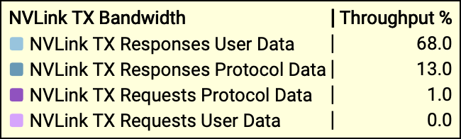

# NVLS\-based 集合通信

NCCL 版本: 2\.29\.7 \(开发机版本\) \& 2\.32\.3 \(最新版本\)

发展历史

- NCCL 2\.17 首次引入 nvls\-based collective communication，在数据通路上利用了 NVSwitch 的硬件聚合与多播能力实现了 nvlink 域内的高效集合通信。

- NCCL 2\.27 首次引入 symmetric memory \(对称内存\)，提供了 AllReduce、AllGather、ReduceScatter 等集合通信的 symmetric kernel 实现。

- NCCL 2\.32 引入 TMA 和 CE 发起的 all\-gather \+ multicast 集合通信

# PTX 核心指令

multitcast \& in\-network reduce 

- `multimem.st` rank r 向 nvswitch 发送报文，nvswitch 检测到 multicast address，将数据复制并发送全部 rank

- `multimem.ld_reduce` rank r 向 nvswitch 发起请求，nvswitch 主动读取各 rank 的数据，在 nvswitch 上聚合后发送给 rank r

- 两个指令操作的都是 multicast address

- multimem\.st 需要 sm 加载数据发给 nvswitch，nvswitch直接存到 HBM 的 multicast address 处

- multimem\.ld\_reduce nvswitch 直接读取 multicast address 处的数据，但存储到 sm 的寄存器上

multimem\.st 直接发送 data \& address 给 nvswitch 即可，nvswitch 检查到 multicast address 就会广播

- CE 通过 `cudaMemcpyBatchAsync` 提交的任务指向 multicast address，从而完成广播

- TMA 则是 sm 执行 `cp.async.bulk`，将复制 HBM 数据到 multicast address 卸载给 TMA，触发广播

几种 send/recv 操作的差别

- sm \+ LSU \(load store unit\): sm 从 HBM 读取数据，存储到 LSU，由 LSU 将 data \& address 发送给 NVLink Port

- sm \+ TMA: sm 将加载指令卸载给 TMA，TMA 从 HBM 读取数据后写入指定地址 \(e\.g\. shared memory / multicast address\)

- ce \(copy engine\): Host API 提交的任务，直接放在 CE 上，等待 stream 上的依赖满足后发起 

# Legacy Kernel

- FIFO slot: NCCL 在 HBM 维护的一块缓冲区，每个 peer 对应一个 FIFO，每个 FIFO 有 8 step \(对应 NCCL STEP\)

- Legacy Kernel 接收的输入是用户的 send\_buff \& recv\_buff

## AllReduce 

AllReduce = ReduceScatter \+ AllGather

- ReduceScatter 只能处理 multicast address 上的数据，因此需要先复制 send\_buff 数据到 reduce FIFO slot

- AllGather 的广播结果存在 gather FIFO slot，因此要将数据复制到 recv\_buff

Legacy Kernel 中，每个 channel 独占一个 sm，使用 1 CTA \(640 线程\)，分为 20 warp，分为 8 scatter \& 5 reduce \& 7 gather

- scatter\[0 \- 8\] 负责 wait send \& copy \& post send

    - scatter\[0\] 前 nHead lane 检查 reduce FIFO slot 上的 reduce 是否完成 `WaitSend[h=lane]` → 等待 8 step 前的任务是否完成 copy 

    - scatter\[0\] \- scatter\[6\] 在全部 nHead slot 都空闲后 barrier，统一开始从 send\_buff copy 数据到 FIFO slot

    - scatter\[7\] 后 nHead lane 在 reduce FIFO slot 上的 copy 任务完成后，标记任务已完成 `PostSend[h=lane]`

- reduce\[15 \- 19\] 负责做 multimem\.ld\_reduce \& multimem\.st 

    - reduce\[15\]\.lane\[0\] 通过 multimem 全局同步，等待全部 rank 的 reduce FIFO slot 都准备好了 reduce 数据 

    - reduce\[15\]\.lane\[1\] 通过 multimem 全局同步，等待 全部 rank 的 gather FIFO slot 已经把收到的数据复制到了 recv\_buff

    - reduce\[15\-18\] 先做 8 次 multimem\.ld\_reduce，然后做 8 次 mutlimem\.st，将 reduce 结果广播出去 \(交替完成，st 的时候开始做下一轮的 ld\_reduce\)

    - reduce\[19\]\.lane\[30\] 本地同步，释放 reduce FIFO slot → 和 scatter 联动 

    - reduce\[19\]\.lane\[31\] 本地同步，标记 gather FIFO slot 数据已到达 → 和 gather 联动 

- gather\[8\-14\] 负责 copy 数据到 recv\_buff

    - gather\[8\] 前 nHead lane 检查 gather FIFO slot 是否准备好数据

    - gather\[8\] \- scatter\[14\] 在全部 nHead slot 都准备好数据后完成 barrier，复制数据到 recv\_buff

    - gather\[14\] 标记 slot 数据已存储

几点观察

1. scatter \& gather 处理是全部 rank 用到的数据，分配了更多 warp，reduce 处理自己 rank 负责的数据，占用资源更少

2. 流程上需要 global barrier 和 local barrier，核心原因是 multicast address 只映射在 FIFO slot 上

    1. 因为存储 copy 数据到 reduce FIFO slot \& 从 gather FIFO slot copy 数据，还要 multimem 来同步 

3. legacy kernel 允许将 recv buffer / send buffer 注册为 multicast address，绕开了 FIFO slot，但只针对 compute tray 内部有效，不如直接看 symmetric kernel 的逻辑

4. 8 slot 支持流水线，scatter 可以比 reduce 快 8 step

## AllGather

Legacy Kernel 中，每个 channel 独占一个 sm，使用 1 CTA \(640 线程\)，分为 20 warp，这与 AllReduce 一致。

AllGather 只有 Gather \& Bcast 两个角色

- Bcast 先执行 8x 加载 send\_buffer 数据，再执行 8x multimem\.st，交替循环，结果存储在 gather FIFO slot

- Gather 将数据从 gather FIFO slot 存储到 recv\_buffer 

## ReduceScatter

AllGather 只有 Scatter \& Reduce 两个角色

- Scatter 将数据从 send buffer 搬运到 reduce FIFO slot

- Reduce 先执行 8x multimem\.ld\_reduce，然后执行 8x 将收到的数据从 sm 寄存器搬运到 recv buffer，交替执行

# Symmetric Kernel

symmetric memory 使用连续的内存连续

- e\.g\. 4 gpu 各分配 1024 byte，起始地址为 9000000

    - gpu 0: 9000000

    - gpu 1: 9001024

    - gpu 2: 9002048

    - gpu 3: 9003072   

- 可以根据初始地址和偏置，计算每个 rank 的地址范围，kernel 访问 9002048 会自动通过 nvlink 访问 GPU 2 的 HBM

- symmetric memory 不需要 FIFO 中转，可以直接操作 send\_buffer \& recv\_buffer，不再需要运行过程中的 barrier → 效率显著高于 legacy kernel 

- symmetric kernel 支持非 mulitcast 实现版本，依赖 p2p unicast 实现

- symmetric kernel 支持 LL \& Simple 协议 

AllReduce

- thread 0 执行 multimem\.ld\_reduce 提交发送任务 → send\_buffer 注册为 mulicast address，nvswitch 直接读取 

- thread 0 执行 multimem\.st 将收到的数据广播出去 → recv\_buffer 注册为 mulicast address，nvswitch 直接存入

AllGather

- thread 0 读取 send\_buffer 数据

- thread 0 执行 multimem\.st 将加载的数据广播出去 → recv\_buffer 注册为 mulicast address，nvswitch 直接存入

ReduceScatter

- thread 0 执行 multimem\.ld\_reduce 提交发送任务 → send\_buffer 注册为 mulicast address，nvswitch 直接读取

- thread 0 将接收到的数据写入 recv\_buffer

# nsys 分析

## Symmetric 

### ReduceScatter

推测

- TX Requests → Protocol Data 携带 multimem\.ld\_reduce 请求，不携带数据

- RX Requests → NVLS 向全部 rank 拉取数据，Protocol Data 是额外信息

- TX Responses → User Data 携带要被规约的数据，Protocol Data 是额外信息

- RX Responses → User Data 携带规约结果 

问题

- nvlink 的 ACK、credit 计入了哪个类别

- RX Requests Protocol Data 为什么比 RX Responses User Data 大很多 / Reduce 数据在哪个类别里面返回?

- 对于 32 GPU 来说，TX User Data : RX User Data = 32:1 是合理，那么 Protocol Data 是什么? 为什么有这么大开销

### AllGather

推测

- TX Requests → User Data 携带广播给其他节点的数据 \(multimem\.st 请求\)

- RX Requests → User Data 携带别的节点广播来的数据，Protocol Data 是额外信息

- TX Responses → Protocol Data 是额外信息，不携带数据

- RX Responses → NVLS 响应 \(multimem\.st 请求\)，不携带数据

### AllReduce

假设流量 1:1 完美混合

- 65:24=2\.7, 46:17=2\.7 → TX 方向可以视为 1:1 流量混合

- 68:28=2\.4, 46:20=2\.3 → TX 方向可以视为 1:1 流量混合

point 1: 微观粒度上是否 overlap 还不可知

point 2: 宏观粒度上，影响 AllReduce 两个方向共享流量的问题在于

- RS 的 TX:RX 流量占比为 76:19 \(4:1\)

- AG 的 TX:RX 流量占比为 15:79 \(1:5\.27\)

我们的假设里面

- 32 GPU 下，RS 的 TX:RX = 32:1，AG 的 TX:RX = 1:32

- 总体流量是 33:33 互补，和单独执行 RS / AG 的时间比为 33:32 → numRank \+ 1 : numRank 

### AllGather \+ ReduceScatter

Bandwidth 占比和 ReduceScatter、AllGather 单独运行是基本一致

从 Cuda Hardware 时许图来看，前面带宽被 AG 占用，后面带宽被 RS 占用，完全没有 overlap

- case 1: all\-gather 流量完全占满了 RX bandwidth，阻塞 reduce\-scatter 通信 \(RX Respond / RX Reduced Data\)

- case 2: nvls 的资源全部被占用

- case 3: 内部调度问题，给了 all\-gather 更高优先级

## Copy Engine

### AllGather

### AllGather \+ Reduce\-Scatter

- copy engine 是完全独立的硬件 → 也出现相同的现象

## Symmetric 16 \& 32 \& 64 对比

### AllGather

- TX Requests → User Data 携带广播给其他节点的数据 \(multimem\.st 请求\) → 下行带宽固定，rank 越多，上行的 data 越小 → 4%, 2%, 1%  

- RX Requests → User Data 携带别的节点广播来的数据，Protocol Data 是额外信息

- TX Responses → Protocol Data 是额外信息，不携带数据

- RX Responses → NVLS 响应 \(multimem\.st 请求\)，不携带数据

### ReduceScatter

- TX Requests → Protocol Data 携带 multimem\.ld\_reduce 请求，不携带数据

- RX Requests → NVLS 向全部 rank 拉取数据，Protocol Data 是额外信息

- TX Responses → User Data 携带要被规约的数据，Protocol Data 是额外信息 → User Data 没有稳定在预期的 64% 

- RX Responses → User Data 携带规约结果 → 4% 2% 1%，User Data 的带宽随着 rank 翻倍稳定降低 1 倍

两组测试的信息已经说明

1. 数据封装在 User Data 里面

2. Protocol Data 可能是 credit 等信号报文

## ReduceScatter 4x \+ AllGather

执行 4 倍数据量的 ReduceScatter，运行到 1/4 左右加入 AllGather 流量 → 观察到 ReduceScatter 流量被 AllGather 流量饿死。

将 nsys frequency 提高到 200 kHz \(5us\)，可以观察到渐变的流量转化 → 倾向于存在拥塞导致到 reduce\-scatter 饥饿

## Extended overlap

ag\+ag / rs\+rs 都可以均分带宽，本节实验在 4 GPU 上执行，Read \& Write 在 GPU 0 \& GPU 1 之间

- AllGather 的数据收发通过 RX \& TX Requests User Data \(主要是 RX\)

- ReduceScatter 的数据收发通过 RX \& TX Responses User Data \(主要是 TX\)

- Read: GPU 0 读数据通过 RX Requests User Data，GPU 1 写数据通过 TX Requests User Data

- Write: GPU 0 写数据通过 TX Requests User Data，GPU 1 读数据通过 RX Requests User Data

根据 NCCL 2\.29\.7 来分析，4 GPU \& 1024MiB 数据

- AG / RS \(symmetric multicast kernel\): 每张卡 6 个 SM，每个 CTA 512 线程

- P2P send/recv: 发送端和接收端各 16 个 SM，每个 CTA 640 线程

### AllGather \+ Read

- p2p 流量从 all\-gather 里面分走了部分带宽，二者基本平衡

### AllGather \+ Write

- NCCL 采用 push 模式，没有默认开启 pull 模式，导致和 AllGather \+ Read 本质上对称的

### ReduceScatter \+ Read

### ReduceScatter \+ Write

从图像来观察，

# 问题总结

需要解决的两个问题

1. 通信量问题 \(AG 和 RS 的流量大于预期\) → AllReduce \(已到达 overlap 上限但无法进一步提高带宽\)

    1. AG \& RS 存在预期外 TX Responses \& RX Requests 的 Protocol Data 开销

2. AG \& RS 重叠调度问题 \(AG 和 RS 流量无法 overlap，至少应该达到 AllReduce 的水准\)

    1. 假设 1: AG kernel 内部的 CTA 占满 \(或均分\) 全部带宽， RS kernel CTA 占不到带宽 → 内部拥塞问题 

        1. 支持: all\-reduce 使用同一批 CTA 可以分享带宽

            - ~~测试两组 all\-gather 重叠 or 两组 reduce\-scatter 重叠 → 内部拥塞则会有一组占不到带宽~~

            - ~~减少每个 kernel 的 CTA 用量 \(channel 数量\) → CTA 减少到 1/2 or 1/4 看带宽下降程度~~

            - 开启 4 倍长度的 reduce\-scatter，在 rs 运行时开启 ag 运行，看 rs 能否占满 ag 带宽

        2. legacy kernel 里面 all\-reduce \& reduce\-scatter 可以同时运行

        3. 反对: copy engine 占用的 RX 带宽比 symmetric kernel 多几个百分点，不至于一点都分不到 RS 里面

    2. 假设 2: nvls 资源不足 → 至少达到 AR 水平

    3. 假设 3: 读写 HBM 竞争 → \(1\) HBM 带宽竞争 \(2\) 已经确认申请的是两个独立的 buffer  

    4. 假设 4: 内部调度问题

        1. 但即使 CE 也是 all\-gather 占满带宽，看起来不像调度问题

        2. ncu 看 rs 的 multimem\.ld\_reduce 是执行了没有返回 \(卡住了\)，还是没被调用 \(等待\) 

新的测试

1. 开启 4 倍长度的 reduce\-scatter，在 reduce\-scatter 跑到一半的时候加入 all\-gather →  all\-gather 能否占满带宽

2. 减少每个 kernel 的 CTA 用量 → 降低 all\-gather 的频率？ 

3. ncu 捕获 sm 内部 → 看 multimem\.ld\_reduce 的停留时间 

